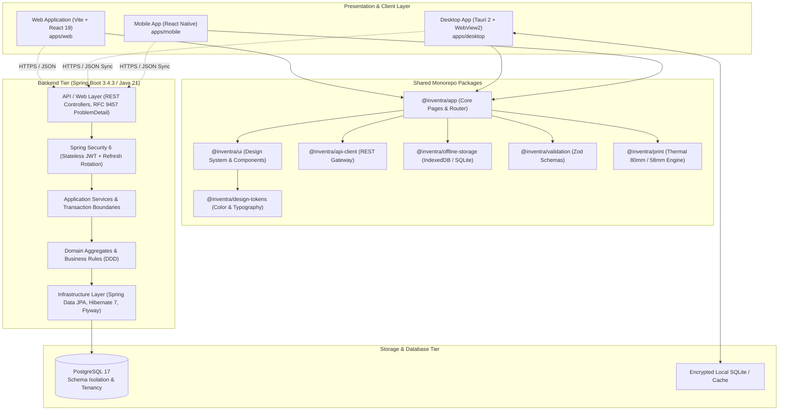
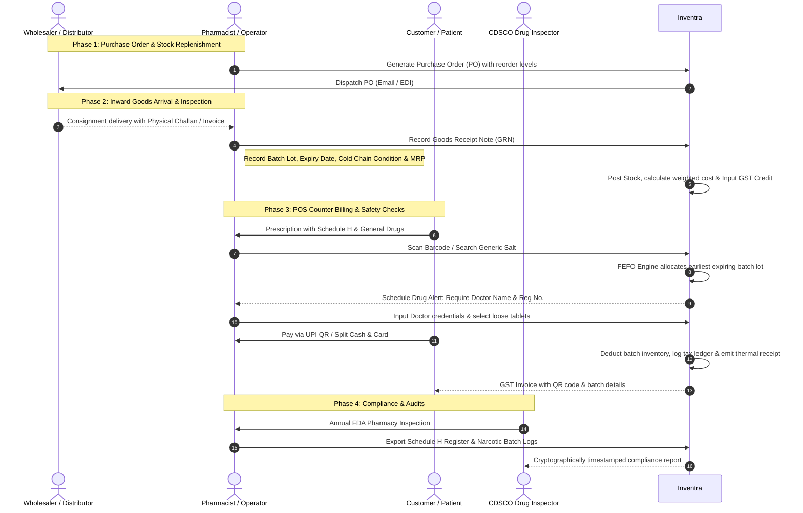
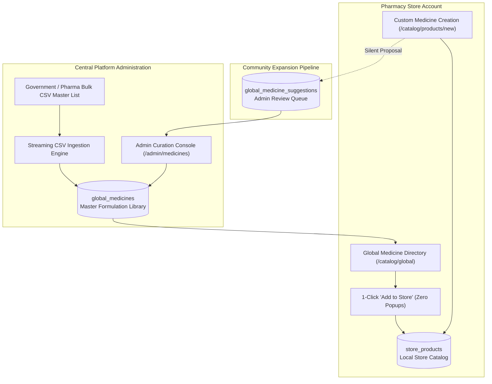

<div align="center">

# 🌿 Inventra Pharmacy ERP

### Next-Generation Smart Pharmacy Cloud OS & Cross-Platform Management Platform

[](https://spring.io/projects/spring-boot)
[](https://openjdk.org/)
[](https://react.dev/)
[](https://www.typescriptlang.org/)
[](https://tauri.app/)
[](https://www.postgresql.org/)
[](https://tailwindcss.com/)
[](https://turbo.build/)
[](#)

*Engineered for high-volume retail chemists, multi-counter dispensaries, hospital pharmacies, and distributed pharmacy chains.*

</div>

---

## 📑 Table of Contents

- [Overview](#-overview)
- [System Architecture & Flows](#-system-architecture--flows)
  - [1. Monorepo & Cross-Platform Topology](#1-monorepo--cross-platform-topology)
  - [2. End-to-End Medicine & Pharmacy Lifecycle](#2-end-to-end-medicine--pharmacy-lifecycle)
  - [3. Offline-First Synchronization Architecture](#3-offline-first-synchronization-architecture)
  - [4. Global Medicine Master Formulation Pipeline](#4-global-medicine-master-formulation-pipeline)
- [Key Features & Modules](#-key-features--modules)
- [Monorepo Structure](#-monorepo-structure)
- [Technology Stack](#-technology-stack)
- [Getting Started & Local Development](#-getting-started--local-development)
  - [Prerequisites](#prerequisites)
  - [1. Clone and Install Dependencies](#1-clone-and-install-dependencies)
  - [2. Start PostgreSQL Database](#2-start-postgresql-database)
  - [3. Launch the Spring Boot Backend](#3-launch-the-spring-boot-backend)
  - [4. Run the Web Application](#4-run-the-web-application)
  - [5. Run the Desktop Application (Tauri)](#5-run-the-desktop-application-tauri)
- [Testing & Quality Gates](#-testing--quality-gates)
- [Design System & Theme Integration](#-design-system--theme-integration)
- [Security & Compliance](#-security--compliance)
- [License](#-license)

---

## 🔬 Overview

**Inventra** is an enterprise-grade, offline-first Pharmacy ERP operating system crafted to solve the operational bottlenecks of modern retail pharmacies, hospital dispensaries, and pharmacy chains. 

Traditional pharmacy software is slow, single-machine bound, susceptible to network disruptions, and prone to costly expiry losses or drug licensing compliance breaches. Inventra delivers:

- **Sub-Second POS Counter Checkout**: Blister strip math, loose-tablet dispensing conversion, barcode scan-to-cart in under 1ms, and split UPI/Cash/Card/Credit settlements.
- **Intelligent FEFO Batch Expiry Protection**: Automatic First-Expiry-First-Out routing preventing expired drug sales and generating proactive 30/60/90-day expiry loss forecasts.
- **Statutory CDSCO Schedule H & Schedule X Compliance**: Built-in prescription safety gates, doctor credential tracking, and government drug inspector register logs.
- **GST Tax Invoicing & Reconciliations**: Automated HSN 3004 tax classification, CGST/SGST/IGST breakdown, and GSTR-1 outward sales tax vs GSTR-3B input credit audits.
- **Universal Global Medicine Master Database (GMD)**: Curated central library of standard formulations with 1-click store catalog import with zero manual typing errors.
- **Offline-First Resilience**: Frameless lightweight native desktop apps (Tauri) that continue counter billing during internet outages and seamlessly reconcile sync queues once reconnected.

---

## 📐 System Architecture & Flows

### 1. Monorepo & Cross-Platform Topology



---

### 2. End-to-End Medicine & Pharmacy Lifecycle



---

### 3. Offline-First Synchronization Architecture

```mermaid
flowchart LR
    subgraph LocalStation["Local Desktop Station (Tauri + IndexedDB / SQLite)"]
        UI["POS Counter UI"]
        LocalDB[("Local Cache DB")]
        SyncQueue["Client Sync Mutation Queue"]
        SyncWorker["Background Sync Worker"]
    end

    subgraph CentralCloud["Inventra Cloud Infrastructure"]
        SyncEndpoint["/api/v1/sync/transactions"]
        ConflictEngine["Vector Clock & Conflict Resolver"]
        CentralDB[("Master PostgreSQL 17")]
    end

    UI -->|1. Create Sale (Offline)| LocalDB
    UI -->|2. Enqueue Mutation| SyncQueue
    LocalDB -. Read Stock / Prices .-> UI

    SyncWorker -->|3. Poll Pending Mutations| SyncQueue
    SyncWorker -.->|4. Ping Liveness & Push Batches| SyncEndpoint
    SyncEndpoint --> ConflictEngine
    ConflictEngine -->|5. Idempotent Commit| CentralDB
    ConflictEngine -->>|6. Server Acknowledgement & Watermark| SyncWorker
    SyncWorker -->|7. Purge Committed Queue| SyncQueue
```

---

### 4. Global Medicine Master Formulation Pipeline



---

## ⚡ Key Features & Modules

### 🛒 1. Point of Sale (POS) & Fast Billing
- **Sub-Second Item Lookup**: Query by Trade Name, Active Salt Composition, or 12/13-digit EAN/UPC Barcode.
- **Unit Conversion Engine**: Sell whole manufacturer strips (e.g. 10 tablets) or split loose tablets with automated decimal arithmetic.
- **Flexible Payments**: Instant UPI dynamic QR code generation, Cash with change calculation, Card, Customer Credit ledger, and split settlements.
- **Thermal Receipt Printing**: Native 80mm and 58mm thermal ESC/POS document generation with customizable store headers and GST breakdown.

### 📦 2. Intelligent FEFO Inventory & Batch Tracking
- **First-Expiry-First-Out Routing**: POS billing automatically selects earliest-expiring active batches to minimize shelf write-offs.
- **Color-Coded Expiry Risk Alerts**: Red badge (< 30 days), Amber badge (< 60 days), and Yellow badge (< 90 days).
- **Consignment Goods Receipts (GRN)**: Inward supplier shipments with delivery note challans, batch lot stamps, manufacturing and expiry dates, and pre-tax purchase costs.
- **Damaged Stock Quarantines**: Separate write-off workflows for damaged, broken, or recalled pharmaceuticals.

### 🛡️ 3. CDSCO Schedule Drug & Regulatory Compliance
- **Schedule H / H1 / X Warnings**: Automated modal alerts triggering at POS counter when dispensing regulated drugs.
- **Prescription Record Keeping**: Captures Prescribing Doctor Name, Registration Number, and Patient details.
- **Statutory Audit Registers**: One-click generation of CDSCO-compliant Schedule H drug registers for inspection visits.

### 📊 4. GST Taxation & Financial Analytics
- **Indian GST Slabs**: Native support for 0%, 5%, 12%, and 18% medicine tax categories with HSN 3004 auto-fill.
- **Tax Breakdown**: Clear distinction of CGST, SGST, and IGST for intra-state and inter-state purchase and sales transactions.
- **Input Tax Credit (ITC)**: Reconciles outward retail sales tax liability with inward distributor invoice tax credits.

### 🏢 5. Multi-Branch Operations & Stock Transfers
- **Inter-Store Stock Requisitions**: Branch stores can request urgent stock replenishments from warehouse or sister branches.
- **In-Transit Stock Governance**: Two-phase transfer verification (Dispatched with batch tracking $\rightarrow$ Received & verified by destination store).

### 👥 6. Super Admin & Platform CMS Console
- **Subscription Tier Governance**: Configure monthly rates, annual discounts, workstation quotas, and dynamic feature checklists in a single canonical console.
- **Onboarding Pipeline**: Review and approve new pharmacy store registrations, verify drug license files, and provision tenant schemas.
- **Website CMS & Coupons**: Real-time content editing for public landing pages and creation of promotional coupon codes (e.g., `INVENTRAFIRST`).

---

## 📂 Monorepo Structure

```text
inventra/
├── apps/
│   ├── web/                     # Vite + React 19 Web SPA
│   ├── desktop/                 # Tauri 2 + React Desktop Native Client
│   └── mobile/                  # React Native Cross-Platform Client
│
├── packages/
│   ├── app/                     # Core application pages, routing, layouts, and state
│   ├── ui/                      # Reusable UI component library (Tailwind + Radix primitives)
│   ├── design-tokens/           # Design tokens, color palettes, spacing, and typography
│   ├── api-client/              # Axios / Fetch client with token interceptors and types
│   ├── api-types/               # TypeScript interfaces shared between frontend and backend
│   ├── offline-storage/         # IndexedDB / SQLite offline persistence and mutation queues
│   ├── print/                   # Thermal printer ESC/POS document generation engine
│   ├── validation/              # Zod validation schemas for forms and API contracts
│   └── shared/                  # Utilities, date formatters, and currency helpers
│
├── backend/
│   └── inventra-backend/        # Spring Boot 3.4.3 / Java 21 REST API
│       ├── src/main/java/com/inventra/inventra_backend/
│       │   ├── auth/            # JWT authentication, sessions, device registration
│       │   ├── tenant/          # Multi-tenancy isolation, business settings, subscriptions
│       │   ├── catalog/         # Products, categories, units, global medicine library
│       │   ├── inventory/       # Batches, stock movements, adjustments, FEFO allocation
│       │   ├── purchasing/      # Suppliers, purchase orders, goods receipts (GRN)
│       │   ├── sales/           # POS orders, billing, payments, credit accounts, returns
│       │   ├── sync/            # Offline change-log queues and conflict reconciliation
│       │   └── common/          # Exceptions (RFC 9457), mailers, audit logs
│       └── src/main/resources/
│           ├── db/migration/    # Flyway SQL schema migrations
│           └── application.yml  # Spring Boot profiles and configuration
│
├── docs/                        # Architecture decisions, API contracts, and specifications
├── scripts/                     # Monorepo build and operational automation scripts
├── docker-compose.yml           # Local development PostgreSQL 17 container
├── turbo.json                   # Turborepo task pipeline configuration
└── pnpm-workspace.yaml          # Monorepo workspace configuration
```

---

## 🛠️ Technology Stack

| Layer | Technologies |
| :--- | :--- |
| **Frontend Core** | React 19, TypeScript 5.7, Vite 6, Tailwind CSS 3.4, Lucide Icons |
| **State & Data** | TanStack Query (React Query) v5, Zustand, React Hook Form, Zod |
| **Desktop Platform** | Tauri 2.0, Rust, WebView2 (Windows) / WebKit (macOS/Linux) |
| **Backend Framework** | Spring Boot 3.4.3, Java 21 LTS, Spring Data JPA, Hibernate 7 |
| **Database & Migration** | PostgreSQL 17, Flyway Database Migrations |
| **Security & Auth** | Spring Security 6, Stateless JWT with Refresh Token Rotation, BCrypt |
| **Build & Tooling** | Turborepo, pnpm workspaces, Maven Wrapper, Vitest, Prettier |

---

## 🚀 Getting Started & Local Development

### Prerequisites

Ensure the following runtimes and developer tools are installed:
- **Node.js**: `v20.x` or `v22.x LTS`
- **pnpm**: `v10.x` (install via `corepack enable` or `npm i -g pnpm@10.24.0`)
- **Java Development Kit (JDK)**: `OpenJDK 21 LTS`
- **Docker**: For PostgreSQL container (or an active local PostgreSQL 17 instance)
- **Rust & Cargo**: *(Optional, required only for building Tauri desktop native binary)*

---

### 1. Clone and Install Dependencies

```bash
git clone https://github.com/veer0401/inventra.git
cd inventra

# Install monorepo dependencies across all apps and packages
pnpm install
```

---

### 2. Start PostgreSQL Database

Launch the preconfigured PostgreSQL 17 database service via Docker Compose:

```bash
docker compose up -d
```

*Default credentials configured in `docker-compose.yml`:*
- **Host**: `localhost`
- **Port**: `5433` (mapped from container `5432`)
- **Database**: `inventra`
- **Username**: `inventra`
- **Password**: `inventra_local`

---

### 3. Launch the Spring Boot Backend

Navigate to the backend directory and run the Spring Boot development profile:

```bash
cd backend/inventra-backend

# On Windows (PowerShell/CMD)
.\mvnw.cmd spring-boot:run

# On macOS/Linux
./mvnw spring-boot:run
```

*Flyway will automatically execute database migrations and initialize seed data. The REST API will listen on `http://localhost:8080`.*

---

### 4. Run the Web Application

In the root directory, start the Vite development server:

```bash
pnpm --filter @inventra/web dev
```

Open [http://localhost:5173](http://localhost:5173) in your browser to access the Inventra Web portal.

---

### 5. Run the Desktop Application (Tauri)

To launch the native frameless desktop application with local hardware integration:

```bash
pnpm --filter @inventra/desktop tauri dev
```

---

## 🧪 Testing & Quality Gates

Inventra enforces strict quality gates across both frontend packages and backend services:

```bash
# Run all frontend Vitest unit & integration tests
pnpm --filter @inventra/app test

# Run TypeScript typechecks across the entire monorepo
pnpm run typecheck

# Execute Turbo build pipeline
pnpm run build

# Run backend unit, domain, and integration tests
cd backend/inventra-backend
.\mvnw.cmd test
```

---

## 🎨 Design System & Theme Integration

Inventra features a custom healthcare-grade UI system engineered for high-concurrency data entry:

- **Theme Adaptability**: High-contrast Light Mode and low-glare Dark Mode ("Operational Station Base").
- **Integrated Custom Scrollbars**: Slender 6px floating rounded pills that match surface tones with zero layout jump (`scrollbar-gutter: stable`).
- **Data Density Modes**:
  - `Compact`: Optimized for high-speed POS item scanning (32px table rows, 28px controls).
  - `Comfortable`: Optimized for reporting and back-office store administration.
- **Tabular Numerics**: `tabular-nums` typography ensuring aligned decimals across monetary ledgers, tax invoices, and batch counts.
- **Keyboard-First Workflow**: Fast navigation shortcuts across all operational hubs (e.g. `G P` for POS Counter, `G I` for Inventory, `G A` for Analytics).

---

## 🔒 Security & Compliance

- **Stateless Authentication**: Access tokens with short TTLs and secure HTTP-only refresh tokens.
- **Strict Tenant Isolation**: Every database query is tenant-scoped by `business_id` and `store_id` with foreign key integrity.
- **Tamper-Evident Audit Trails**: Critical actions (drug dispensing, batch write-offs, manual price adjustments) log operator ID, timestamp, and device fingerprint.
- **Statutory Drug Regulation**: CDSCO Form 20B/21B wholesale and retail license checks enforced during store onboarding and supplier creation.

---

## 📄 License

Inventra Pharmacy ERP is proprietary software. All rights reserved. Unauthorized copying, modification, distribution, or commercial deployment of this codebase is strictly prohibited.
