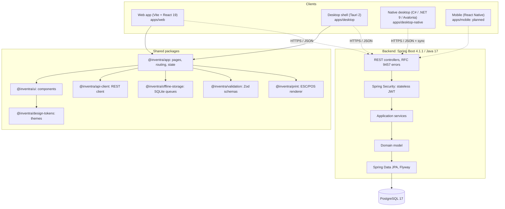
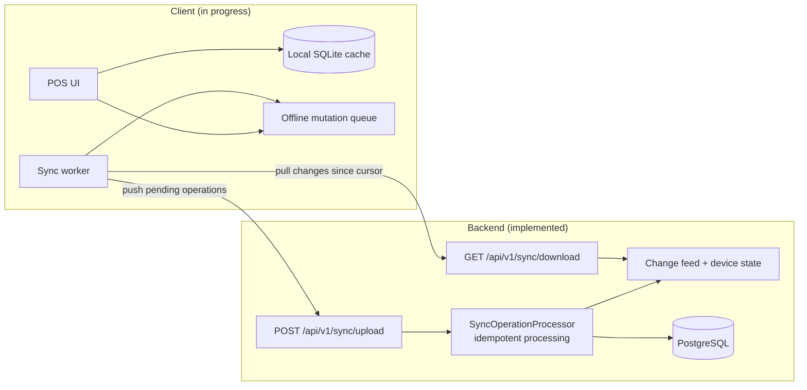
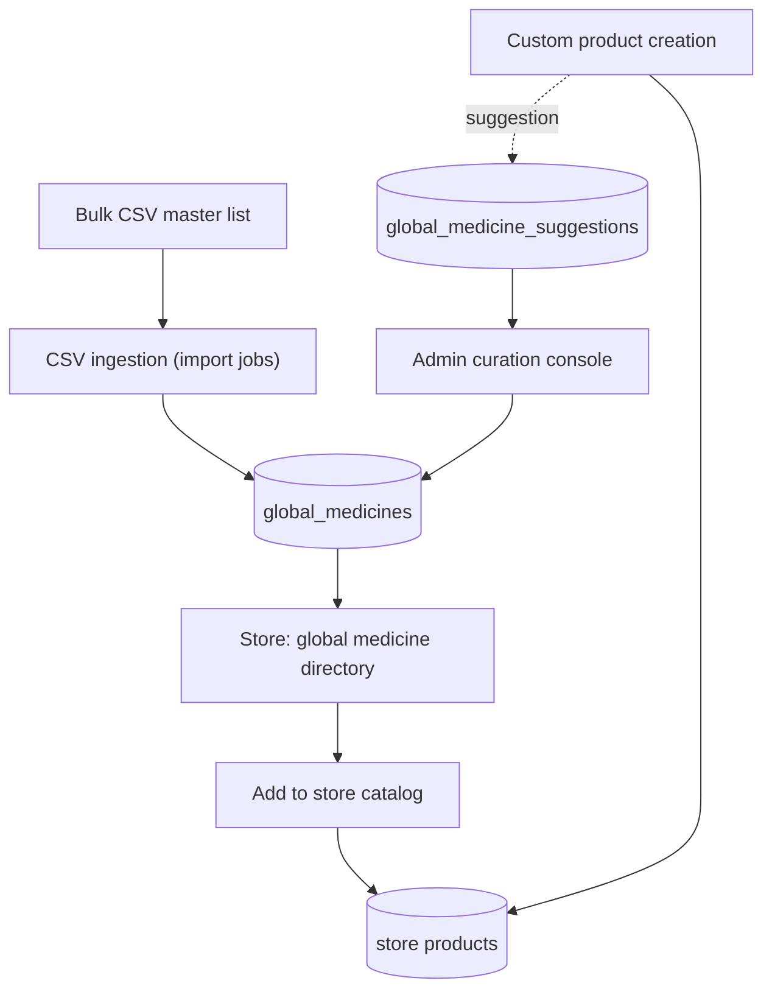

<div align="center">

# 🌿 Inventra Pharmacy ERP

### Multi-tenant, offline-capable pharmacy management platform

[](https://spring.io/projects/spring-boot)
[](https://openjdk.org/)
[](https://react.dev/)
[](https://www.typescriptlang.org/)
[](https://tauri.app/)
[](https://www.postgresql.org/)
[](https://tailwindcss.com/)
[](https://turbo.build/)
[](#-license)

*A solo-built pharmacy ERP: Java / Spring Boot backend, shared React app for web and desktop, and an offline sync layer. **Work in progress.***

</div>

---

## 📍 Project Status

This README separates what exists in the code today from what is still being built or only planned.

| Marker | Meaning |
| :---: | :--- |
| ✅ | **Implemented**: present in the codebase and exercised by tests or a working UI |
| 🚧 | **In progress**: partly built; not complete end to end |
| 🗓️ | **Future scope**: planned, not implemented yet |

| Area | Status | Notes |
| :--- | :---: | :--- |
| Backend REST API (Spring Boot) | ✅ | 17 backend modules, 36 REST controllers, 19 Flyway migrations, 56 tables |
| Multi-tenancy, auth, devices | ✅ | Business and store scoping, JWT with refresh rotation, device registration |
| Catalog, inventory, purchasing, sales, transfers | ✅ | Batch-level stock with expiry, automatic FEFO batch allocation at sale |
| Reporting | ✅ | Sales, valuation, product velocity, expiry risk, Schedule H register |
| Platform admin (subscriptions, coupons, CMS, onboarding) | ✅ | Razorpay-linked subscription records, PDF invoices, dynamic CMS pages |
| Web app (React 19 + Vite) | ✅ | Shared app in `packages/app` |
| Sync API (upload / download change feed) | ✅ | Server side is in place and tested |
| Offline client storage and sync client | 🚧 | Packages and tests exist; end-to-end offline billing is not finished |
| Tauri desktop shell | 🚧 | Renders the shared React app; native commands (SQLite, printing) not fully wired |
| Native desktop client (C# / .NET 9 / Avalonia) | 🚧 | Phase 0 / 1: inventory workspace, GST calculator, local SQLite, sync engine |
| Receipt printing (ESC/POS) | 🚧 | Renderer and USB / network / virtual adapters exist; hardware flow not verified end to end |
| Mobile app (React Native) | 🗓️ | Placeholder only, no source yet |

---

## 🔬 Overview

Pharmacy software tends to be tied to one machine and one network connection. Inventra is built the other way round: a multi-tenant backend where every record is scoped by business and store, plus clients designed to keep working offline and reconcile through a sync API.

It covers the day-to-day pharmacy workflow: catalog and global medicine library, batch and expiry tracked stock, purchasing and goods receipts, POS sales and returns, inter-store transfers, reporting, and a platform admin console for onboarding and subscriptions.

---

## 📐 Architecture

### 1. Monorepo and cross-platform topology



### 2. Offline sync

The server side (✅) is implemented. The client side (🚧) is in progress.



### 3. Global medicine library



---

## ✅ Currently Implemented

### Backend (`backend/inventra-backend`)

- **Identity and access**: JWT access and refresh tokens with rotation, password hashing, device registration, user invitations, role-based access, per-user keyboard shortcut profiles, and a security audit log for auth events.
- **Multi-tenancy**: business and store scoping on every request, tenant context propagation, store capacity limits.
- **Onboarding**: public pharmacy applications that capture drug licence details, with availability checks and an admin review flow.
- **Catalog**: products, categories, units and tax attributes, plus a **global medicine library** with admin curation, a suggestion queue, and one-click import into a store catalog.
- **Inventory**: batch-level stock with expiry dates, stock movements and adjustments. Sales allocate batches automatically by **first-expiry-first-out (FEFO)**, with an optional manual batch override.
- **Purchasing**: suppliers, purchase orders, goods receipts and purchase invoices.
- **Sales and POS**: sales, returns and a POS product search that returns FEFO batch pricing. Payment methods: cash, card, UPI, bank transfer, wallet and other.
- **Inter-store transfers**: ship and receive flow with batch tracking and expiry validation (expired batches cannot be shipped).
- **Customers**: customer records with GSTIN.
- **Reporting**: sales, inventory valuation, product velocity, expiry risk, and a **Schedule H register** report.
- **Import framework**: CSV import jobs with idempotency keys. Handlers exist for product catalog and suppliers.
- **Notifications and email**: in-app notifications and Thymeleaf email templates (for example batch-expiry alerts).
- **Intelligence**: a deterministic intent engine that interprets typed commands into app destinations.
- **Platform administration**: subscription plans, prorated invoices, PDF invoice generation, Razorpay reference fields, coupons, a dynamic CMS for public pages, and a careers board.
- **Sync API**: `POST /api/v1/sync/upload` and `GET /api/v1/sync/download`, an operation recorder and processor, a change feed, and per-device sync state.

### Frontend (`packages/*`, `apps/web`)

- **Shared React 19 app** powering the web client, with pages for dashboard, POS, sales, returns, inventory, catalog, customers, suppliers, purchasing, transfers, imports, reports, devices, users, settings and admin.
- **Design system**: reusable UI components, multiple colour themes, light and dark modes, data-density modes, and keyboard-first shortcuts.
- **Typed API layer**: shared TypeScript API types, an API client with token refresh and tenant headers, and Zod validation schemas.
- **ESC/POS receipt renderer** with USB, network and virtual printer adapters (`packages/print`).
- **Offline storage package** with SQLite drivers, product and customer caches, an offline mutation queue and a sync client (`packages/offline-storage`).

### Tests

- **Backend**: 81 test classes with 263 test methods across catalog, identity, inventory, purchasing, sales, sync, tenant, transfer and more.
- **Frontend**: 77 test files (Vitest).
- **Native desktop**: automated tests for GST rules, SQLite, the offline queue and connectivity in `apps/desktop-native/tests`.

---

## 🚧 In Progress

- **Offline-first client.** The storage layer, mutation queue and sync client exist, and the server side is complete. What remains is wiring them into the POS flow so a station can bill fully offline and reconcile on reconnect. There is a debug offline mode in Store Settings for testing the queue.
- **Tauri desktop shell.** It renders the shared React app in a native window. Native commands for local SQLite, device registration, the sync queue and printing still need to be implemented and verified.
- **Native desktop client (`apps/desktop-native`).** A local-first C# / .NET 9 / Avalonia app (Phase 0 / 1) with an inventory workspace and FEFO batch drill-down, a GST calculator (CGST + SGST intra-state, IGST inter-state), a local SQLite store, an offline outbox, a sync engine, and ESC/POS and barcode services.
- **Receipt printing.** The renderer and adapters are written; end-to-end printing on real hardware has not been verified.
- **Schedule H handling.** The Schedule H register report is implemented. Prompting for prescriber details at billing time is not yet verified end to end.
- **Documentation.** Some files under `docs/` predate recent work and may lag the code.

---

## 🗓️ Future Scope

Not implemented yet. These are plans, not features:

- **Mobile app** (React Native) with an on-device database and camera barcode scanning. `apps/mobile` is a placeholder.
- **Customer credit ledger** and credit-based settlement (there is no credit payment method today).
- **GST filing support**: GSTR-1 / GSTR-3B reconciliation and input-tax-credit matching.
- **Richer sync conflict handling** beyond idempotent replay (for example vector clocks or field-level merges).
- **Purchase order dispatch** to suppliers by email or EDI.
- **Dynamic UPI QR** generation at the POS counter.
- **Universal ingestion** for more import types, including PDF and OCR of supplier invoices.
- **Expanded audit trail** for dispensing, stock write-offs and price changes, with tamper evidence.
- **Quarantine workflow** for damaged or recalled stock.
- **Statutory licence checks** (for example Form 20B / 21B) when creating suppliers.

---

## 📂 Monorepo Structure

```text
inventra/
├── apps/
│   ├── web/                     # Vite + React 19 web app
│   ├── desktop/                 # Tauri 2 shell around the shared React app
│   ├── desktop-native/          # C# / .NET 9 / Avalonia local-first desktop (in progress)
│   └── mobile/                  # React Native: placeholder
│
├── packages/
│   ├── app/                     # Shared pages, routing, layouts and state
│   ├── ui/                      # Component library
│   ├── design-tokens/           # Themes, colours, spacing, typography
│   ├── api-client/              # REST client with token refresh
│   ├── api-types/               # Shared TypeScript API types
│   ├── offline-storage/         # SQLite drivers, caches, mutation queue, sync client
│   ├── print/                   # ESC/POS receipt renderer and printer adapters
│   ├── validation/              # Zod schemas
│   └── shared/                  # Constants, permissions, formatters
│
├── backend/
│   └── inventra-backend/        # Spring Boot 4.1.1 / Java 17
│       ├── src/main/java/com/inventra/inventra_backend/
│       │   ├── identity/        # Auth, users, devices, security audit
│       │   ├── tenant/          # Tenancy, subscriptions
│       │   ├── onboarding/      # Pharmacy applications
│       │   ├── catalog/         # Products, categories, global medicines
│       │   ├── inventory/       # Batches, movements, adjustments
│       │   ├── purchasing/      # Suppliers, POs, goods receipts, invoices
│       │   ├── sales/           # POS sales, returns, payments
│       │   ├── transfer/        # Inter-store transfers
│       │   ├── customer/        # Customer records
│       │   ├── sync/            # Upload, download, change feed
│       │   ├── ingestion/       # CSV import framework
│       │   ├── reporting/       # Reports, Schedule H register
│       │   ├── intelligence/    # Command / intent interpretation
│       │   ├── notification/    # In-app and email notifications
│       │   ├── content/         # Dynamic CMS
│       │   ├── careers/         # Careers board
│       │   └── common/          # Config, security, exceptions, mail, geo
│       └── src/main/resources/db/migration/   # Flyway V1 to V19
│
├── docs/                        # Architecture notes and specifications
├── docker-compose.yml           # Local PostgreSQL 17
├── turbo.json                   # Turborepo pipeline
└── pnpm-workspace.yaml          # Workspace configuration
```

---

## 🛠️ Technology Stack

| Layer | Technologies |
| :--- | :--- |
| **Frontend** | React 19, TypeScript 5.7, Vite 6, React Router 7, Tailwind CSS 3.4, Zustand, TanStack Query, React Hook Form, Zod |
| **Web / desktop shell** | Vite, Tauri 2 (Rust, WebView2) |
| **Native desktop** | C#, .NET 9, Avalonia UI, SQLite |
| **Backend** | Java 17, Spring Boot 4.1.1, Spring Data JPA, Spring Security, Bean Validation |
| **Data** | PostgreSQL 17, Flyway migrations |
| **Auth** | Stateless JWT (jjwt) with refresh-token rotation |
| **Other backend** | Thymeleaf email templates, OpenPDF invoices, Caffeine caching |
| **Build and tooling** | Turborepo, pnpm workspaces, Maven Wrapper, Vitest |

---

## 🚀 Getting Started

### Prerequisites

- **Node.js** 20 or 22 LTS
- **pnpm** 10 (`corepack enable` or `npm i -g pnpm@10.24.0`)
- **JDK 17**
- **Docker** for PostgreSQL (or a local PostgreSQL 17)
- **Rust and Cargo** (optional, only for the Tauri shell)
- **.NET 9 SDK** (optional, only for `apps/desktop-native`)

### 1. Install dependencies

```bash
git clone https://github.com/veer0401/inventra.git
cd inventra
pnpm install
```

### 2. Start PostgreSQL

```bash
docker compose up -d
```

Local development defaults from `docker-compose.yml`: host `localhost`, port `5433`, database `inventra`, user `inventra`. These are local-only credentials; change them for any shared environment.

### 3. Run the backend

```bash
cd backend/inventra-backend

# Windows
.\mvnw.cmd spring-boot:run

# macOS / Linux
./mvnw spring-boot:run
```

Flyway applies the migrations on startup. The API listens on `http://localhost:8080`.

### 4. Run the web app

```bash
pnpm --filter @inventra/web dev
```

Open [http://localhost:5173](http://localhost:5173).

### 5. Optional: desktop clients

```bash
# Tauri shell (in progress)
pnpm --filter @inventra/desktop tauri dev

# Native desktop (in progress)
dotnet run --project apps/desktop-native/src/Inventra.Desktop.App
```

---

## 🧪 Testing

```bash
# Frontend unit and integration tests
pnpm --filter @inventra/app test

# Typecheck the whole monorepo
pnpm run typecheck

# Build pipeline
pnpm run build

# Backend tests
cd backend/inventra-backend
.\mvnw.cmd test

# Native desktop tests
dotnet test apps/desktop-native/Inventra.Desktop.sln
```

---

## 🔒 Security

Implemented today:

- Stateless JWT access tokens with refresh-token rotation and hashed passwords.
- Tenant isolation: requests are scoped by business and store.
- Device registration for stations.
- A security audit log for authentication events.

A wider tamper-evident audit trail (dispensing, write-offs, price changes) is listed under Future Scope.

---

## 📄 License

Inventra Pharmacy ERP is proprietary software. All rights reserved. Unauthorized copying, modification, distribution, or commercial deployment of this codebase is prohibited.
