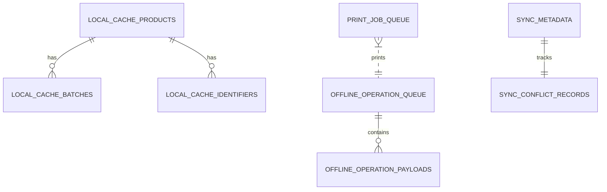
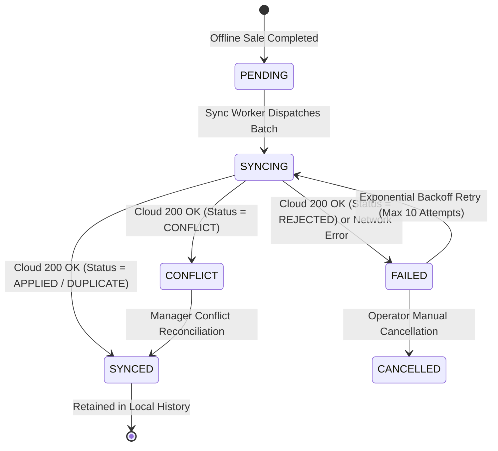

# Phase F9 Implementation Plan — Desktop Offline Operations + Thermal POS Printing

**Document Status:** Authoritative Implementation Specification  
**Phase:** F9  
**Monorepo Target:** Inventra Multi-Tenant Pharmacy ERP  
**Target Environment:** Tauri 2.x + React 19 + TypeScript + Local SQLite + Spring Boot 3.x + PostgreSQL  
**Author:** Antigravity Architect  
**Date:** 2026-08-28  

---

## 1. Executive Summary

Phase F9 introduces the **Desktop Offline Operations & Thermal POS Printing Foundation** to the Inventra Pharmacy ERP monorepo. Building upon the verified web application and the backend synchronization framework established in prior phases, F9 empowers counter retail terminals to continue high-speed billing and receipt printing even during severe or prolonged internet outages, without compromising ledger truth, inventory invariants, or tenant isolation.

### The Authoritative Invariant Architecture

```text
               INVENTRA CLOUD (PostgreSQL)
                          ▲
                          │ Online Sync Protocol (JSON / SHA-256 / Cursors)
                          ▼
            ┌──────────────────────────────────────────┐
            │          DESKTOP CLIENT (Tauri 2.x)      │
            ├──────────────────────────────────────────┤
            │  React 19 Frontend Shell                 │
            │  Shared Design Tokens & CSS Var Engine   │
            │  Centralized Shortcut Registry           │
            │  PosCartStore & Offline Billing UX       │
            ├──────────────────────────────────────────┤
            │  Local Persistence & Sync Layer          │
            │  • Local SQLite Engine                   │
            │  • Durable Offline Operation Queue       │
            │  • Bi-directional Sync Worker            │
            │  • Device Identity & Revocation Guard    │
            ├──────────────────────────────────────────┤
            │  Thermal POS Printing Engine             │
            │  • Canonical ReceiptDocument Model       │
            │  • ESC/POS Byte Stream Renderer          │
            │  • Pluggable Printer Transport Layer     │
            │  • Asynchronous Print Job Queue          │
            └──────────────────────────────────────────┘
                          │
                          ▼
            Thermal ESC/POS Printer (80mm / 58mm) & USB Barcode Scanner
```

---

## 2. Repository Findings & Baseline

Comprehensive audit of the repository (`d:\project\anti-gravity-projects\inventra`) confirmed:
1. **Existing Backend Sync (`com.inventra.inventra_backend.sync`):**
   - Flyway migration `V7__init_offline_sync.sql` is active with `sync_operations`, `sync_change_feed`, and `sync_device_states`.
   - `SyncController` provides `POST /api/v1/sync/upload` (accepting up to 50 operations) and `GET /api/v1/sync/download` (cursor pagination).
   - `SyncOperationProcessor` executes `SALE_CREATED`, `SALE_RETURN_CREATED`, and `TRANSFER_REQUEST_CREATED` with isolated transactions, canonical JSON SHA-256 checksum validation, and idempotency guarantees.
   - `ChangeFeedPublisher` publishes updates from `ProductService`, `CategoryService`, and `InventoryService`.
2. **Existing POS Web UI:**
   - `apps/web/src/pages/pos/PosPage.tsx` provides rapid product search, cart state management (`posCartStore.ts`), and checkout modals.
   - Web currently displays an offline warning banner disabling checkout when `navigator.onLine` is false.
3. **Existing Desktop Package:**
   - `apps/desktop` is a scaffold package with placeholder scripts.
4. **Existing Hardware Print / Barcode:**
   - Receipt preview in `PosReceiptView.tsx` triggers browser `window.print()`.
   - No ESC/POS byte generator, hardware printer abstraction, or barcode buffer currently exists.

---

## 3. Existing Architecture Integration

F9 does NOT create a disconnected second backend or independent source of truth. The authoritative cloud backend remains the sole commit ledger:

$$\text{Desktop UI} \rightarrow \text{Local SQLite (Draft/Queue)} \rightarrow \text{Sync Worker} \rightarrow \text{Cloud Sync API} \rightarrow \text{Authoritative Domain Services} \rightarrow \text{PostgreSQL}$$

- **Tenancy:** Every local record carries `businessId`, `storeId`, `deviceId`, and `userId`.
- **Identity:** Device codes and hardware registration inherit from `V2` and `DeviceService`.
- **Tokens:** Shared `@inventra/design-tokens` and `@inventra/ui` ensure identical UI aesthetics across web and desktop.
- **Shortcuts:** `shortcutStore.ts` commands (`F2`, `F4`, `F8`, `G O`, `Ctrl+K`) are reused directly.

---

## 4. Exact F9 Scope Matrix

| Capability | Scope Classification | Offline Allowed | Online Required | Operational Rationale |
| :--- | :---: | :---: | :---: | :--- |
| **POS Sale Creation** | **A (Required)** | **YES** | NO | Core pharmacy cashier workflow must never block on connectivity. |
| **Product & Barcode Lookup** | **A (Required)** | **YES** | NO | Local SQLite cache enables sub-millisecond local barcode scanning. |
| **Customer Lookup** | **A (Required)** | **YES** | NO | Cached active customers enable loyalty and contact assignment offline. |
| **FEFO Batch Selection** | **A (Required)** | **YES** | NO | Offline cache stores local batch snapshot; cloud verifies on sync. |
| **Receipt Rendering & Print** | **A (Required)** | **YES** | NO | ESC/POS receipt generation and printing must function disconnected. |
| **Receipt Preview** | **A (Required)** | **YES** | NO | Common preview rendering model for screen and thermal paper. |
| **Printer Configuration** | **A (Required)** | **YES** | NO | Local device-specific printer port, baud, and paper width setup. |
| **Offline Operation Queue** | **A (Required)** | **YES** | NO | Durable SQLite queue surviving crashes and power failures. |
| **Bidirectional Sync Worker** | **A (Required)** | NO | **YES** | Pushes pending operations and pulls delta change feed when connected. |
| **Sync Center & Conflict UI** | **A (Required)** | **YES** | NO | Local operator interface to review queue status, sync logs, and conflicts. |
| **Hardware Barcode Buffer** | **A (Required)** | **YES** | NO | Rapid keystroke detection (<50ms) for USB HID scanners. |
| **Product Catalog Editing** | **D (Prohibited)** | NO | **YES** | Master catalog creation/editing is cloud-authoritative. |
| **Inventory Transfer Approval** | **D (Prohibited)** | NO | **YES** | Inter-store inventory transfers require cloud coordination. |
| **User / Role Management** | **D (Prohibited)** | NO | **YES** | Administrative role changes require online authorization. |
| **Hardware Device Revocation** | **D (Prohibited)** | NO | **YES** | Revocation is cloud-authoritative; synced immediately to client. |
| **Universal CSV Imports (F8)** | **D (Prohibited)** | NO | **YES** | Mass ingestion and ledger verification are online-only. |

---

## 5. Out-of-Scope Functionality (Strict Phase Boundaries)

1. **No Mobile Floor Scanner:** React Native Android offline operations are scheduled for Phase F10.
2. **No OCR / AI Invoice Scanning:** AI invoice recognition belongs to future intelligence phases.
3. **No Direct Database Replication (PostgreSQL $\leftrightarrow$ SQLite):** Sync occurs strictly through versioned REST JSON APIs.
4. **No Autonomous Financial Reconciliation:** Financial discrepancies create business review records; no automated write-offs.

---

## 6. Desktop Client Architecture (Tauri 2.x Shell)

```text
apps/desktop/
├── src-tauri/
│   ├── Cargo.toml                  # Tauri 2.x dependencies (plugins: sql, fs, shell, printer)
│   ├── tauri.conf.json             # Tauri configuration, window dimensions, security CSP
│   ├── capabilities/
│   │   └── default.json            # Tauri v2 capability permissions
│   └── src/
│       ├── main.rs                 # Rust runtime entry point
│       └── lib.rs                  # Native plugin registration & commands
├── src/
│   ├── main.tsx                    # React desktop entry point
│   ├── App.tsx                     # Desktop routing & shell wrapper
│   ├── components/
│   │   ├── shell/                  # Desktop titlebar & sync header widget
│   │   └── sync/                   # Sync Center modal & health indicator
│   └── pages/                      # Reused POS, Sales, Catalog, Settings views
├── package.json
└── vite.config.ts
```

- **Window Management:** Frameless custom titlebar inheriting Inventra theme variables with minimize, maximize, and close controls.
- **Native Storage:** `tauri-plugin-sql` providing asynchronous SQLite database access via `sqlite:inventra_desktop.db`.

---

## 7. Local SQLite Database Architecture

The local SQLite database contains four functional classifications of tables:



### Classification 1: Master & State Cache (`CACHE`)
```sql
-- 1. Products Master Cache
CREATE TABLE cache_products (
    id TEXT PRIMARY KEY,
    business_id TEXT NOT NULL,
    store_id TEXT,
    code TEXT,
    name TEXT NOT NULL,
    generic_name TEXT,
    dosage_form TEXT,
    strength TEXT,
    base_unit TEXT NOT NULL,
    selling_unit TEXT NOT NULL,
    units_per_selling_unit REAL NOT NULL DEFAULT 1.0,
    tax_rate REAL NOT NULL DEFAULT 0.0,
    is_tax_inclusive INTEGER NOT NULL DEFAULT 0,
    prescription_required INTEGER NOT NULL DEFAULT 0,
    selling_price REAL NOT NULL,
    mrp REAL NOT NULL,
    current_stock REAL NOT NULL DEFAULT 0.0,
    updated_at INTEGER NOT NULL
);

CREATE INDEX idx_cache_products_name ON cache_products(name);
CREATE INDEX idx_cache_products_generic ON cache_products(generic_name);

-- 2. Product Identifiers (Barcodes & SKUs) Cache
CREATE TABLE cache_product_identifiers (
    id TEXT PRIMARY KEY,
    product_id TEXT NOT NULL,
    identifier_type TEXT NOT NULL,
    identifier_value TEXT NOT NULL,
    is_primary INTEGER NOT NULL DEFAULT 0,
    FOREIGN KEY (product_id) REFERENCES cache_products(id) ON DELETE CASCADE
);

CREATE INDEX idx_cache_identifiers_value ON cache_product_identifiers(identifier_value);

-- 3. Batches Cache (FEFO Lots)
CREATE TABLE cache_batches (
    id TEXT PRIMARY KEY,
    product_id TEXT NOT NULL,
    store_id TEXT NOT NULL,
    batch_number TEXT NOT NULL,
    expiry_date TEXT NOT NULL,
    available_quantity REAL NOT NULL,
    selling_price REAL NOT NULL,
    mrp REAL NOT NULL,
    FOREIGN KEY (product_id) REFERENCES cache_products(id) ON DELETE CASCADE
);

CREATE INDEX idx_cache_batches_fefo ON cache_batches(product_id, expiry_date ASC);

-- 4. Customer Directory Cache
CREATE TABLE cache_customers (
    id TEXT PRIMARY KEY,
    business_id TEXT NOT NULL,
    customer_code TEXT NOT NULL,
    full_name TEXT NOT NULL,
    phone TEXT,
    email TEXT,
    gstin TEXT,
    status TEXT NOT NULL DEFAULT 'ACTIVE',
    updated_at INTEGER NOT NULL
);

CREATE INDEX idx_cache_customers_phone ON cache_customers(phone);
CREATE INDEX idx_cache_customers_name ON cache_customers(full_name);
```

### Classification 2: Durable Offline Queue (`PENDING_OPERATION`)
```sql
-- 5. Offline Operation Queue
CREATE TABLE offline_operations (
    operation_id TEXT PRIMARY KEY,          -- UUIDv7
    business_id TEXT NOT NULL,
    store_id TEXT NOT NULL,
    device_id TEXT NOT NULL,
    user_id TEXT NOT NULL,
    device_sequence_number INTEGER NOT NULL,
    event_type TEXT NOT NULL,               -- 'SALE_CREATED', 'SALE_RETURN_CREATED'
    event_version INTEGER NOT NULL DEFAULT 1,
    payload_json TEXT NOT NULL,
    payload_checksum TEXT NOT NULL,         -- SHA-256
    idempotency_key TEXT NOT NULL UNIQUE,
    status TEXT NOT NULL,                   -- 'PENDING', 'SYNCING', 'SYNCED', 'FAILED', 'CONFLICT', 'CANCELLED'
    retry_count INTEGER NOT NULL DEFAULT 0,
    last_attempt_at INTEGER,
    server_entity_id TEXT,
    error_code TEXT,
    error_message TEXT,
    created_at INTEGER NOT NULL
);

CREATE INDEX idx_offline_ops_status ON offline_operations(status, device_sequence_number ASC);
```

### Classification 3: Sync & Device Metadata (`SYNC_METADATA`)
```sql
-- 6. Sync Metadata & Checkpoints
CREATE TABLE sync_metadata (
    key TEXT PRIMARY KEY,
    value TEXT NOT NULL,
    updated_at INTEGER NOT NULL
);

-- 7. Sync Conflict Records
CREATE TABLE sync_conflicts (
    conflict_id TEXT PRIMARY KEY,
    operation_id TEXT NOT NULL,
    event_type TEXT NOT NULL,
    error_code TEXT NOT NULL,
    error_message TEXT NOT NULL,
    conflict_details_json TEXT,
    resolution_status TEXT NOT NULL DEFAULT 'UNRESOLVED', -- 'UNRESOLVED', 'ACKNOWLEDGED', 'RESOLVED'
    created_at INTEGER NOT NULL,
    FOREIGN KEY (operation_id) REFERENCES offline_operations(operation_id)
);
```

### Classification 4: Local Print Jobs (`LOCAL_STATE`)
```sql
-- 8. Print Job Queue
CREATE TABLE print_jobs (
    job_id TEXT PRIMARY KEY,
    business_id TEXT NOT NULL,
    store_id TEXT NOT NULL,
    device_id TEXT NOT NULL,
    document_type TEXT NOT NULL,            -- 'RECEIPT_80MM', 'RECEIPT_58MM'
    source_entity_id TEXT NOT NULL,         -- Sale ID or Operation ID
    receipt_data_json TEXT NOT NULL,
    printer_name TEXT,
    status TEXT NOT NULL,                   -- 'QUEUED', 'PRINTING', 'PRINTED', 'FAILED'
    attempts INTEGER NOT NULL DEFAULT 0,
    error_message TEXT,
    created_at INTEGER NOT NULL,
    last_attempt_at INTEGER
);

CREATE INDEX idx_print_jobs_status ON print_jobs(status, created_at ASC);
```

---

## 8. Offline Operation Queue State Machine



1. **Durability:** Every offline sale is written to `offline_operations` inside a local SQLite transaction before the cashier is shown the success confirmation.
2. **Local Stock Deduction:** Local SQLite `cache_products.current_stock` and `cache_batches.available_quantity` are decremented immediately to prevent cashier overselling during offline periods.
3. **Ordering:** Operations are assigned a strictly monotonic `device_sequence_number` (1, 2, 3...) per device.

---

## 9. Bidirectional Synchronization Protocol

### 1. Push Phase (`POST /api/v1/sync/upload`)
- **Trigger:** Automatic timer (configurable, default 60s), network reconnection event (`window.onLine`), or manual "Sync Now" button.
- **Batch Size:** Up to 50 pending operations ordered by `device_sequence_number ASC`.
- **Payload:**
  ```json
  {
    "deviceId": "01918a22-3b10-7f9a-9e12-34567890abcd",
    "syncSessionId": "01918a22-4444-7f9a-9e12-abcdef123456",
    "protocolVersion": 1,
    "clientTimestamp": "2026-08-28T10:00:00Z",
    "operations": [
      {
        "eventId": "01918a22-5555-7f9a-9e12-9876543210fe",
        "eventType": "SALE_CREATED",
        "eventVersion": 1,
        "deviceSequenceNumber": 42,
        "occurredAt": "2026-08-28T09:55:12Z",
        "payloadChecksum": "e3b0c44298fc1c149afbf4c8996fb92427ae41e4649b934ca495991b7852b855",
        "payload": { ... }
      }
    ]
  }
  ```
- **Response Processing:**
  - `APPLIED` $\rightarrow$ Mark status `SYNCED`, update `server_entity_id`.
  - `DUPLICATE` $\rightarrow$ Mark status `SYNCED` (idempotent recovery).
  - `CONFLICT` $\rightarrow$ Mark status `CONFLICT`, insert record into `sync_conflicts`.
  - `REJECTED` (retryable = false) $\rightarrow$ Mark status `FAILED`, record `error_code`.
  - Network Failure / HTTP 5xx $\rightarrow$ Increment `retry_count`, calculate exponential backoff ($2^{\text{retry}} \times 1\text{s}$, max 300s).

### 2. Pull Phase (`GET /api/v1/sync/download?cursor={last_cursor}&limit=100`)
- **Execution:** After successful upload (or on interval).
- **Process:**
  - Retrieve entries from `sync_change_feed` with `changeSeq > last_downloaded_cursor`.
  - Apply changes locally in an atomic SQLite transaction (`cache_products`, `cache_batches`, `cache_customers`).
  - Update `sync_metadata.key = 'last_downloaded_cursor'` to `nextCursor`.
  - If `hasMore == true`, repeat pull until caught up.

---

## 10. Conflict Model & Resolution

Inventra enforces the **Zero Silent Data Loss Principle**:

| Conflict Scenario | Detection Mechanism | Resolution Behavior |
| :--- | :--- | :--- |
| **Oversold Stock (Last Dolo Problem)** | Cloud stock < requested quantity at sync time. | Cloud records `Sale` successfully, records negative/zero stock discrepancy event, marks operation `APPLIED_WITH_DISCREPANCY`, flags store audit alert for physical count review. Completed cashier invoice is NEVER deleted. |
| **Price Tampering / Outdated Price** | Unit price in payload does not match valid price snapshot on server. | Server rejects operation with `PRICE_SNAPSHOT_INVALID`. Client marks operation `FAILED`, alerts store manager for review. |
| **Batch Expiration During Offline Period** | Batch expired in cloud while terminal was offline. | Cloud accepts sale (physical product was sold), logs expired-sale compliance warning, decrements batch. |
| **Device Revoked While Offline** | Device status is `REVOKED` in cloud. | Server rejects with `403 DEVICE_REVOKED`. Client immediately locks sync engine, clears access tokens, and alerts operator. |

---

## 11. Device Security & Revocation Guard

1. **Hardware Identity:** On initial setup, desktop generates a persistent UUIDv7 `deviceId` stored securely in the local SQLite metadata table.
2. **Device Registration:** Admin registers the device code (`DEV-COUNTER-01`) via web dashboard or setup wizard.
3. **Revocation Enforcement:**
   - When server marks device `REVOKED`, subsequent sync calls fail with `DEVICE_REVOKED`.
   - Desktop client catches this code $\rightarrow$ clears cached JWT $\rightarrow$ locks local offline billing for that business $\rightarrow$ displays "Device Revoked by Administrator" security barrier.

---

## 12. Thermal Printing Architecture

```text
ReceiptDocument (Canonical TypeScript Object)
       │
       ├─────────────────────────────────┐
       ▼                                 ▼
PosReceiptView.tsx               EscPosRenderer.ts
(Interactive Screen Preview)     (Binary Buffer Generation)
                                         │
                                         ▼
                               PrinterAdapter (Interface)
                                         │
                         ┌───────────────┼───────────────┐
                         ▼               ▼               ▼
                   UsbPrinter      NetworkPrinter   VirtualPrinter
                   (Raw USB)       (TCP Port 9100)  (Test/Preview)
```

- **Receipt Safety Rule:** A financial sale is committed independently of printer status.
  $$\text{Sale Committed (DB)} \rightarrow \text{Print Job Enqueued} \rightarrow \text{Printer Output}$$
  If the printer is out of paper or disconnected, the sale remains 100% valid. The UI allows "Retry Print" or "Print Later".

---

## 13. ESC/POS Byte Stream Engine (`packages/print`)

F9 implements a dedicated package `@inventra/print`:
- **Command Set:**
  - `ESC @`: Initialize printer.
  - `ESC a {0,1,2}`: Text alignment (Left, Center, Right).
  - `ESC E {0,1}`: Bold font toggle.
  - `GS ! {n}`: Character size scaling (double width, double height).
  - `ESC - {n}`: Underline toggle.
  - `GS k`: 1D Barcode generation (Code128, EAN13).
  - `GS ( k`: QR Code generation for invoice digital verification.
  - `GS V {0,1}`: Paper cut (Full cut / Partial cut).
  - `ESC p`: Cash drawer kick pulse.
- **Paper Formats:** 80mm (48 characters per line) and 58mm (32 characters per line).

---

## 14. Canonical Receipt Document Model

```typescript
export interface ReceiptDocument {
  header: {
    pharmacyName: string;
    storeName: string;
    address?: string;
    phone?: string;
    gstin?: string;
    drugLicenseNumber?: string;
  };
  metadata: {
    saleNumber: string;
    invoiceNumber: string;
    date: string;
    cashierName: string;
    customerName?: string;
    customerPhone?: string;
  };
  lines: Array<{
    name: string;
    batchNumber?: string;
    expiryDate?: string;
    quantity: number;
    sellingUnit: string;
    unitPrice: number;
    discountAmount: number;
    taxAmount: number;
    totalAmount: number;
  }>;
  financials: {
    subtotal: number;
    discountAmount: number;
    taxAmount: number;
    roundOffAmount: number;
    totalAmount: number;
    paidAmount: number;
    changeAmount: number;
    paymentMethod: string;
  };
  footer: {
    customNote?: string;
    returnPolicyNotice: string;
    barcodeValue?: string;
  };
}
```

---

## 15. Theme & Design Token Integration

Desktop directly imports `@inventra/design-tokens` and `themeStore.ts`.
- **CSS Custom Properties:** Injected into `document.documentElement` at launch.
- **Presets & Modes:** Full support for `clinical`, `slate`, `emerald`, `midnight`, `corporate`, Light/Dark modes, and OKLCH custom primary/accent colors.
- **Tauri Native Titlebar:** Styled via CSS custom properties matching `--bg-surface` and `--text-primary`.

---

## 16. Centralized Keyboard Shortcut Registry

Desktop inherits `shortcutStore.ts` and `useKeyboardShortcuts.ts`:
- `F2`: Focus Barcode/Product Search Input.
- `F4`: Open Customer Selection Modal.
- `F8`: Trigger POS Checkout Modal.
- `F9`: Quick Print Last Receipt.
- `F10`: Trigger Immediate Manual Sync.
- `Ctrl+K`: Global Command Palette.
- `Ctrl+B`: Toggle Sidebar Rail.
- `?`: Open Keyboard Shortcuts Help Modal.

---

## 17. Hardware Barcode Scanner Integration

- **Hook:** `useBarcodeScanner.ts` in `@inventra/ui` or desktop client.
- **Mechanism:** Listens for rapid global keystroke sequences (inter-character arrival $\le 40\text{ms}$) terminated by `Enter` or `Tab`.
- **Disambiguation:** Distinguishes physical scanner bursts from human manual typing.
- **Lookup Pipeline:**
  $$\text{Scan (EAN13/Code128)} \rightarrow \text{Local SQLite (cache\_product\_identifiers)} \rightarrow \text{Add Item to Cart with Sound Feedback}$$

---

## 18. Tenancy & Multi-Store Boundary Rules

1. Every SQLite table includes `business_id` and `store_id`.
2. When an operator switches active store context:
   - Verify that all pending operations for the previous store are synced (or prompt operator).
   - Reload store-specific batch snapshots and stock levels.
   - Filter all queries strictly by `WHERE business_id = ? AND (store_id IS NULL OR store_id = ?)`.

---

## 19. Backend Changes Required

1. **Customer & Supplier Change Feed Publishing:**
   - Update `CustomerService.java` to call `changeFeedPublisher.publish(businessId, null, "CUSTOMER", saved.getId(), SyncChangeOperation.UPSERT, 1, CustomerResponse.from(saved))` on create/update.
   - Update `SupplierService.java` to call `changeFeedPublisher.publish(businessId, null, "SUPPLIER", saved.getId(), SyncChangeOperation.UPSERT, 1, SupplierResponse.from(saved))` on create/update.
2. **Device Sync Heartbeat:**
   - Enhance `SyncService.updateDeviceState` to update `devices.last_seen_at` and `devices.last_ip_address`.

---

## 20. Database Migrations

- Existing Flyway migrations **V1 through V11** already supply full table schemas (`sync_operations`, `sync_change_feed`, `sync_device_states`, `devices`, `sales`, etc.).
- **No new Flyway migration is needed** unless a new entity type is introduced. Existing V7 schema is 100% sufficient and backwards-compatible.

---

## 21. API Changes & Contracts

All REST API contracts in `com.inventra.inventra_backend.sync.api` remain unchanged:
- `POST /api/v1/sync/upload`
- `GET /api/v1/sync/download`
- `GET /api/v1/sales/{id}/receipt`
- `POST /api/v1/devices/register`
- `POST /api/v1/devices/{id}/revoke`

---

## 22. Frontend Pages & Components Created / Enhanced

1. **New Package `@inventra/offline-storage`:**
   - SQLite DAO, Schema Migration Manager, Queue Repository, Cache Repository.
2. **New Package `@inventra/print`:**
   - `ReceiptDocument` types, `EscPosRenderer`, `UsbPrinterAdapter`, `NetworkPrinterAdapter`, `VirtualPrinterAdapter`.
3. **Enhanced POS Terminal (`PosPage.tsx` / `DesktopPosPage.tsx`):**
   - Offline checkout flow pushing to local queue.
   - Local FEFO batch allocation.
   - Automatic thermal receipt dispatch.
4. **New Desktop Components:**
   - `SyncStatusBadge`: Live pill showing `ONLINE (SYNCED)`, `SYNCING (3 PENDING)`, `OFFLINE (5 PENDING)`, `SYNC ERROR`.
   - `SyncCenterModal`: Complete operational log of synced, pending, and conflicted operations.
   - `PrinterSettingsModal`: Port selection, paper width (80mm/58mm), test print button.
   - `DesktopTitlebar`: Window minimize, maximize, close, and drag area.

---

## 23. Monorepo Package Architecture

```text
packages/
├── api-types/          # Existing canonical DTOs
├── api-client/         # Existing HTTP client
├── design-tokens/      # Existing theme token system
├── ui/                 # Existing UI components + barcode hook + sync badges
├── validation/         # Existing Zod schemas + printer schemas
├── shared/             # Existing canonical JSON & SHA-256
├── offline-storage/    # [NEW] SQLite wrapper, offline queue, sync client engine
└── print/              # [NEW] ESC/POS encoder, receipt document, printer adapters

apps/
├── web/                # Existing Web SPA (Online-first)
└── desktop/            # [NEW] Tauri 2.0 Desktop Counter POS
```

---

## 24. Test Strategy

| Test Suite | Scope | Target Count | Key Verification |
| :--- | :--- | :---: | :--- |
| **Backend Sync Integration** | `SyncControllerIntegrationTest`, `SyncCrashRecoveryIntegrationTest` | 27+ | Partial failure, idempotency, price tampering, device revocation. |
| **Backend Change Feed** | `CustomerServiceTest`, `SupplierServiceTest` | 8+ | Verify `ChangeFeedPublisher` invocations on create/update. |
| **ESC/POS Encoder Unit** | `@inventra/print` | 15+ | Byte stream accuracy, table alignment, 80mm/58mm line wrapping, QR codes. |
| **Offline Queue Unit** | `@inventra/offline-storage` | 20+ | Enqueue, dequeue, state transitions, backoff calculation, deduplication. |
| **Local Cache DAO Unit** | `@inventra/offline-storage` | 15+ | Product lookup, barcode matching, local batch stock decrement. |
| **Sync Client Engine Unit** | `@inventra/offline-storage` | 15+ | Batch upload flow, delta pull applying to SQLite, conflict recording. |
| **Desktop POS Component** | `apps/desktop` or `apps/web` | 12+ | Offline checkout modal, thermal print dispatch, sync status badge. |
| **Monorepo Build & Typecheck** | All packages & apps | 100% | `turbo run typecheck` & `turbo run build` pass with 0 errors. |

---

## 25. Migration & Backwards Compatibility Strategy

1. **Zero Impact on Web:** Web application remains online-only; imports from `@inventra/ui` and `@inventra/api-types` without requiring SQLite or native Tauri APIs.
2. **Clean Abstraction:** SQLite operations are encapsulated behind an `IOfflineStorageDriver` interface, allowing browser mocked in-memory fallback for unit testing.

---

## 26. Rollout & Deployment Strategy

1. **Phase 1:** Publish backend updates (`CustomerService` / `SupplierService` change feed publishers).
2. **Phase 2:** Publish shared libraries (`@inventra/print`, `@inventra/offline-storage`).
3. **Phase 3:** Build and package Tauri desktop installer (`.msi` / `.exe` for Windows counter terminals, `.deb` for Linux).

---

## 27. Failure Handling Matrix

| Failure Event | System Reaction | Recovery Action |
| :--- | :--- | :--- |
| **Network Loss during Checkout** | POS switches to offline mode; transaction committed to SQLite queue. | Cashier receives receipt immediately; operation syncs on reconnection. |
| **Application Crash / Power Outage** | SQLite write-ahead log (WAL) protects database integrity. | On relaunch, queue manager discovers un-synced operations and resumes. |
| **Printer Paper Out / Disconnected** | Sale is committed; print job marked `FAILED`. | Cashier clicks "Retry Print" or replaces paper roll; sale total never duplicated. |
| **Server 401 / Session Expired** | Sync worker pauses uploads; UI prompts cashier to enter PIN / password. | On re-auth, sync resumes seamlessly without loss of queued sales. |
| **Corrupt SQLite File** | System logs diagnostic error and provides database reset / resync from cloud tool. | Master catalog re-downloaded via `cursor=0` pull. |

---

## 28. Security Considerations

1. **Local Data Protection:** SQLite database stores only operational cache and queue; sensitive secrets (refresh tokens, passwords) are never stored in plain text SQLite.
2. **Token Security:** Refresh tokens in desktop are managed with operating system credential store or session memory.
3. **Tamper Prevention:** Every offline operation calculates a SHA-256 checksum over canonical JSON before enqueuing. Server rejects any payload with modified checksums or prices.

---

## 29. Performance Targets

- **Local Product / Barcode Search:** $< 5\text{ms}$ on 50,000 cached records.
- **Offline Checkout Commit to SQLite:** $< 50\text{ms}$.
- **ESC/POS Receipt Generation & Byte Transmission:** $< 200\text{ms}$.
- **Background Sync CPU Utilization:** $< 2\%$ during background delta processing.

---

## 30. Future-Phase Boundaries

- **Phase F10 (Mobile Android):** Extends `@inventra/offline-storage` and sync protocol to React Native SQLite.
- **Phase F11 (Analytics & Intelligence):** Ingests synchronized data for inventory forecasting and predictive replenishment.

---

## 31. Ordered Implementation Tasks

```text
TASK F9.1: Repository Audit & Authoritative Design Plan (COMPLETED)
  ├── docs/F9_REPOSITORY_AUDIT.md
  └── docs/F9_IMPLEMENTATION_PLAN.md

TASK F9.2: Monorepo Package Infrastructure
  ├── Create packages/print (ESC/POS encoder, receipt models, adapters)
  └── Create packages/offline-storage (SQLite schemas, queue manager, sync client)

TASK F9.3: Backend Incremental Enhancements
  ├── Update CustomerService to publish to ChangeFeedPublisher
  └── Update SupplierService to publish to ChangeFeedPublisher

TASK F9.4: ESC/POS Thermal Receipt Engine Implementation
  ├── EscPosRenderer (80mm/58mm, bold, tables, barcode, cut)
  ├── PrinterAdapter (USB, Network/TCP, Virtual/Mock)
  └── Unit tests for ESC/POS byte buffers

TASK F9.5: Local SQLite Storage & Cache DAO Implementation
  ├── SQLite table initialization scripts
  ├── Product, batch, and customer cache DAOs
  └── Unit tests for local querying and stock deduction

TASK F9.6: Durable Offline Queue & Idempotency Pipeline
  ├── OfflineOperationQueue state machine
  ├── SHA-256 payload checksum calculator
  └── Unit tests for queue durability and crash recovery

TASK F9.7: Bidirectional Sync Worker
  ├── Batch upload worker (POST /api/v1/sync/upload)
  ├── Delta download worker (GET /api/v1/sync/download)
  └── Conflict detection and error logging

TASK F9.8: Hardware Barcode Scanner Buffering & POS Integration
  ├── useBarcodeScanner hook with <40ms inter-key threshold
  ├── Update PosPage to seamlessly switch between online API and offline SQLite
  └── Audio/visual scan feedback

TASK F9.9: Sync Center & Printer Configuration UI
  ├── SyncStatusBadge & SyncCenterModal
  ├── PrinterSettingsModal & Test Print routine
  └── Shortcut bindings for F9 (Print) and F10 (Sync)

TASK F9.10: Desktop Shell (Tauri 2.0 Shell Setup)
  ├── Configure src-tauri, tauri.conf.json, Cargo.toml
  ├── Native window frame & titlebar controls
  └── Desktop packaging scripts

TASK F9.11: Comprehensive Verification & Test Suite
  ├── Run all backend tests (.\mvnw.cmd test)
  ├── Run all frontend & package tests (pnpm test)
  ├── Full monorepo typecheck (pnpm typecheck)
  └── Full production build (pnpm build)
```

---

## 32. Acceptance Criteria

- [ ] **Desktop Shell:** Launches natively via Tauri 2.0 with custom titlebar and design-token styling.
- [ ] **Offline POS Billing:** Cashier can search products, scan barcodes, add medicines, select customers, and complete checkout while disconnected.
- [ ] **Queue Durability:** Completed offline sales survive application restarts and system power loss.
- [ ] **Thermal Printing:** Receipts render accurately in ESC/POS byte stream and transmit to thermal printers (or virtual preview) with 80mm/58mm formatting.
- [ ] **Print Resilience:** A printer error does not roll back or duplicate a completed sale.
- [ ] **Zero Direct Mutation:** All offline sales pass through the cloud `SyncController` $\rightarrow$ `SaleService` pipeline upon reconnection.
- [ ] **Idempotent Sync:** Duplicate submissions are acknowledged as `DUPLICATE` without creating double invoices or double stock deductions.
- [ ] **Conflict Visibility:** Stock discrepancies are surfaced in the Sync Center without deleting historical invoices.
- [ ] **Device Revocation:** Revoked terminals are barred from syncing and blocked from further billing.
- [ ] **Test Quality:** 100% passing tests across backend, frontend packages, typecheck, and production builds.
