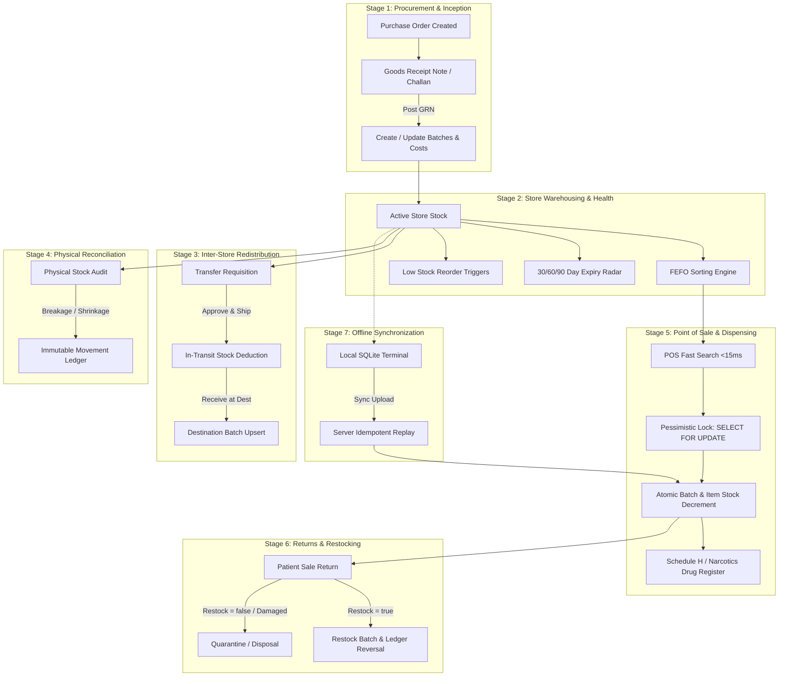

# Inventra Pharmacy ERP — Inventory Life Cycle & Core Architectural Thought Process

> **Authoritative Technical Architecture & Operational Guide**  
> **Target Audience**: Core Engineers, Tech Leads, Pharmacy Domain Architects  
> **Key Database Tables**: `products`, `product_identifiers`, `inventory_items`, `inventory_batches`, `stock_movements`, `goods_receipt_notes`, `goods_receipt_items`, `sales`, `sale_items`, `sale_returns`, `inventory_transfers`  
> **Database Engine**: PostgreSQL 16+ via Flyway (`V1` through `V19`)  

---

## Table of Contents

1. [Executive Summary: System Philosophy & Thought Process](#1-executive-summary-system-philosophy--thought-process)
   - [The Inseparable Truth: Inventory & Finance](#the-inseparable-truth-inventory--finance)
   - [Why Inventory Is Never a Single Number](#why-inventory-is-never-a-single-number)
   - [Dual-Layer Truth: Fast Read Cache vs. Immutable Audit Ledger](#dual-layer-truth-fast-read-cache-vs-immutable-audit-ledger)
   - [The Non-Negative Stock Invariant](#the-non-negative-stock-invariant)
   - [First-Expiry-First-Out (FEFO) Imperative](#first-expiry-first-out-fefo-imperative)
   - [Zero Silent Mutations & Reversibility Over Deletion](#zero-silent-mutations--reversibility-over-deletion)
2. [End-to-End Inventory Life Cycle Diagram](#2-end-to-end-inventory-life-cycle-diagram)
3. [Deep-Dive: The 7 Stages of the Inventory Life Cycle](#3-deep-dive-the-7-stages-of-the-inventory-life-cycle)
   - [Stage 1: Procurement & Inwarding (PO & GRN)](#stage-1-procurement--inwarding-po--grn)
   - [Stage 2: Store Warehousing & Proactive Health Monitoring](#stage-2-store-warehousing--proactive-health-monitoring)
   - [Stage 3: Inter-Store Stock Logistics (Transfers)](#stage-3-inter-store-stock-logistics-transfers)
   - [Stage 4: Shrinkage, Breakage & Stock Adjustments](#stage-4-shrinkage-breakage--stock-adjustments)
   - [Stage 5: High-Speed Counter Checkout & Dispensing](#stage-5-high-speed-counter-checkout--dispensing)
   - [Stage 6: Sales Returns, Restocking & Quarantine](#stage-6-sales-returns-restocking--quarantine)
   - [Stage 7: Offline-First Synchronization & Replay](#stage-7-offline-first-synchronization--replay)
4. [The Immutable Stock Movement Ledger Matrix](#4-the-immutable-stock-movement-ledger-matrix)
5. [Concurrency, Row-Level Locking & Race Condition Prevention](#5-concurrency-row-level-locking--race-condition-prevention)
6. [Regulatory Compliance: Schedule H, H1 & Narcotics Tracking](#6-regulatory-compliance-schedule-h-h1--narcotics-tracking)
7. [Design Trade-Off Analysis: Why Inventra Was Built This Way](#7-design-trade-off-analysis-why-inventra-was-built-this-way)

---

## 1. Executive Summary: System Philosophy & Thought Process

### The Inseparable Truth: Inventory & Finance
In many standard ERP or point-of-sale systems, inventory is treated as a secondary inventory counter updated whenever a cart is paid. In **Inventra Pharmacy ERP**, inventory and financial transactions are treated as **two sides of the same immutable coin**:

$$\text{Inventory Truth} \iff \text{Financial Transaction Truth}$$

A pharmacy cannot claim revenue for stock it did not dispense, and cannot reduce stock without an explainable financial or regulatory paper trail. Every tablet on every shelf across every store branch must be mathematically explainable from supplier purchase to patient receipt.

```
Supplier GRN ──► Batch Creation ──► FEFO Shelf Life ──► POS Dispense ──► Patient Receipt
     │                 │                     │                 │               │
     ▼                 ▼                     ▼                 ▼               ▼
 Accounts          Unit Cost &           Near-Expiry       Pessimistic     Schedule H/H1
 Payable             MRP Pin             Risk Radar           Lock            Audit
```

---

### Why Inventory Is Never a Single Number
A fundamental flaw in generic POS systems is modeling inventory as a scalar:
$$\text{Product} \longrightarrow \text{Quantity}$$

In pharmaceuticals, this model is **catastrophic and illegal**. Two boxes of the same brand (e.g. *Augmentin 625 Duo*) may have:
- Different manufacturer batch numbers
- Different expiry dates (e.g. one expires next month, one expires in 2 years)
- Different purchase costs and different government-regulated MRP caps

Therefore, in Inventra, inventory is always modeled hierarchically:

$$\text{Total Store Inventory} = \sum_{i=1}^{n} \text{Batch}_i(\text{Product}, \text{Batch Number}, \text{Expiry Date}, \text{MRP}, \text{Cost}, \text{Quantity})$$

The product-level quantity (`inventory_items.total_quantity`) is strictly a **derived aggregate** maintained for rapid querying.

---

### Dual-Layer Truth: Fast Read Cache vs. Immutable Audit Ledger
To achieve sub-15ms barcode checkout while satisfying statutory drug audits, Inventra employs a dual-layer state design:

```
┌────────────────────────────────────────────────────────┐
│  LAYER 1: REAL-TIME READ STATE (Fast Balances)        │
│  - inventory_batches.current_quantity                  │
│  - inventory_items.total_quantity                     │
│  Purpose: Ultra-low latency lookups at counter checkout│
└──────────────────────────┬─────────────────────────────┘
                           │ Synchronized under
                           │ @Transactional row lock
┌──────────────────────────▼─────────────────────────────┐
│  LAYER 2: IMMUTABLE AUDIT LEDGER (Financial Truth)     │
│  - stock_movements (append-only ledger)                │
│  Fields: before_qty, after_qty, movement_type, ref_id  │
│  Purpose: Complete auditability & reconstruction       │
└────────────────────────────────────────────────────────┘
```

1. **Layer 1 (Read Balance)**: Serves real-time queries for cashiers scanning items.
2. **Layer 2 (Movement Ledger)**: An append-only historical log. **No stock is ever mutated without appending a signed record into `stock_movements`.** If an auditor or owner questions why stock changed from 50 to 48, the ledger produces the exact sale invoice ID, cashier user ID, and timestamp.

---

### The Non-Negative Stock Invariant
By default, Inventra strictly enforces:
$$\text{Available Stock} \ge 0$$

A counter cashier **cannot** complete a sale for quantities that do not logically exist. If a system allows negative inventory, it destroys:
- Batch traceability (which batch went negative?)
- Weighted average cost calculations
- Expiry tracking compliance

To avoid checkout halts during physical count discrepancies, Inventra provides rapid supervisor overrides via auditable **Stock Adjustments**, but never silently permits negative balances.

---

### First-Expiry-First-Out (FEFO) Imperative
Unlike general manufacturing or grocery retail (which often uses FIFO or LIFO), pharmacy stock must strictly follow **FEFO**:
> **"Batches expiring earliest must always be dispensed first."**

Dispensing newer stock while older batches sit on the shelf creates expired inventory write-offs and endangers patients. Inventra's fast search engine automatically prioritizes and allocates batches based on `ORDER BY expiry_date ASC`.

---

### Zero Silent Mutations & Reversibility Over Deletion
- **No `DELETE` statements**: Invoices, purchase orders, transfers, and stock movements are **never deleted** from the database.
- **Counter-acting Reversals**: Cancellations, voids, and patient returns generate compensatory reversing events (`SALE_RETURN`, `ADJUSTMENT_IN`) with explicit reasons and operator identity.

---

## 2. End-to-End Inventory Life Cycle Diagram



---

## 3. Deep-Dive: The 7 Stages of the Inventory Life Cycle

### Stage 1: Procurement & Inwarding (PO & GRN)
* **Trigger**: Physical shipment arrives at the store branch or warehouse from a distributor.
* **Entities**: `purchase_orders`, `goods_receipt_notes`, `goods_receipt_items`, `inventory_batches`, `inventory_items`, `stock_movements`.
* **Execution Flow**:
  1. The store operator creates a draft **Goods Receipt Note (GRN)** linking to the original Purchase Order.
  2. The operator enters physical packing data: manufacturer batch number, manufacturing date, expiry date, MRP, purchase rate, received quantity, and bonus free strips.
  3. **Posting the GRN (`POST /api/v1/goods-receipts/{id}/post`) initiates an atomic transaction**:
     - Locks the GRN record to `POSTED`.
     - Checks if a batch record exists matching `(business_id, store_id, product_id, batch_number)`. If yes, increments its `current_quantity`; if not, creates a new `inventory_batches` record.
     - Updates `inventory_items.total_quantity` using `ON CONFLICT (store_id, product_id) DO UPDATE`.
     - Appends an entry into `stock_movements`:
       ```json
       {
         "movementType": "PURCHASE_RECEIPT",
         "quantity": 100,
         "referenceType": "GOODS_RECEIPT",
         "referenceId": "grn_uuid"
       }
       ```
     - Evaluates whether the Purchase Order is `PARTIALLY_RECEIVED` or `COMPLETED`.

---

### Stage 2: Store Warehousing & Proactive Health Monitoring
Once stock is committed to `inventory_batches`, it is governed by three continuous automated mechanisms:

1. **FEFO Allocation Priority**:
   Any inventory selection defaults to:
   ```sql
   SELECT * FROM inventory_batches
   WHERE store_id = :storeId 
     AND product_id = :productId 
     AND current_quantity > 0 
     AND is_active = true
   ORDER BY expiry_date ASC;
   ```
2. **Automated Expiry Radar**:
   - **Green (> 90 days remaining)**: Healthy stock, available for routine dispensing.
   - **Yellow (30 to 90 days remaining)**: Near-expiry status. The POS highlights these batches in yellow so cashiers clear them first.
   - **Red (< 30 days or past expiry)**: Critical danger. Flagged automatically; cashier checkout triggers a warning or hard block to prevent illegal sale of expired medicine.
3. **Reorder Level Monitoring**:
   When `inventory_items.total_quantity <= products.reorder_level`, an alert is dispatched to dashboard notifications and purchasing reports to generate a replenishment PO.

---

### Stage 3: Inter-Store Stock Logistics (Transfers)
In multi-branch pharmacies, inventory rebalancing moves stock without supplier involvement:

```
[Store A: Source]                                     [Store B: Destination]
      │                                                         │
      │ ◄─────── 1. Requisition (POST /api/v1/transfers) ───────┤
      │                                                         │
      ├── 2. Approval (POST /api/v1/transfers/{id}/approve)     │
      │                                                         │
      ├── 3. Dispatch (POST /api/v1/transfers/{id}/ship)        │
      │   - Deducts Store A Batch stock (FOR UPDATE)            │
      │   - Creates stock_movement ('TRANSFER_OUT')             │
      │   - Status: IN_TRANSIT                                  │
      │                                                         │
      └───────── 4. Delivery Challan arrives ──────────────────►│
                                                                │
                                5. Acknowledge Receipt ─────────┤
                                   (POST /transfers/{id}/receive)
                                   - Creates/increments Store B batch
                                   - Creates stock_movement ('TRANSFER_IN')
                                   - Status: COMPLETED
```

* **Stock Invariance during Transit**: Stock deducted from Store A is logically marked **In-Transit**. It cannot be double-sold at Store A or prematurely sold at Store B until physically received and acknowledged.

---

### Stage 4: Shrinkage, Breakage & Stock Adjustments
* **Trigger**: Physical count audit, broken glass ampoules, spoiled cold-chain products, or expired drug dumping.
* **Endpoint**: `POST /api/v1/inventory/adjustments`
* **Protocol**:
  - The operator selects the exact batch ID and adjustment type (`INCREASE` or `DECREASE`).
  - The service executes `SELECT current_quantity FROM inventory_batches WHERE id = :batchId FOR UPDATE`.
  - Computes $\Delta$, updates batch and aggregate quantities, and appends a `stock_movements` record (`ADJUSTMENT_IN`, `ADJUSTMENT_OUT`, or `EXPIRY_DUMP`) with user ID, mandatory reason code, and notes.

---

### Stage 5: High-Speed Counter Checkout & Dispensing
* **Trigger**: Cashier scans barcode or searches drug name at billing counter.
* **Performance Budget**: Under 15 milliseconds.
* **Execution Flow**:
  1. `GET /api/v1/pos/products/search?q={query}&storeId={storeId}`: Returns matching products with FEFO batch availability and prices via indexed joins.
  2. Cashier tenders payment and submits `POST /api/v1/sales`.
  3. **Atomic Transaction Execution**:
     - Acquires `PESSIMISTIC_WRITE` locks on every batch row involved:
       ```sql
       SELECT id, current_quantity FROM inventory_batches 
       WHERE id IN (:batchIds) FOR UPDATE;
       ```
     - Validates that `current_quantity >= requested_quantity`.
     - Decrements `inventory_batches.current_quantity`.
     - Decrements `inventory_items.total_quantity`.
     - Appends `stock_movements` with `movement_type = 'SALE'`.
     - Creates `sales`, `sale_items`, and `sale_payments`.
     - If the medicine is **Schedule H, H1, or X**, records doctor registration number and patient details into the statutory compliance log.

---

### Stage 6: Sales Returns, Restocking & Quarantine
* **Trigger**: Patient returns unconsumed medicine with bill within return window.
* **Endpoint**: `POST /api/v1/sales/{id}/returns`
* **Protocol**:
  1. Validates original sale line item: `returned_quantity + previous_returns <= originally_billed_quantity`.
  2. **Restocking Logic (`restock: boolean`)**:
     - **If `restock == true` (Intact pack, valid seal)**: Restores batch stock (`current_quantity = current_quantity + return_qty`), updates item total, and appends a `stock_movements` record (`SALE_RETURN`).
     - **If `restock == false` (Broken blister, temperature breach)**: Batch stock is **not** restored. The stock is routed to damage/quarantine write-off.
  3. Issues cash/UPI refund or reduces customer's credit balance in `customer_ledger`.

---

### Stage 7: Offline-First Synchronization & Replay
* **Context**: Remote clinics or basement retail counters with intermittent internet connectivity.
* **Mechanism**:
  1. Terminal bills sales against local SQLite cache, generating a client-side UUID `Idempotency-Key`.
  2. Terminal queues records in local SQLite outbox.
  3. When network connectivity resumes, the client calls `POST /api/v1/sync/upload`.
  4. **Server Replay Engine**:
     - Verifies `deviceId` validity against `devices` table.
     - Checks `sync_events` to ensure the `idempotency_key` has not been processed.
     - Executes standard checkout logic, decrementing central server inventory and writing server audit movements.
     - Returns server sync cursor sequence to the terminal.

---

## 4. The Immutable Stock Movement Ledger Matrix

| Movement Type | Direction | Business Trigger | Source Table | Balance Effect |
|---|---|---|---|---|
| `PURCHASE_RECEIPT` | **+ Inflow** | Posting Goods Receipt Note (GRN) | `goods_receipt_notes` | Increases batch & item balance |
| `SALE` | **- Outflow** | Completing POS counter checkout | `sales` | Decreases batch & item balance |
| `SALE_RETURN` | **+ Inflow** | Customer returns undamaged medicine | `sale_returns` | Restores batch & item balance |
| `TRANSFER_OUT` | **- Outflow** | Shipping stock to another store | `inventory_transfers` | Deducts from source store batch |
| `TRANSFER_IN` | **+ Inflow** | Receiving stock from another store | `inventory_transfers` | Adds to destination store batch |
| `ADJUSTMENT_IN` | **+ Inflow** | Physical stock audit found extra units | `inventory_adjustments` | Increases batch quantity |
| `ADJUSTMENT_OUT` | **- Outflow** | Breakage, theft, or shrinkage | `inventory_adjustments` | Decreases batch quantity |
| `EXPIRY_DUMP` | **- Outflow** | Disposal / destruction of expired lots | `inventory_adjustments` | Zeroes out expired batch |

---

## 5. Concurrency, Row-Level Locking & Race Condition Prevention

In a busy pharmacy with 4 counter terminals billing during peak evening hours, two cashiers may attempt to sell the final 5 strips of a fast-moving antibiotic simultaneously.

```
Counter 1 Terminal                      Counter 2 Terminal
      │                                       │
      ├── POST /api/v1/sales                  ├── POST /api/v1/sales
      │   (Requests 5 strips)                 │   (Requests 5 strips)
      │                                       │
      ▼                                       ▼
  [DB: BEGIN TX 1]                        [DB: BEGIN TX 2]
  SELECT FOR UPDATE                       SELECT FOR UPDATE
  (Acquires lock on Batch B-101)          (BLOCKED: Waits for TX 1)
  Quantity available: 5                   │
  Deducts: 5 - 5 = 0                      │
  Writes stock_movement                   │
  COMMIT TX 1                             │
  (Releases lock) ───────────────────────►│
                                          Lock acquired on Batch B-101
                                          Quantity available: 0
                                          Assertion fails: 0 < 5
                                          ROLLBACK TX 2
                                          Returns 422: INSUFFICIENT_STOCK
```

### Why Optimistic Locking Alone Is Insufficient for Counters:
If Inventra relied solely on version numbers (`@Version`), Counter 2's transaction would fail at commit time after the cashier spent 30 seconds typing customer details and printing. 

By applying **Pessimistic Row-Level Locks (`SELECT ... FOR UPDATE`)** inside `@Transactional` boundaries on the exact batch rows, Inventra serializes conflicting transactions at the database level, guaranteeing zero overselling and immediate stock accuracy.

---

## 6. Regulatory Compliance: Schedule H, H1 & Narcotics Tracking

Under Indian Pharmaceutical Regulations (Drugs & Cosmetics Act, 1940 and Rules, 1945):
- **Schedule H & H1 Drugs** (e.g. Third-generation cephalosporins, psychotropics) cannot be sold over the counter without a registered medical practitioner's prescription.
- Pharmacies must maintain a separate register recording: date of sale, patient name and address, doctor's name and registration number, drug name, batch number, and quantity dispensed.

### How Inventra Solves This Natively in the Life Cycle:
1. Every product in `products` is tagged with its regulatory classification (`NON_SCHEDULED`, `SCHEDULE_H`, `SCHEDULE_H1`, `SCHEDULE_X`).
2. At checkout, if any product requires a prescription:
   - The UI mandates doctor registration number and patient details.
   - The backend validates prescription metadata prior to stock deduction.
3. Every dispensed batch is logged in `GET /api/v1/reports/schedule-h`. When state drug inspectors visit the pharmacy, the report outputs a pre-formatted, tamper-proof statutory register ready for printing.

---

## 7. Design Trade-Off Analysis: Why Inventra Was Built This Way

| Decision | Why We Chose This | Alternative Evaluated | Why The Alternative Was Rejected |
|---|---|---|---|
| **Batch-Level Entity Modeling** | Enables FEFO, regulatory lot audits, accurate margin per lot, and manufacturer recall isolation. | Single `Product.stock` scalar | Cannot identify which batch was sold, cannot enforce expiry rules, violates drug laws. |
| **Dual-Layer (Balances + Ledger)** | Sub-15ms POS search latency while maintaining 100% financial and regulatory audit trails. | Pure Event Sourcing (calculating stock from stream of events) | Recomputing balance across millions of lifetime transactions degrades counter checkout speed. |
| **Pessimistic Row Locks** | Deterministic concurrency; stops inventory overselling dead in its tracks. | Optimistic Locking alone | Causes frequent optimistic lock exceptions and lost bills for cashiers during store rush hours. |
| **Strict FEFO Order** | Maximizes store margins by clearing expiring medicine first; stops stock spoilage. | FIFO (First In First Out) | In pharma, newly delivered stock may have an earlier expiry than old stock; FIFO causes expired waste. |
| **Idempotent Sync Replay** | Allows offline desktop and tablet billing without risking duplicate stock deductions on reconnect. | Asynchronous batch upload without idempotency keys | Reconnecting after network drops causes duplicated transactions and corrupted stock balances. |

---

*Inventra Pharmacy ERP Architecture Team — Definitive Guide for Production Implementations.*
