# Inventra Pharmacy ERP — System Diagrams & Future Engineering Roadmap

> **Authoritative Technical Blueprint**  
> **Backend Stack**: Spring Boot 3.x / Java 21 / PostgreSQL 16+  
> **Architecture Pattern**: Domain-Driven Design (DDD), Modular Layered Monolith, Row-Level Logical Multi-Tenancy  
> **Related Architecture Documents**:
> - [BACKEND_API_REFERENCE.md](file:///d:/project/anti-gravity-projects/inventra/docs/BACKEND_API_REFERENCE.md)
> - [INVENTORY_LIFECYCLE.md](file:///d:/project/anti-gravity-projects/inventra/docs/INVENTORY_LIFECYCLE.md)
> - [TRANSITION_AND_FLOW_DIAGRAMS.md](file:///d:/project/anti-gravity-projects/inventra/docs/TRANSITION_AND_FLOW_DIAGRAMS.md)

---

## Table of Contents

1. [Architectural Overview & Core Aggregates](#1-architectural-overview--core-aggregates)
2. [Domain-Specific Relational ER Diagrams](#2-domain-specific-relational-er-diagrams)
   - [2.1 Identity, Tenancy & Security Schema](#21-identity-tenancy--security-schema)
   - [2.2 Catalog, Categories & Global Medicine Master Schema](#22-catalog-categories--global-medicine-master-schema)
   - [2.3 Procurement, Suppliers & Goods Receipt (GRN) Schema](#23-procurement-suppliers--goods-receipt-grn-schema)
   - [2.4 Inventory, Discrete Batches & Movement Ledger Schema](#24-inventory-discrete-batches--movement-ledger-schema)
   - [2.5 Point of Sale (POS), Sales & Customer Credit Ledger Schema](#25-point-of-sale-pos-sales--customer-credit-ledger-schema)
   - [2.6 Subscriptions, Licensing & Content (CMS) Schema](#26-subscriptions-licensing--content-cms-schema)
   - [2.7 Bulk Data Ingestion & Offline Sync Schema](#27-bulk-data-ingestion--offline-sync-schema)
3. [Object-Oriented Domain Class Diagrams](#3-object-oriented-domain-class-diagrams)
   - [3.1 Sales & Billing Aggregate Class Diagram](#31-sales--billing-aggregate-class-diagram)
   - [3.2 Inventory & Stock Movement Aggregate Class Diagram](#32-inventory--stock-movement-aggregate-class-diagram)
   - [3.3 Purchasing & Inwarding Aggregate Class Diagram](#33-purchasing--inwarding-aggregate-class-diagram)
4. [Advanced Algorithmic Flowcharts](#4-advanced-algorithmic-flowcharts)
   - [4.1 Statutory Prescription & Narcotics (Schedule H/H1/X) Validation Flow](#41-statutory-prescription--narcotics-schedule-hh1x-validation-flow)
   - [4.2 Dynamic Pricing, Discount & Proration Calculation Flow](#42-dynamic-pricing-discount--proration-calculation-flow)
   - [4.3 Multi-Tenant Resolution & Execution Interceptor Flow](#43-multi-tenant-resolution--execution-interceptor-flow)
5. [Future Scope: What Is Yet to Be Implemented](#5-future-scope-what-is-yet-to-be-implemented)
   - [5.1 AI-Powered PDF / OCR Invoice Ingestion](#51-ai-powered-pdf--ocr-invoice-ingestion)
   - [5.2 WhatsApp & Automated SMS Patient Engagement](#52-whatsapp--automated-sms-patient-engagement)
   - [5.3 Ayushman Bharat Digital Mission (ABDM) & e-Prescription Network](#53-ayushman-bharat-digital-mission-abdm--e-prescription-network)
   - [5.4 Distributor B2B Electronic Data Interchange (EDI)](#54-distributor-b2b-electronic-data-interchange-edi)
   - [5.5 Predictive AI Stock Replenishment & Demand Forecasting](#55-predictive-ai-stock-replenishment--demand-forecasting)
   - [5.6 Direct Hardware Peripheral WebUSB / Serial Drivers](#56-direct-hardware-peripheral-webusb--serial-drivers)
   - [5.7 Statutory GST e-Invoicing & e-Way Bill Integration](#57-statutory-gst-e-invoicing--e-way-bill-integration)
   - [5.8 Native Android / iOS Field Application](#58-native-android--ios-field-application)
6. [Feature Matrix: Current State vs. Future Roadmap](#6-feature-matrix-current-state-vs-future-roadmap)

---

## 1. Architectural Overview & Core Aggregates

Inventra is built upon Domain-Driven Design (DDD) principles to prevent anemic CRUD models and guarantee financial and stock invariant protections. The application organizes domain logic into bounded aggregates:

```
┌────────────────────────────────────────────────────────────────────────┐
│                        INVENTRA CORE BOUNDED CONTEXT                   │
├─────────────────┬───────────────────┬─────────────────┬────────────────┤
│ TENANCY & AUTH  │ CATALOG & FORMULA │ INVENTORY & LOT │ SALES & POS    │
│ - Business      │ - Product         │ - Batch         │ - Sale         │
│ - Store         │ - Category        │ - StockMovement │ - SaleItem     │
│ - User          │ - GlobalMedicine  │ - Transfer      │ - SalePayment  │
│ - Device        │ - Identifier      │ - Adjustment    │ - SaleReturn   │
├─────────────────┼───────────────────┼─────────────────┼────────────────┤
│ PURCHASING      │ CUSTOMER & LEDGER │ LICENSING & SUB │ INGESTION/SYNC │
│ - Supplier      │ - Customer        │ - Subscription  │ - ImportJob    │
│ - PurchaseOrder │ - CustomerLedger  │ - LicenseInvoice│ - ImportRow    │
│ - GoodsReceipt  │ - CreditLimit     │ - Coupon        │ - SyncEvent    │
│ - PurchaseBill  │ - PatientHistory  │ - PricingConfig │ - SyncChangeLog│
└─────────────────┴───────────────────┴─────────────────┴────────────────┘
```

---

## 2. Domain-Specific Relational ER Diagrams

### 2.1 Identity, Tenancy & Security Schema
Manages pharmacy enterprise hierarchies, multi-store branch configurations, role-based access control (RBAC), and hardware POS terminal authorizations.

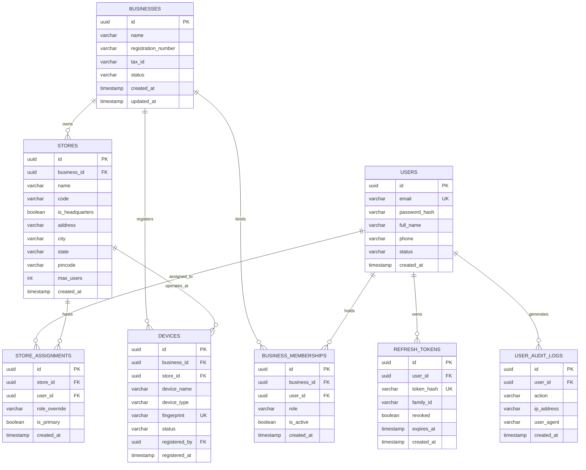

---

### 2.2 Catalog, Categories & Global Medicine Master Schema
Handles localized pharmacy stock-keeping units (SKUs), multiple barcode aliases, and connects to the centralized 50,000+ formulation master.

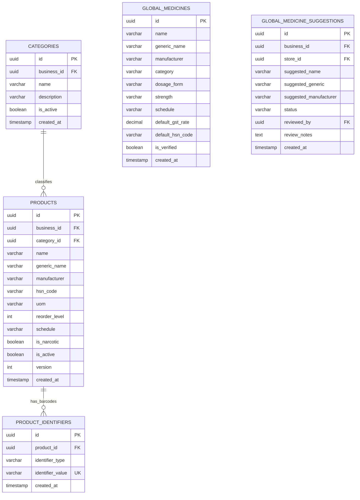

---

### 2.3 Procurement, Suppliers & Goods Receipt (GRN) Schema
Maintains wholesale vendor relationships, contract rates, procurement orders, and formal shipment receipt vouchers.

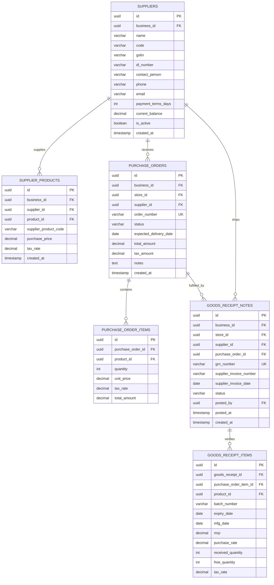

---

### 2.4 Inventory, Discrete Batches & Movement Ledger Schema
The operational heart of the system. Balances are fast-read caches; `stock_movements` is the immutable source of truth.

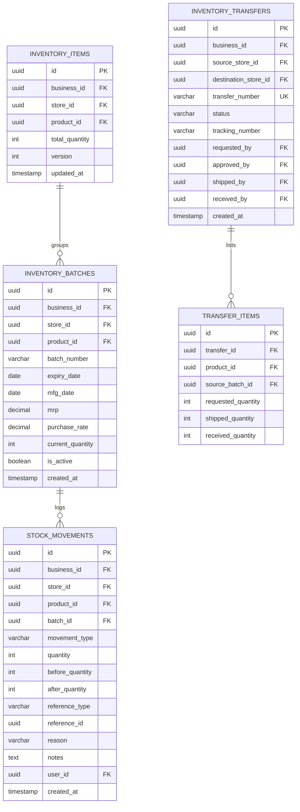

---

### 2.5 Point of Sale (POS), Sales & Customer Credit Ledger Schema

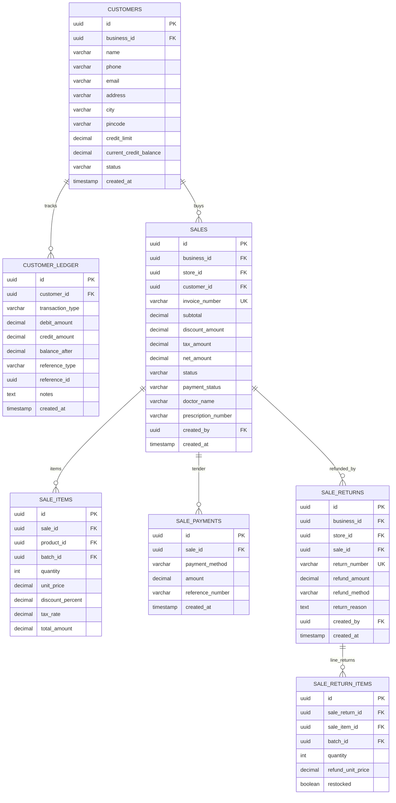

---

### 2.6 Subscriptions, Licensing & Content (CMS) Schema

```mermaid
erDiagram
    SUBSCRIPTIONS {
        uuid id PK
        uuid business_id FK UK
        varchar plan_tier
        varchar billing_cycle
        varchar status
        timestamp start_date
        timestamp valid_until
        boolean autopay_enabled
        timestamp updated_at
    }

    LICENSE_INVOICES {
        uuid id PK
        uuid business_id FK
        varchar invoice_number UK
        varchar tier
        varchar billing_cycle
        decimal subtotal
        decimal tax_amount
        decimal total_amount
        varchar razorpay_order_id UK
        varchar razorpay_payment_id
        varchar status
        timestamp paid_at
        timestamp created_at
    }

    COUPONS {
        uuid id PK
        varchar code UK
        varchar discount_type
        decimal discount_value
        decimal max_discount_amount
        timestamp valid_from
        timestamp valid_until
        int usage_limit
        int used_count
        boolean is_active
    }

    CMS_PAGES {
        uuid id PK
        varchar page_key UK
        varchar title
        text content_markdown
        varchar meta_description
        varchar updated_by
        timestamp updated_at
    }

    CAREER_JOBS {
        uuid id PK
        varchar title
        varchar department
        varchar location
        varchar employment_type
        text description
        text requirements
        varchar status
        timestamp created_at
    }

    JOB_APPLICATIONS {
        uuid id PK
        uuid job_id FK
        varchar full_name
        varchar email
        varchar phone
        varchar resume_url
        varchar status
        timestamp created_at
    }

    CAREER_JOBS ||--o{ JOB_APPLICATIONS : applications
```

---

### 2.7 Bulk Data Ingestion & Offline Sync Schema

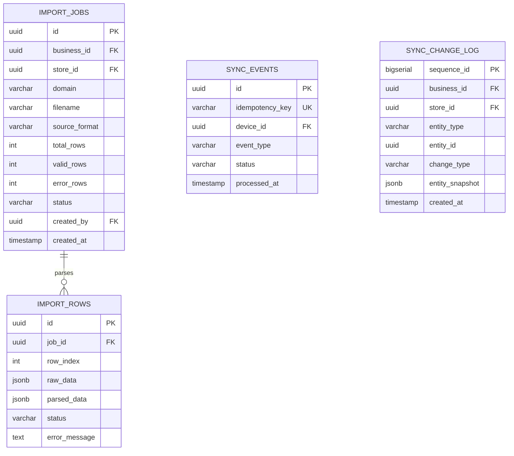

---

## 3. Object-Oriented Domain Class Diagrams

### 3.1 Sales & Billing Aggregate Class Diagram
Illustrates the encapsulation boundaries, rich domain behaviors, value objects, and domain events emitted during counter checkout.

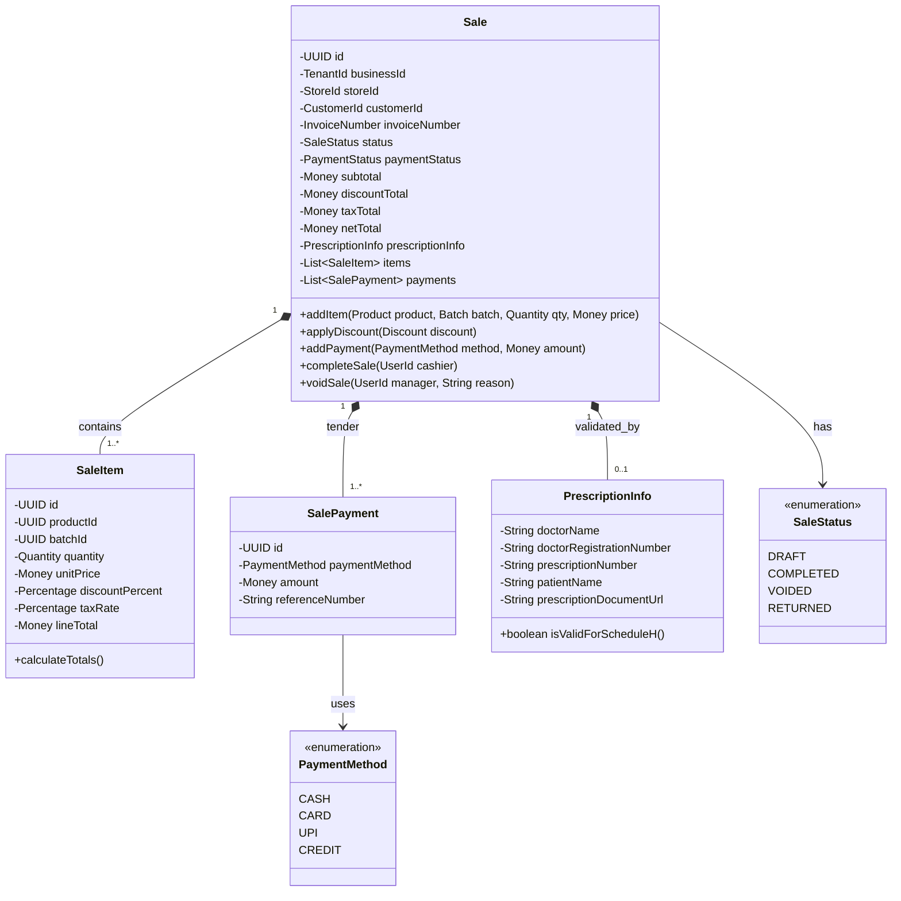

---

### 3.2 Inventory & Stock Movement Aggregate Class Diagram

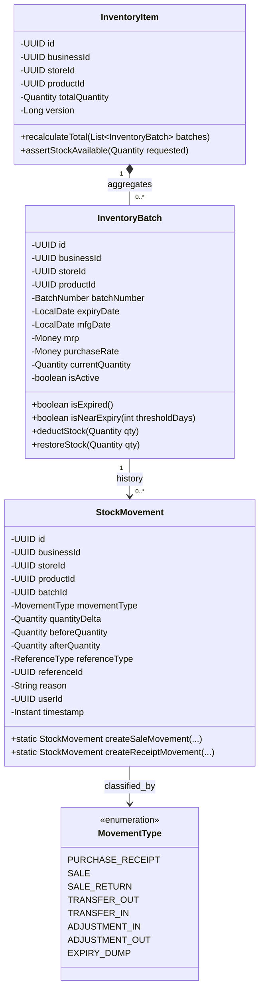

---

### 3.3 Purchasing & Inwarding Aggregate Class Diagram

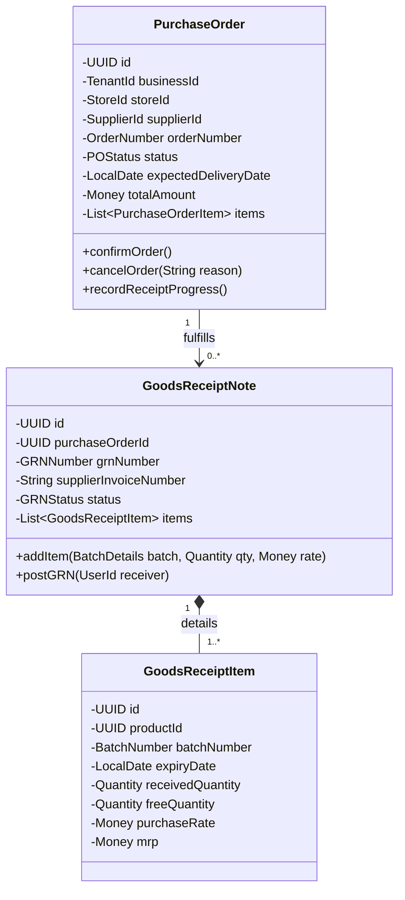

---

## 4. Advanced Algorithmic Flowcharts

### 4.1 Statutory Prescription & Narcotics (Schedule H/H1/X) Validation Flow

Ensures full adherence to the Indian Drugs and Cosmetics Act (1940). Pharmacists cannot bypass mandatory regulatory fields when dispensing scheduled antibiotics or narcotics.

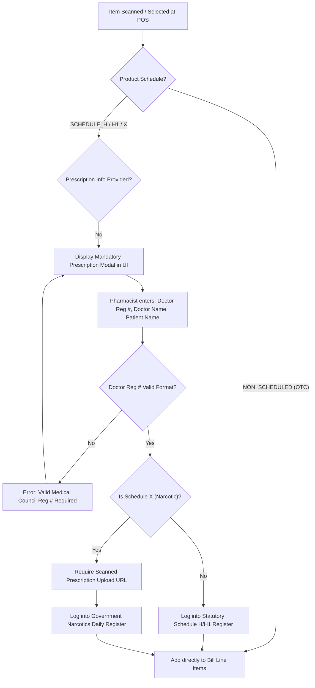

---

### 4.2 Dynamic Pricing, Discount & Proration Calculation Flow

The exact computation pipeline executed when owners upgrade subscriptions or cashiers apply tiered discounts.

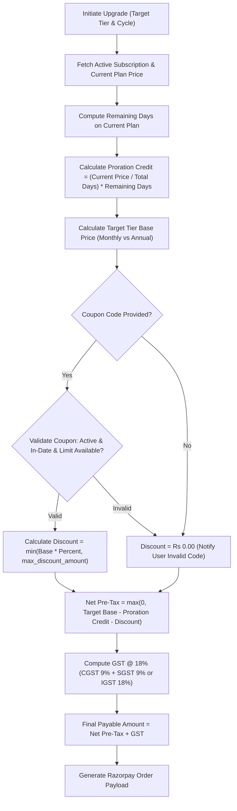

---

### 4.3 Multi-Tenant Resolution & Execution Interceptor Flow

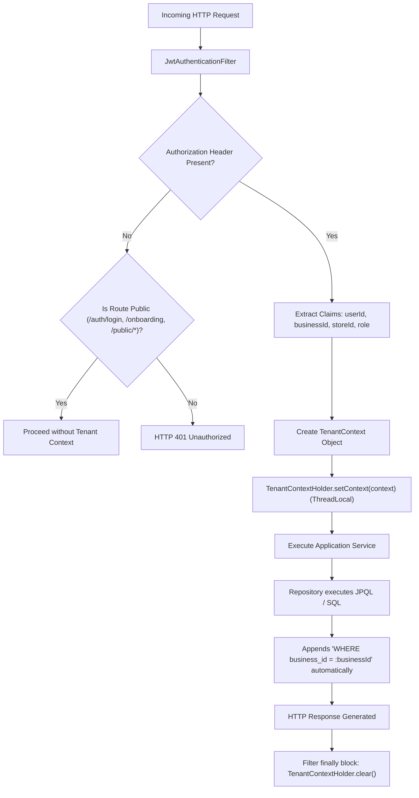

---

## 5. Future Scope: What Is Yet to Be Implemented

While Inventra currently features a complete, battle-tested core across billing, inventory, multi-store logistics, subscriptions, and offline synchronization, several advanced platform capabilities are documented in the architecture roadmap for future release phases:

```
┌────────────────────────────────────────────────────────────────────────┐
│                     INVENTRA FUTURE ROADMAP PHASES                     │
├──────────────────────────┬──────────────────────────┬──────────────────┤
│ PHASE F10: AI & OCR      │ PHASE F11: ENGAGEMENT    │ PHASE F12: B2B   │
│ - Universal PDF Ingest   │ - WhatsApp Business API  │ - Superstockist  │
│ - Vision OCR Challan Scn │ - Automated SMS Alerts   │   EDI Direct PO  │
│ - Supplier Format Learner│ - Refill Reminders       │ - Auto Reorder   │
├──────────────────────────┼──────────────────────────┼──────────────────┤
│ PHASE F13: GOVT DIGITAL  │ PHASE F14: HARDWARE      │ PHASE F15: MOBILE│
│ - ABDM Healthcare M1/M2  │ - WebUSB ESC/POS Printer │ - Kotlin/Android │
│ - National Health ID     │ - Serial Weighing Scale  │   Store Audit App│
│ - GST e-Way Bill & IRN   │ - Electronic Cash Drawer │ - Tablet POS App │
└──────────────────────────┴──────────────────────────┴──────────────────┘
```

---

### 5.1 AI-Powered PDF / OCR Invoice Ingestion
* **Current State**: Manual entry via Goods Receipt Note (GRN) or bulk CSV ingestion via `ImportController`.
* **Future Architecture**:
  1. Distributors email purchase bills as PDFs or cashiers photograph paper challans with mobile cameras.
  2. OCR pipeline (Tesseract / Google Cloud Vision / Gemini Vision) extracts table columns: Item Name, Batch, Expiry, MRP, Rate, HSN, and CGST/SGST.
  3. **Supplier Format Learning Engine**: Learns column coordinate maps for major distributors (e.g. Vardhman Pharma, Religare) to reach >99.5% optical parse accuracy.
  4. Automatically stages extracted rows in `import_rows` ready for 1-click confirmation into `goods_receipt_notes`.

---

### 5.2 WhatsApp & Automated SMS Patient Engagement
* **Current State**: Receipts printed via 80mm/58mm thermal printers or viewed on-screen.
* **Future Architecture**:
  1. **Paperless Green Invoicing**: On counter checkout, the system triggers a WhatsApp Business Cloud API webhook delivering a digital PDF invoice directly to the customer's phone.
  2. **Automated Chronic Refill Reminders**: For patients taking daily cardiovascular, diabetes, or hypertension maintenance drugs, background cron jobs calculate when their 30-day supply reaches day 27 and send automated replenishment notifications with 1-click WhatsApp order confirmation.

---

### 5.3 Ayushman Bharat Digital Mission (ABDM) & e-Prescription Network
* **Current State**: Manual doctor registration number logging into Schedule H statutory registers.
* **Future Architecture**:
  1. **ABHA (Ayushman Bharat Health Account) Integration**: Verification and generation of 14-digit national patient ABHA IDs at counter checkout.
  2. **National Health Claims Exchange (NHCX)**: Electronic transmission of cashless outpatient insurance claims directly from the pharmacy POS to insurance TPAs.
  3. **Direct e-Prescription Ingestion**: Pulls verified digital prescriptions directly from hospital EMRs via ABDM Milestone 1, 2, and 3 certified APIs.

---

### 5.4 Distributor B2B Electronic Data Interchange (EDI)
* **Current State**: Store generates PO PDF and emails/calls distributor manually.
* **Future Architecture**:
  1. Automated API ordering connecting directly to regional super-stockist ERPs (PharmEasy Wholesale, API Holdings, Ascent Health, Entero Healthcare).
  2. POs placed electronically inside Inventra are dispatched directly into the distributor's order queue with live delivery tracking.

---

### 5.5 Predictive AI Stock Replenishment & Demand Forecasting
* **Current State**: Threshold-based reorder alerts (`total_quantity <= reorder_level`).
* **Future Architecture**:
  1. Time-series machine learning models (ARIMA / Prophet / LightGBM) factoring in seasonality (e.g. monsoon dengue/paracetamol surges, winter allergy syrup surges).
  2. Dynamically calculates optimal **Economic Order Quantity (EOQ)** and suggests automated purchase orders before stockout risks emerge.

---

### 5.6 Direct Hardware Peripheral WebUSB / Serial Drivers
* **Current State**: Standard OS system print dialog (`window.print()`) rendering styled thermal receipts.
* **Future Architecture**:
  1. WebUSB and WebSerial API connectors allowing the browser and desktop app to bypass Windows/CUPS spoolers and fire raw binary **ESC/POS byte commands** directly to thermal printers (<100ms print latency).
  2. Hardware COM-port integration with electronic weighing scales (for Ayurvedic raw powders) and automated 24V cash drawer kick pulses.

---

### 5.7 Statutory GST e-Invoicing & e-Way Bill Integration
* **Current State**: Detailed GST calculation (CGST/SGST/IGST) with HSN codes; reports exportable to Excel/CSV for accountants.
* **Future Architecture**:
  1. Direct integration with the GST Network (GSTN) Invoice Registration Portal (IRP).
  2. For B2B wholesale transactions exceeding statutory turnover limits, the system uploads JSON invoices in real-time, receives a 64-character **Invoice Reference Number (IRN)**, and embeds the mandatory signed QR code onto the invoice PDF.

---

### 5.8 Native Android / iOS Field Application
* **Current State**: Web application (responsive React SPA) and Desktop application (Tauri + SQLite).
* **Future Architecture**:
  1. Dedicated React Native / Kotlin mobile application designed for smartphone camera barcode scanning.
  2. Allows warehouse staff to perform walking physical inventory audits, barcode shelf mapping, and inter-store delivery dispatch scanning.

---

## 6. Feature Matrix: Current State vs. Future Roadmap

| Subsystem | Feature / Capability | Implementation Status | Implementation Phase |
|---|---|---|---|
| **Identity & Security** | Multi-Tenancy Context & RBAC | ✅ **Complete in Production** | Core / V1 |
| **Identity & Security** | JWT Access & Refresh Token Family Rotation | ✅ **Complete in Production** | Core / V2 |
| **Catalog** | Product Master & Multiple Barcodes | ✅ **Complete in Production** | Core / V3 |
| **Catalog** | 50,000+ Global Medicine Master & 1-Click Import | ✅ **Complete in Production** | Core / V18 |
| **Purchasing** | PO & Goods Receipt (GRN) Inwarding | ✅ **Complete in Production** | Core / V4 |
| **Inventory** | Discrete Batch Expiry & FEFO Allocation | ✅ **Complete in Production** | Core / V3 |
| **Inventory** | Immutable Stock Movement Ledger | ✅ **Complete in Production** | Core / V3 |
| **Logistics** | Inter-Store Stock Transfer & In-Transit Tracking | ✅ **Complete in Production** | Core / V6 |
| **Point of Sale** | Fast Search (<15ms) & Pessimistic Lock Billing | ✅ **Complete in Production** | Core / V5 |
| **Point of Sale** | Split Tender (Cash / Card / UPI / Credit) | ✅ **Complete in Production** | Core / V5 |
| **Sales Returns** | Restock Validation & Credit Reversals | ✅ **Complete in Production** | Core / V5 |
| **Compliance** | Schedule H/H1/X Statutory Drug Registers | ✅ **Complete in Production** | Core / V5 |
| **Offline Sync** | Desktop SQLite Queuing & Idempotent Replay | ✅ **Complete in Production** | Core / V7 |
| **Data Ingestion** | CSV Bulk Upload with Error Review & Inline Fix | ✅ **Complete in Production** | Core / V11 |
| **Billing & Plans** | Razorpay Gateway, Proration & Coupons | ✅ **Complete in Production** | Core / V14–V17 |
| **AI / Ingestion** | Vision OCR Distributor Bill & Challan Scanner | 🔮 **Planned Future Scope** | Phase F10 |
| **Patient Comms** | WhatsApp Business Digital Bills & Refill Bot | 🔮 **Planned Future Scope** | Phase F11 |
| **Healthcare** | ABDM ABHA ID & National e-Prescription | 🔮 **Planned Future Scope** | Phase F13 |
| **Supply Chain** | Superstockist EDI Real-Time Auto-Ordering | 🔮 **Planned Future Scope** | Phase F12 |
| **Intelligence** | Predictive Machine Learning Demand Forecasting | 🔮 **Planned Future Scope** | Phase F12 |
| **Hardware** | WebUSB Direct ESC/POS Driver & Cash Drawer Kick | 🔮 **Planned Future Scope** | Phase F14 |
| **Compliance** | Real-Time GST e-Invoicing (IRN) & e-Way Bill | 🔮 **Planned Future Scope** | Phase F13 |
| **Mobile App** | Native Android/iOS Warehouse Barcode Scanner App | 🔮 **Planned Future Scope** | Phase F15 |

---

*Inventra Pharmacy ERP Documentation Suite — Authoritative Technical Reference.*
