# Inventra Pharmacy ERP — Transition State Machines & Architecture Flow Diagrams

> **Authoritative System Architecture & Visual Flow Reference**  
> **Backend Framework**: Spring Boot 3.x / Java 21 / PostgreSQL 16+  
> **Format**: GitHub Flavored Markdown with Mermaid Sequence, State, and Entity-Relationship Diagrams  
> **Related Documents**: [BACKEND_API_REFERENCE.md](file:///d:/project/anti-gravity-projects/inventra/docs/BACKEND_API_REFERENCE.md) | [INVENTORY_LIFECYCLE.md](file:///d:/project/anti-gravity-projects/inventra/docs/INVENTORY_LIFECYCLE.md) | [SYSTEM_DIAGRAMS_AND_FUTURE_ROADMAP.md](file:///d:/project/anti-gravity-projects/inventra/docs/SYSTEM_DIAGRAMS_AND_FUTURE_ROADMAP.md)

---

## Table of Contents

1. [High-Level System & Security Boundary Flow](#1-high-level-system--security-boundary-flow)
2. [Tenant Onboarding & Activation State Machine](#2-tenant-onboarding--activation-state-machine)
3. [Authentication, JWT Rotation & Session Lifecycle](#3-authentication-jwt-rotation--session-lifecycle)
4. [Subscription, Tier Upgrade & Manual Payment Flow](#4-subscription-tier-upgrade--manual-payment-flow)
5. [Crowdsourced Global Medicine Curation & 1-Click Import Flow](#5-crowdsourced-global-medicine-curation--1-click-import-flow)
6. [Procurement Lifecycle: Purchase Order (PO) to Goods Receipt (GRN)](#6-procurement-lifecycle-purchase-order-po-to-goods-receipt-grn)
7. [Comprehensive Inventory & Batch State Transition Machine](#7-comprehensive-inventory--batch-state-transition-machine)
8. [Inter-Store Stock Transfer (Logistics) State Machine](#8-inter-store-stock-transfer-logistics-state-machine)
9. [Point of Sale (POS) Counter Checkout & Concurrency Flow](#9-point-of-sale-pos-counter-checkout--concurrency-flow)
10. [Sales Return, Refund & Quarantine Flow](#10-sales-return-refund--quarantine-flow)
11. [Customer Credit Ledger & B2B Settlement Flow](#11-customer-credit-ledger--b2b-settlement-flow)
12. [Offline-First Terminal Synchronization & Conflict Replay Sequence](#12-offline-first-terminal-synchronization--conflict-replay-sequence)
13. [Bulk CSV Ingestion & Remediation Pipeline](#13-bulk-csv-ingestion--remediation-pipeline)
14. [Entity Relationship & Master Schema Model](#14-entity-relationship--master-schema-model)

---

## 1. High-Level System & Security Boundary Flow

This diagram illustrates how client requests traverse the security perimeter, resolve the tenant context via `ThreadLocal`, and interact with the database under transactional guarantees.

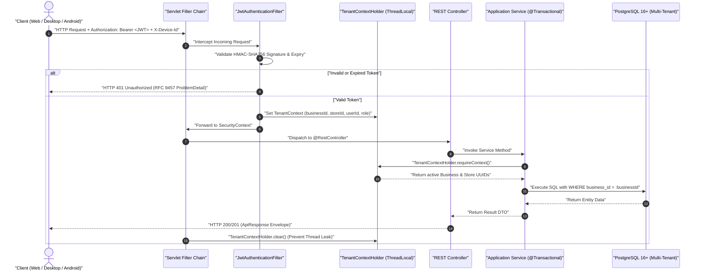

---

## 2. Tenant Onboarding & Activation State Machine

Governs the regulatory onboarding process from initial pharmacy KYC submission through administrative verification to active account status.

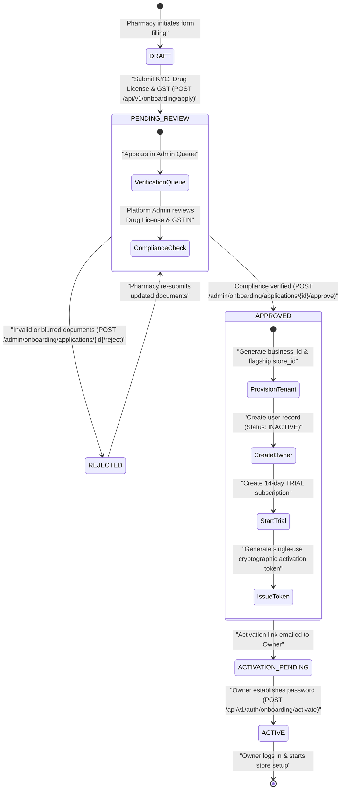

---

## 3. Authentication, JWT Rotation & Session Lifecycle

Inventra implements **Refresh Token Family Rotation** to protect counter terminals from token replay attacks.

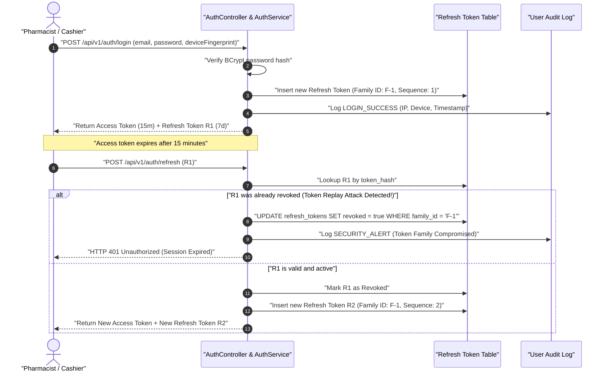

---

## 4. Subscription, Tier Upgrade & Manual Payment Flow

Online checkout is not available. The owner previews the upgrade price, pays through the agreed channel, and a platform administrator records the payment.

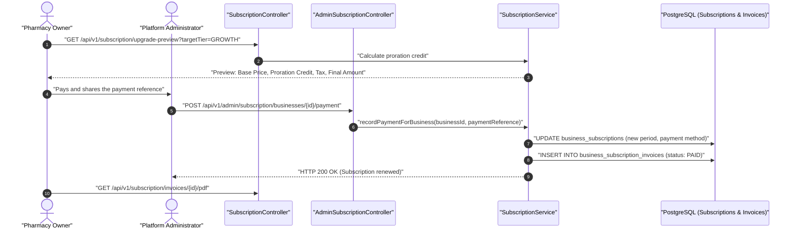

---

## 5. Crowdsourced Global Medicine Curation & 1-Click Import Flow

Shows how unrecognized drug names entered at pharmacy counters are curated by platform administrators into a standardized master database.

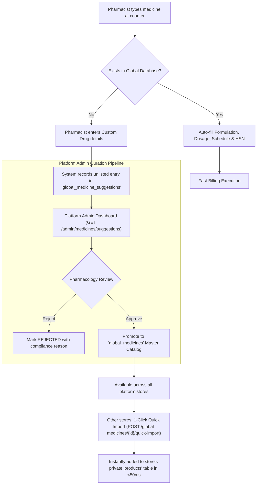

---

## 6. Procurement Lifecycle: Purchase Order (PO) to Goods Receipt (GRN)

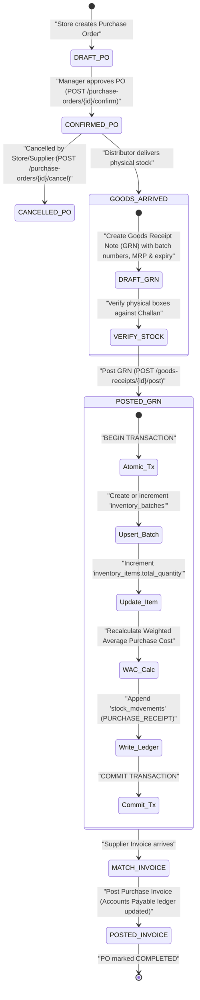

---

## 7. Comprehensive Inventory & Batch State Transition Machine

Details how an individual pharmaceutical lot transitions from inwarding to dispensing or disposal.

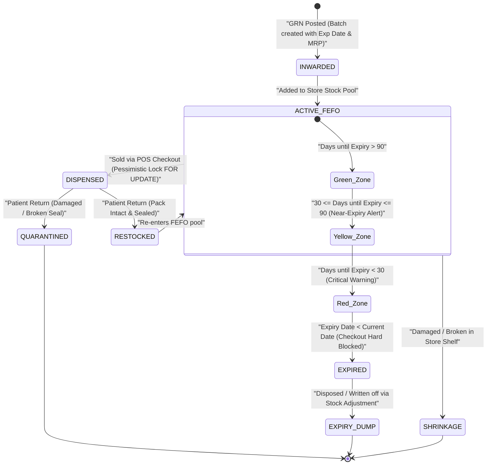

---

## 8. Inter-Store Stock Transfer (Logistics) State Machine

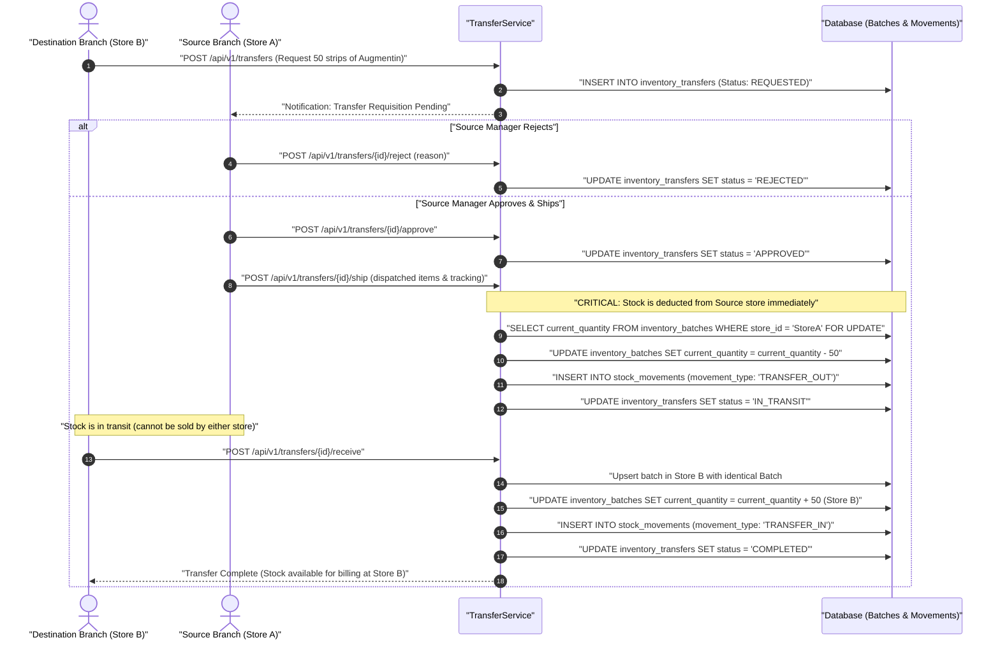

---

## 9. Point of Sale (POS) Counter Checkout & Concurrency Flow

Demonstrates how two parallel cashiers selling the same batch are handled deterministically without inventory overselling.

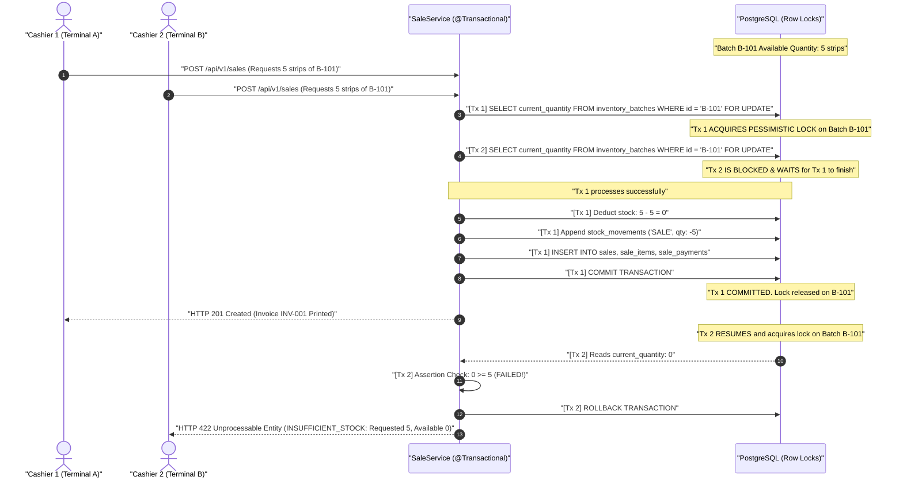

---

## 10. Sales Return, Refund & Quarantine Flow

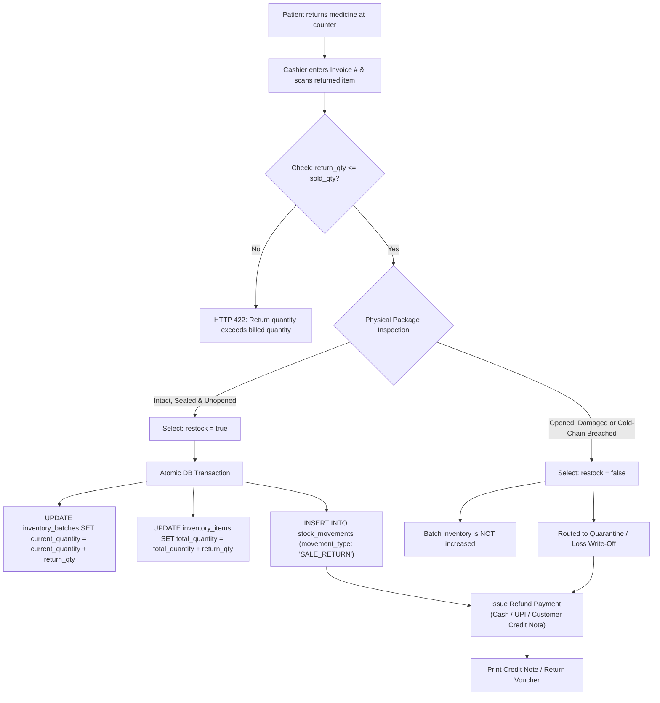

---

## 11. Customer Credit Ledger & B2B Settlement Flow

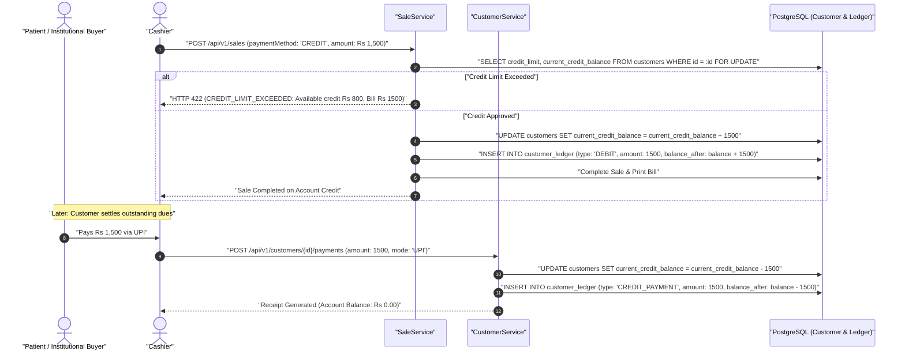

---

## 12. Offline-First Terminal Synchronization & Conflict Replay Sequence

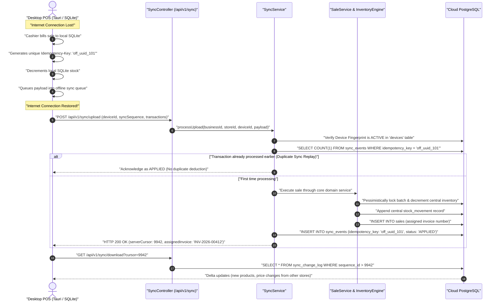

---

## 13. Bulk CSV Ingestion & Remediation Pipeline

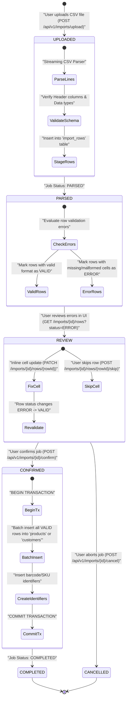

---

## 14. Entity Relationship & Master Schema Model

This ER diagram demonstrates the foreign key relationships connecting procurement, batches, point of sale, customer balances, and immutable audit movements.

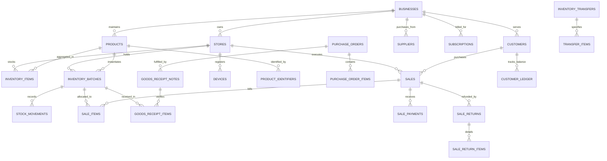

---

## 15. Cross-Reference Index

| Domain | Key Endpoints | Relevant Diagram | Primary Entities |
|---|---|---|---|
| **Identity & Auth** | `/api/v1/auth/*` | Diagrams 1, 3 | `users`, `refresh_tokens`, `devices` |
| **Onboarding** | `/api/v1/onboarding/*`, `/api/v1/admin/onboarding/*` | Diagram 2 | `onboarding_applications`, `businesses`, `stores` |
| **Subscriptions** | `/api/v1/subscription/*`, `/api/v1/admin/subscription/*` | Diagram 4 | `subscriptions`, `license_invoices`, `coupons` |
| **Global Medicines** | `/api/v1/catalog/global-medicines/*`, `/api/v1/admin/medicines/*` | Diagram 5 | `global_medicines`, `global_medicine_suggestions` |
| **Purchasing** | `/api/v1/purchase-orders/*`, `/api/v1/goods-receipts/*` | Diagram 6 | `purchase_orders`, `goods_receipt_notes` |
| **Inventory & Batches**| `/api/v1/inventory/*` | Diagram 7 | `inventory_items`, `inventory_batches`, `stock_movements` |
| **Transfers** | `/api/v1/transfers/*` | Diagram 8 | `inventory_transfers`, `transfer_items` |
| **POS Billing** | `/api/v1/sales/*`, `/api/v1/pos/*` | Diagram 9 | `sales`, `sale_items`, `sale_payments` |
| **Sales Returns** | `/api/v1/returns/*`, `/api/v1/sales/{id}/returns` | Diagram 10 | `sale_returns`, `sale_return_items` |
| **Customer Credit** | `/api/v1/customers/*` | Diagram 11 | `customers`, `customer_ledger` |
| **Offline Sync** | `/api/v1/sync/*` | Diagram 12 | `sync_events`, `sync_change_log` |
| **CSV Ingestion** | `/api/v1/imports/*` | Diagram 13 | `import_jobs`, `import_rows` |

---
*Inventra Pharmacy ERP Documentation Engine — System Transition & Architecture Specification.*
