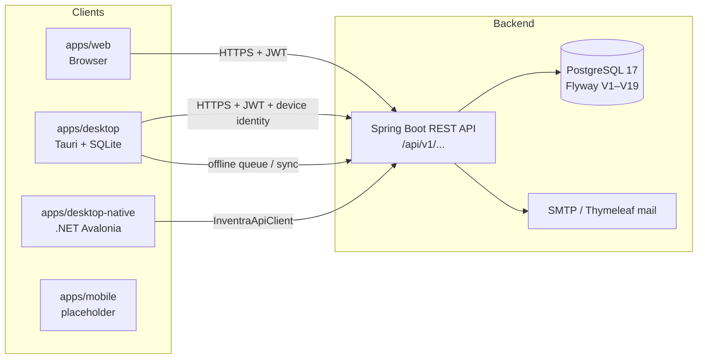
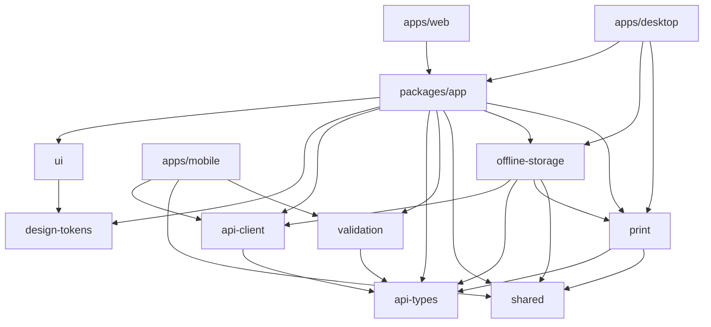
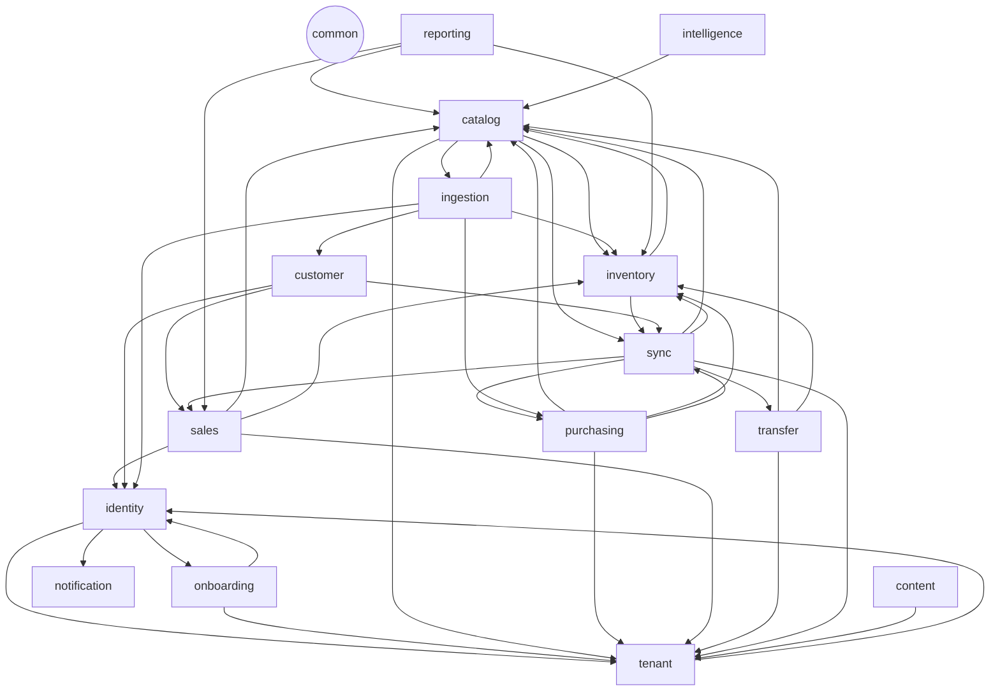
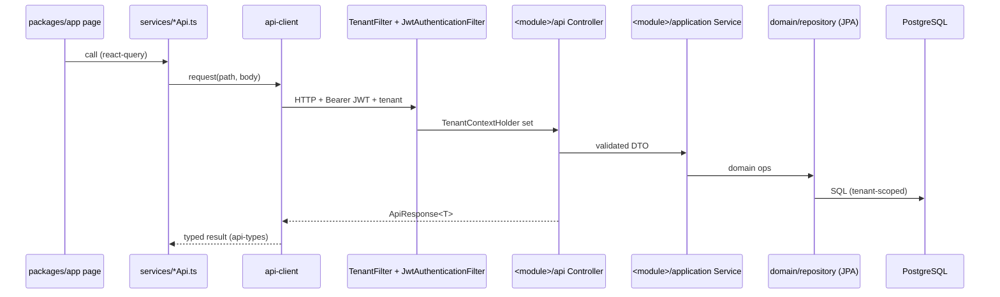
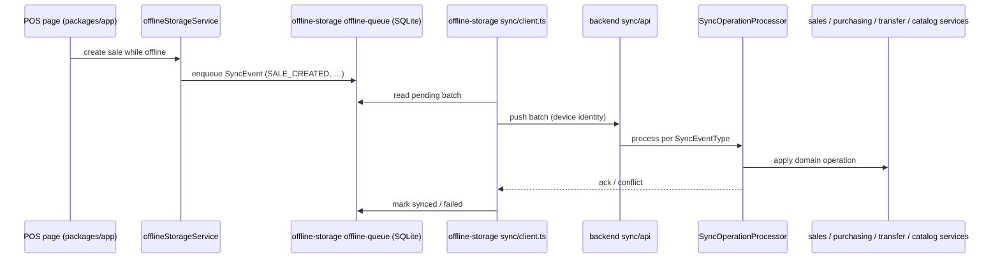

# Module Map — How Inventra Is Linked

Snapshot taken 2026-10-20 from `package.json` files and Java `import` statements. Phase 1 of the audit (see `01_AUDIT_PLAN.md`) re-verifies this and keeps it current.

---

## 1. System context



---

## 2. Frontend workspace dependency graph

Arrows read "depends on". Source: `dependencies` / `peerDependencies` in each `package.json`.



Leaf packages (no internal deps): `api-types`, `shared`, `design-tokens`.

### Package responsibilities

| Package | Role | Key contents |
|---|---|---|
| `api-types` | TypeScript mirror of backend DTOs | one file per backend domain (`auth`, `catalog`, `sales`, `sync`, …) |
| `api-client` | HTTP client, error mapping | `client.ts`, `error.ts` |
| `validation` | Zod schemas for forms and payloads | built on `api-types` |
| `shared` | Formatting, constants, canonical helpers | `format.ts`, `canonical.ts`, `constants.ts` |
| `design-tokens` | Colour presets, semantic tokens, colour utils | `presets.ts`, `semantic.ts`, `color-utils.ts` |
| `ui` | Primitive components (button, card, table, …) | consumes `design-tokens` |
| `print` | Receipt/thermal models, renderer, adapters | `models/`, `renderer/`, `adapters/` |
| `offline-storage` | SQLite schema, caches, offline queue, sync client | `driver/` (tauri-sqlite, sqlite-memory), `repositories/`, `sync/client.ts` |
| `app` | **The whole product UI**: routes, pages, stores, services, runtime adapters | `pages/` (≈20 domains), `services/*Api.ts`, `stores/`, `runtime/` |

### How apps host the shared app

`apps/web/src/main.tsx` and `apps/desktop/src/main.tsx` both render `<App runtime={…} />` from `@inventra/app`, injecting a runtime adapter:

```mermaid
flowchart LR
  subgraph packages/app/runtime
    RC[RuntimeContext]
    WRA[WebRuntimeAdapter]
    DRA[DesktopRuntimeAdapter]
  end
  web[apps/web main.tsx] -- new WebRuntimeAdapter --> RC
  desk[apps/desktop main.tsx] -- DesktopRuntimeAdapter --> RC
  DRA --> tauri[@tauri-apps/api, plugin-sql]
  DRA --> offline[offline-storage]
  DRA --> print
```

Desktop adds its own pieces: `DesktopTitlebar`, `SyncCenterModal`, `SyncStatusBadge`, `PrinterSettingsModal`, `useBarcodeScanner`, `deviceIdentity`.

> **Audit finding A-001 (confirmed 2026-10-20):** `apps/web/src` holds 126 tracked files (`pages/`, `components/`, `services/`, `stores/`) that duplicate `packages/app`. `main.tsx` imports only `@inventra/app`, so they are unreachable dead code.

### Frontend layering inside `packages/app`

```
pages/<domain>  →  components/<domain>  →  hooks / stores (zustand)
       ↓                                         ↓
services/<domain>Api.ts  →  @inventra/api-client  →  backend REST
       ↓ (desktop)
services/offlineStorageService.ts → @inventra/offline-storage
```

| Frontend service | Backend module |
|---|---|
| `sessionApi`, `deviceApi`, `shortcutApi`, `storeStaffApi` | identity |
| `subscriptionApi`, `storeCapacityApi` | tenant (+ subscription) |
| `catalogApi`, `globalMedicineApi` | catalog |
| `inventoryApi` | inventory |
| `purchasingApi` | purchasing |
| `salesApi` | sales |
| `customerApi` | customer |
| `transferApi` | transfer |
| `importApi` | ingestion |
| `reportApi` | reporting |
| `intelligenceApi` | intelligence |
| `cmsApi` | content |
| `careerApi` | careers |
| `geoData` | common/geo |

---

## 3. Backend module graph

Package root: `com.inventra.inventra_backend`. Each module follows `api / api.dto / application / domain(model, repository) / infrastructure`. Numbers are import counts from the source module into the target.



(Every module also depends on `common`; omitted for readability.)

| Module | Files | Depends on (import count) |
|---|---|---|
| common | 33 | — (security, multitenancy, mail, geo, exceptions, `ApiResponse`) |
| identity | 48 | common 25, tenant 22, onboarding 1, notification 1 |
| tenant (+subscription) | 50 | common 34, identity 9 |
| onboarding | 12 | common 9, identity 8, tenant 8 |
| catalog | 43 | common 27, sync 6, inventory 5, tenant 3, ingestion 1 |
| inventory | 15 | common 14, catalog 2, sync 2 |
| purchasing | 53 | common 36, catalog 8, inventory 7, tenant 6, sync 2 |
| sales | 48 | common 26, inventory 18, catalog 8, tenant 6, identity 3 |
| customer | 10 | sales 17, common 8, identity 2, sync 2 |
| transfer | 30 | common 16, inventory 7, catalog 2, tenant 2 |
| sync | 21 | purchasing 13, common 12, sales 9, tenant 4, transfer 3, catalog 2, inventory 2 |
| ingestion | 29 | catalog 15, common 8, inventory 7, purchasing 5, customer 4, identity 2 |
| reporting | 8 | sales 9, catalog 4, inventory 4, common 4 |
| intelligence | 8 | catalog 5, common 2 |
| notification | 7 | common 6 |
| content | 5 | common 3, tenant 2 |
| careers | 10 | common 5 |

### Cycles to resolve (Phase 3)

Verified 2026-10-20 from import counts: each pair below imports in both directions. `customer → sales` is one-way (no cycle).

| Cycle | Likely cause |
|---|---|
| identity ⇄ tenant | users belong to tenants; tenant services look up users |
| identity ⇄ onboarding | onboarding approval creates users; identity references applications |
| catalog ⇄ inventory | products ↔ stock batches |
| catalog ⇄ sync, inventory ⇄ sync | domain modules publish sync events; sync processor calls domain services |
| catalog ⇄ ingestion | imports write catalog; catalog references import entities |

---

## 4. Cross-cutting request flow



## 5. Offline / sync flow (desktop)



`SyncEventType` in the backend is `SALE_CREATED`, `SALE_RETURN_CREATED`, `TRANSFER_REQUEST_CREATED`, `SUPPLIER_CREATED`, `PURCHASE_ORDER_CREATED`, `GOODS_RECEIPT_POSTED`. The TS mirror in `packages/api-types/src/sync.ts` currently disagrees (finding A-016); both must change together.

## 6. Contracts that must stay in lockstep

| Contract | Source of truth | Mirrors |
|---|---|---|
| REST DTOs | `backend/**/api/dto/*.java` | `packages/api-types/src/*.ts`, `apps/desktop-native/.../Core/Domain/*Models.cs` |
| Sync event types | `sync/domain/model/SyncEventType.java` | `api-types/src/sync.ts`, `offline-storage`, `desktop-native SyncModels.cs` |
| Validation rules | Jakarta `@Valid` on DTOs | `packages/validation` (Zod) |
| DB schema | `db/migration/V*.sql` | JPA entities; `offline-storage/schema/init.ts`; `desktop-native DatabaseContext.cs` |
| Permissions/roles | identity module | `app` route guards (`components/routes`), `desktop-native AppPermissions.cs` |
| GST/tax maths | sales/purchasing services | `shared/format.ts`?, `desktop-native GstCalculator.cs` |
| Design tokens | `packages/design-tokens` | `apps/*/tailwind.config.js`, `desktop-native InventraTheme.axaml` |
| API docs | controllers | `docs/BACKEND_API_REFERENCE.md`, `docs/api-contract.md` |
