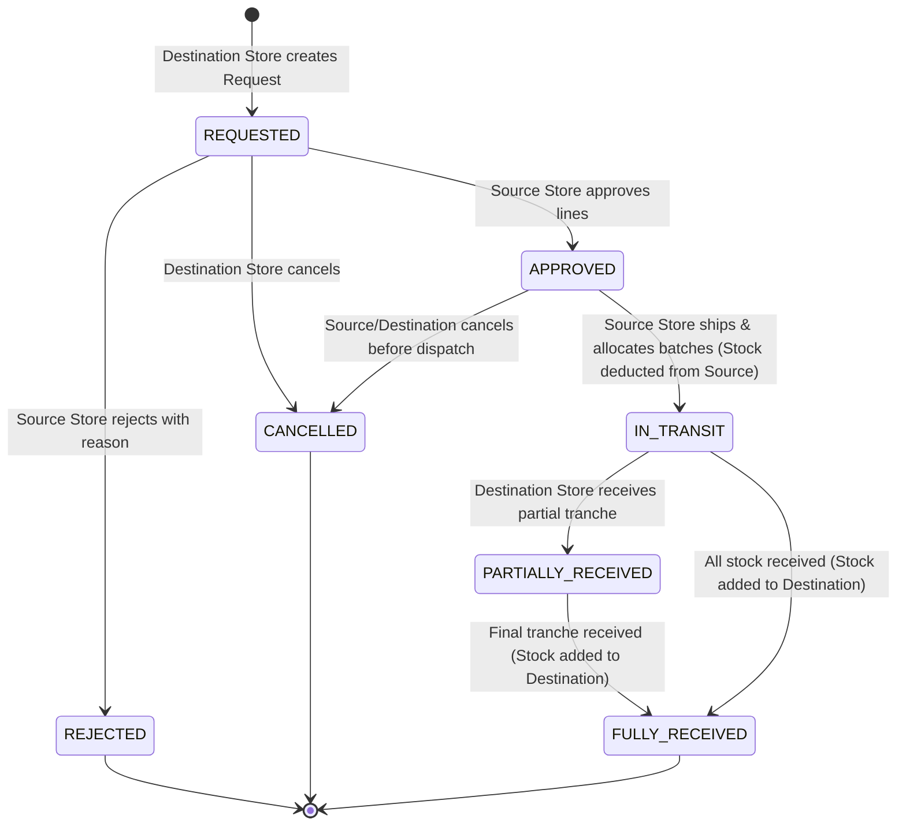
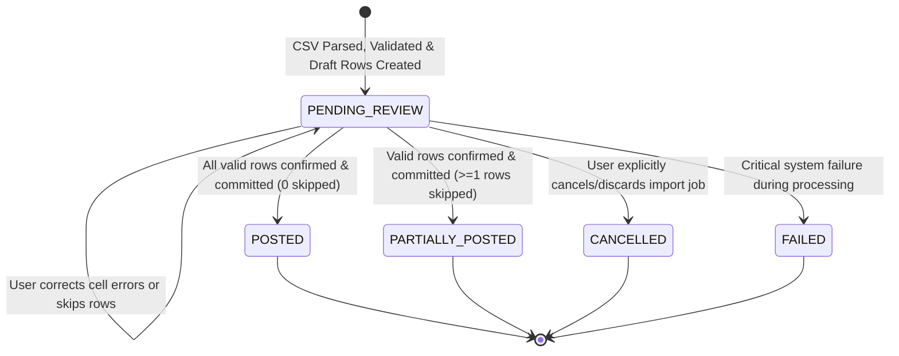

# Phase F8 Design Specification — Operations Completion & Universal Import Foundation

**Document Status:** Implementation-Ready Architectural Design (Amended Baseline)  
**Phase Identifier:** F8  
**Target Milestone:** Operations Completion + Universal Ingestion & Draft Verification Engine  
**Author:** AI Pair Programming Architect (Google DeepMind Antigravity)  
**Creation Date:** 2026-08-28 (Updated with Architectural Amendments)  
**Governing Architectural Principles:** Modular Layered DDD, Zero Direct Mutation, Strict Tenancy Isolation, Composite Foreign Key Tenancy Consistency, RFC 9457 Problem Details, Centralized Theme & Shortcut Registry, Online-Only Web Client Boundary.

---

## 1. Executive Summary

Phase F8 completes the core operational workflow triad and establishes the enterprise ingestion backbone for the **Inventra Pharmacy ERP** platform. It bridges existing backend foundations into high-density clinical user interfaces while introducing a universal ingestion architecture designed for today's bulk CSV imports and tomorrow's automated Email/PDF/OCR document pipelines.

### The Four F8 Workstreams
1. **F8-A (Inter-Store Inventory Transfers):** Full lifecycle management of stock transfer requests, source store approval/rejection, FEFO-aware dispatch shipment batch allocation, in-transit status tracking, destination tranche receiving with cumulative receiving invariants ($\sum \text{received} \le \text{shipped}$), and variance reconciliation.
2. **F8-B (POS Hardware Device Management):** Centralized terminal registry, counter binding, real-time status monitoring, and remote session revocation for secure point-of-sale hardware.
3. **F8-C (Store Staff & User Management):** Store branch staff directory, user assignment with role overrides, and visual enforcement of the 5-user store capacity limit based on dynamic backend queries.
4. **F8-D (Universal Import & Draft Foundation):** A decoupled ingestion engine supporting streaming CSV parsing, dynamic column mapping, row-level validation issue tracking, domain-specific entity matching, interactive correction, explicit row skipping, and transactional confirmation.

```
┌─────────────────────────────────────────────────────────────────────────┐
│                           INVENTRA PHASE F8                             │
├───────────────────┬───────────────────┬───────────────────┬─────────────┤
│ F8-A: TRANSFERS   │ F8-B: DEVICES     │ F8-C: STAFF       │ F8-D: IMPORT│
│ • Request Stock   │ • Register POS    │ • Directory       │ • CSV Upload│
│ • Source Approval │ • Counter Binding │ • 5-User Capacity │ • Mapping   │
│ • Dispatch Batch  │ • Last Seen Mon   │ • Role Override   │ • Validation│
│ • Tranche Receive │ • Revoke Session  │ • Assignment Admin│ • Draft & UX│
└───────────────────┴───────────────────┴───────────────────┴─────────────┘
                                     │
                                     ▼
                    ZERO DIRECT MUTATION PRINCIPLE
      (No external input directly touches authoritative ledgers)
```

---

## 2. Existing Architecture Findings & Discrepancies

An exhaustive audit of the codebase, schemas (Flyway V1–V10), and backend controllers revealed the following facts:

### A. Backend Capabilities Already Fully Operational
- **Transfers (`com.inventra.inventra_backend.transfer`):** Flyway `V6__init_inter_store_transfers.sql` created 5 tables (`inventory_transfers`, `inventory_transfer_lines`, `inventory_transfer_line_batch_allocations`, `inventory_transfer_receipts`, `inventory_transfer_receipt_lines`). `TransferController` and `TransferService` are fully implemented with 100% test coverage (request, approve, reject, ship, receive, rollback).
- **Devices (`com.inventra.inventra_backend.tenant`):** Flyway `V2__init_auth_and_device_identity.sql` created the `devices` table. `DeviceController` exposes listing, registration, and remote revocation.
- **Store Capacity (`com.inventra.inventra_backend.tenant`):** Flyway `V9__user_shortcut_profiles_and_store_capacity.sql` added `stores.max_users` (default 5). `StoreCapacityService` enforces capacity via pessimistic row locking (`findByIdAndBusinessIdWithLock`), and `StoreController` exposes capacity endpoints.
- **Offline Sync Foundation (`com.inventra.inventra_backend.sync`):** Flyway `V7__init_offline_sync.sql` created `sync_operations`, `sync_change_feed`, and `sync_device_states`.

### B. Frontend Gaps & Discrepancies to Resolve
- **Placeholder Pages:** In `apps/web/src/App.tsx`, routes `/transfers`, `/devices`, and `/users` currently render `ModulePlaceholderPage.tsx`. These must be replaced with full operational pages.
- **TypeScript API Types:** `packages/api-types` already defines comprehensive interfaces for `transfer.ts`, `devices.ts`, and `storeCapacity.ts`. These must be consumed directly by newly developed frontend services.
- **Store User Capacity:** The frontend must dynamically read `maxUsers` and `currentActiveUsers` from `GET /api/v1/stores/{storeId}/capacity` rather than hardcoding a `5` constant.
- **Transfer Status Enum Alignment:** Backend enum in `TransferStatus.java` uses `FULLY_RECEIVED`, whereas early documentation mentioned `COMPLETED`. The frontend contract strictly binds to `FULLY_RECEIVED`.

---

## 3. F8 Scope

### IN SCOPE (Phase F8 Deliverables)
- **Frontend Inter-Store Transfers:** Dashboard, request workflow, source approval/rejection modal, batch allocation dispatch picker, in-transit tracker, and receiving variance dialog with cumulative receiving invariants.
- **Frontend POS Device Console:** Registered devices table, registration modal, counter binding, and destructive remote revocation dialog.
- **Frontend Staff Directory:** Staff listing, user assignment modal with role overrides, and store capacity progress visualization.
- **Universal Ingestion Framework:** Flyway migration `V11__init_import_and_ingestion_framework.sql` (creating `import_jobs`, `import_documents`, `import_rows`, `import_validation_issues` with composite foreign keys), backend domain handler strategy pattern, streaming CSV parser, entity matching engine, REST APIs, and high-density review UI.

### DEFERRED OUT OF SCOPE (Future Phase Adapters)
- Live email mailbox IMAP/POP3 polling and email webhook ingestors (Phase F12).
- Production OCR / Vision AI document extraction worker (Phase F12).
- Desktop Tauri 2.0 offline SQLite storage and ESC/POS thermal printing (Phase F9).
- Mobile React Native floor scanning application (Phase F11).
- Autonomous invoice ledger posting without human confirmation (Strictly Prohibited).

---

## 4. F8-A — Inter-Store Transfers Design

### A. Information Architecture & State Machine
The inventory transfer lifecycle is governed by a deterministic, auditable finite state machine:



### B. Cumulative Receiving Invariant ($\sum \text{received} \le \text{shipped}$)
A critical inventory invariant is strictly enforced at both backend and frontend layers:
$$\sum_{i=1}^{n} \text{receivedQuantity}_{\text{tranche}_i} \le \text{shippedQuantity}$$

1. **Validation Rule:** When receiving an incoming transfer tranche, the destination operator can never record a received quantity greater than the remaining unreceived shipped quantity for any batch allocation.
2. **Over-Receive Prohibition:** Submitting $\text{receivedQuantity} > \text{remainingQuantity}$ is rejected with HTTP 422 `TRANSFER_OVER_RECEIVE_VIOLATION`.
3. **Variance Logging:** If $\text{receivedQuantity} < \text{shippedQuantity}$ on the final tranche, the UI mandates a structured **Variance Reason** (e.g. `DAMAGED_IN_TRANSIT`, `MISSING_FROM_BOX`, `EXPIRED_UPON_ARRIVAL`, `OTHER`) along with explanatory notes.

### C. Screen Specifications

#### 1. Transfers Dashboard (`/transfers`)
- **Header:** Title "Inter-Store Transfers", Active Store context indicator, quick filter tabs (`All`, `Inbound`, `Outbound`, `Action Required`), and "New Transfer Request" primary button (`N T`).
- **Data Table Columns:**
  - `Transfer #` (Monospace, e.g. `TRF-202608-0001`)
  - `Type` (Inbound / Outbound pill badge)
  - `Source Store` & `Destination Store`
  - `Items / Total Qty` (Tabular numeric, e.g. `4 items / 120.000`)
  - `Status` (`TransferStatusBadge`: `REQUESTED` Amber, `APPROVED` Sky, `IN_TRANSIT` Indigo, `PARTIALLY_RECEIVED` Purple, `FULLY_RECEIVED` Emerald, `REJECTED` Rose, `CANCELLED` Slate)
  - `Requested Date` (Kolkata formatted `DD MMM YYYY`)
  - `Actions` (Contextual: "Review Request", "Ship Stock", "Receive Stock", "View Details")

#### 2. Create Transfer Request (`/transfers/new`)
- **Step 1:** Select Source Store (dropdown populated only with active stores in same business, excluding destination store).
- **Step 2:** Expected Delivery Date picker and notes.
- **Step 3 (Line Item Builder):**
  - Debounced Product search autocomplete.
  - Live stock badge: Shows *Source Store Available Stock* and *Destination Store Current Stock*.
  - Quantity input (enforces `quantity <= sourceStock` warning).
  - Add line button with `Enter` hotkey.
- **Step 4:** Summary card with total items, total units, and submission confirmation (`Ctrl+Enter`).

#### 3. Transfer Detail & Action Hub (`/transfers/:id`)
- **Header Section:** Transfer Number, Source $\rightarrow$ Destination breadcrumb, current status badge, and audit metadata (Requested by, Date).
- **Audit Timeline Stepper:** Visual step-progress tracking:
  `Created (User, Time) → Approved/Rejected (User, Time) → Shipped (User, Time) → Received (User, Time)`.
- **Line Items Table:** Product, Unit, Requested Qty, Approved Qty, Shipped Qty, Received Qty, Variance Delta.
- **Action Drawers & Modals:**
  - **Approval Modal (`OWNER`, `MANAGER` at Source):** Allows adjusting approved quantity per line or entering a mandatory rejection reason.
  - **Shipment Dispatch Modal (`OWNER`, `MANAGER`, `INVENTORY_OPERATOR` at Source):** Opens batch allocation selector per line. Automatically suggests lots using **FEFO** (First-Expiry-First-Out). Validates that `allocatedQty == approvedQty`. Deducts inventory from source upon confirmation.
  - **Tranche Receiving Modal (`OWNER`, `MANAGER`, `INVENTORY_OPERATOR` at Destination):** Lists in-transit batches. Operator enters received quantity (enforcing $\sum \text{received} \le \text{shipped}$). If variance exists, a **Variance Reason Box** is strictly mandatory.

---

## 5. F8-B — POS Hardware Device Management Design

### A. Architectural Context
Inventra enforces cryptographically verified device identities for retail POS terminals. Devices are registered once and bound to a specific physical counter. Remote revocation immediately blocks further token refresh and offline synchronization attempts.

### B. Screen Specifications

#### 1. Device Management Dashboard (`/devices`)
- **Header:** Registered POS Devices, Active Terminal count, and "Register New Device" CTA (`N D`).
- **Data Table Columns:**
  - `Device Code` (Monospace, e.g. `POS-CTR-01`)
  - `Device Name` (e.g. `Counter 1 Windows Terminal`)
  - `Device Type` (`DESKTOP`, `MOBILE_ANDROID`, `MOBILE_IOS`, `BROWSER`)
  - `Platform OS & App Version` (e.g. `Windows 11 / v1.4.0`)
  - `Status` (`ACTIVE` Emerald, `SUSPENDED` Amber, `REVOKED` Rose)
  - `Last Seen` (Relative time, e.g. `2 mins ago`, with IP address tooltip)
  - `Registered At` (Date & Operator)
  - `Actions` ("Edit Terminal", "Revoke Access")

#### 2. Device Registration Modal
- Fields: `Device Name`, `Device Code` (unique per business), `Device Type` dropdown, `Platform OS`, `App Version`.
- Submits `POST /api/v1/devices/register`.

#### 3. Remote Session Revocation Workflow
- **Security Boundary:** High-friction destructive action requiring explicit confirmation.
- **Modal Display:**
  - Displays terminal name, hardware code, last active IP, and currently signed-in operator.
  - Warning alert: *"Revoking this device will instantly terminate active cashier sessions and reject all subsequent synchronization requests."*
  - Mandatory reason text field (`Revocation reason`).
  - Red Destructive Confirmation button (`Revoke Terminal Now`).

---

## 6. F8-C — Store Staff & User Management Design

### A. Store Capacity Rule & Architecture
- **Business Limit:** 5 active users per store branch by default (`stores.max_users = 5`).
- **Backend Authority:** Handled via `@Lock(LockModeType.PESSIMISTIC_WRITE)` on the store record during `StoreCapacityService.assignUserToStore`.
- **Dynamic Configuration:** Frontend displays capacity based on live API response (`GET /api/v1/stores/{storeId}/capacity`).

### B. Screen Specifications

#### 1. Staff Directory (`/users`)
- **Store Capacity Card:** Prominent visual meter at top of page:
  ```text
  ┌────────────────────────────────────────────────────────────────────────┐
  │ Main Dispensary Branch (MAIN-01)          Capacity: 4 / 5 Active Users │
  │ [████████████████████████████████████░░░░░░░░░░] 80% Utilized         │
  └────────────────────────────────────────────────────────────────────────┘
  ```
  When capacity reaches 100% (5/5), the meter turns Amber/Rose, and the "Assign User" button is disabled with an explanatory tooltip: *"Store user limit reached (5/5). Contact Platform Admin to expand store capacity."*

- **Staff Table Columns:**
  - `Staff Member` (Avatar, Full Name, Email)
  - `Global Business Role` (`OWNER`, `MANAGER`, `CASHIER`, `INVENTORY_OPERATOR`)
  - `Store Role Override` (e.g. `CASHIER` at Branch B, or `Default`)
  - `Primary Store` (Indicator badge)
  - `Assignment Status` (`ACTIVE`, `REVOKED`)
  - `Actions` ("Change Role Override", "Set Primary", "Remove from Store")

#### 2. User Assignment Modal
- **Step 1:** Select existing Business User (from unassigned or multi-store staff list).
- **Step 2:** Target Store (pre-filled with active context).
- **Step 3:** Optional Role Override dropdown.
- **Step 4:** Primary Store checkbox.
- **Step 5:** Submits `POST /api/v1/stores/{storeId}/users`.

---

## 7. F8-D — Universal Ingestion & Import Design

### A. The Zero Direct Mutation Principle
```text
┌─────────────────────────────────────────────────────────────────────────┐
│                      ZERO DIRECT MUTATION BOUNDARY                      │
├─────────────────────────────────────────────────────────────────────────┤
│ [ External Source ] CSV / PDF / Email / OCR                             │
│         │                                                               │
│         ▼                                                               │
│ [ Ingestion & Parse ] Raw JSON / Unverified Rows                        │
│         │                                                               │
│         ▼                                                               │
│ [ Validation Engine ] Schema, Data Types, Bounds, Barcode Checksum      │
│         │                                                               │
│         ▼                                                               │
│ [ Entity Resolution ] Match Products/Suppliers, Score Confidence        │
│         │                                                               │
│         ▼                                                               │
│ [ Draft Store ] import_jobs, import_rows (PENDING_REVIEW)               │
│ ═══════════════════════════════════════════════════════════════════════ │
│                     HUMAN REVIEW & VERIFICATION (UI)                    │
│    Operator inspects, corrects cell errors, and confirms posting        │
│ ═══════════════════════════════════════════════════════════════════════ │
│         │                                                               │
│         ▼ (Explicit POST /imports/{id}/confirm)                         │
│ [ Domain Application Service ] ProductService, InventoryService, etc.   │
│         │                                                               │
│         ▼                                                               │
│ [ Authoritative Ledger ] products, inventory_batches, stock_movements   │
└─────────────────────────────────────────────────────────────────────────┘
```

---

## 8. Import State Machine & Persisted States

The `import_jobs` aggregate lifecycle is persisted via the `status` column using explicit enum values:



### Persisted `ImportJobStatus` Enum
1. **`PENDING_REVIEW`:** The file has been uploaded, parsed into raw rows, normalized, validated, and matched. It is stored as draft rows awaiting human inspection.
2. **`POSTED`:** The operator confirmed the draft, and all valid rows were successfully posted to authoritative domain ledgers with zero skipped rows.
3. **`PARTIALLY_POSTED`:** The operator confirmed the draft, posting all valid rows while explicitly marking some rows as `SKIPPED`.
4. **`CANCELLED`:** The operator discarded the draft. No mutations were applied to authoritative ledgers.
5. **`FAILED`:** Unrecoverable system or schema error occurred before the draft could be presented for review.

---

## 9. Draft Architecture & Skipped Row Semantics

An import job creates non-destructive **Draft Rows** in PostgreSQL:
1. `import_jobs`: Tracks the session, source (`CSV`), domain (`PRODUCT_CATALOG`, `CUSTOMERS`, `SUPPLIERS`, `INVENTORY`), and progress counters (`total_rows`, `valid_rows`, `invalid_rows`, `skipped_rows`).
2. `import_rows`: Stores both `raw_data_json` (exact text from CSV) and `normalized_data_json` (coerced data types, formatted dates, normalized names), along with `match_confidence` (0.00 to 1.00), `matched_entity_id`, and `status` (`DRAFT`, `VALID`, `INVALID`, `POSTED`, `SKIPPED`).
3. `import_validation_issues`: Stores discrete, cell-level errors linked to specific rows (`fieldName`, `errorCode`, `errorMessage`, `severity`).

### Row Skipping Specification
When a row cannot be immediately corrected or should not be posted, the operator can mark it as **SKIPPED**:
- **Audit Columns in `import_rows`:**
  - `skipped_by UUID REFERENCES users(id)`: User who authorized skipping.
  - `skipped_at TIMESTAMPTZ`: Exact timestamp when the row was skipped.
  - `skip_reason TEXT`: Mandatory human-entered reason (e.g. *"Product discontinued by supplier"*, *"Duplicate barcode to be resolved separately"*).
- **Semantics:** Skipped rows are completely bypassed by domain posting handlers during confirmation. They remain permanently in PostgreSQL for auditing, filtering, and export.

---

## 10. Partial Confirmation & Posting Architecture

Ledger mutation is strictly isolated to the confirmation endpoint (`POST /api/v1/imports/{id}/confirm`).

```text
POST /api/v1/imports/{id}/confirm
             │
             ▼
1. Acquire Optimistic Lock on import_jobs (version check)
2. Verify Operator RBAC permissions for target domain
3. Check for UNHANDLED INVALID rows:
   - If any row has status = 'INVALID', REJECT with HTTP 422 UNRESOLVED_IMPORT_ERRORS.
   - All rows must be either 'VALID', 'MATCHED', or 'SKIPPED'.
4. Open single @Transactional boundary
5. Fetch all rows where status IN ('VALID', 'MATCHED')
6. Iterate through rows and delegate to Domain-Specific Handler Strategy
7. Domain Service creates authoritative Entities, Batches, or Movements
8. Update valid import_rows.status = 'POSTED'
9. If skipped_rows > 0 -> import_jobs.status = 'PARTIALLY_POSTED'
   If skipped_rows == 0 -> import_jobs.status = 'POSTED'
10. Set confirmed_at = NOW(), confirmed_by = userId
11. Commit Transaction & emit SecurityAuditEventType.IMPORT_POSTED
```

> [!IMPORTANT]
> **Zero Invalid Posting Rule:** Confirmation will fail immediately if any row remains in the `INVALID` state. Operators must either fix the cell errors or explicitly mark the row `SKIPPED` with an audit reason before posting.

---

## 11. Domain Handler Architecture (Strategy Pattern)

To avoid a "God Service", all domain-specific logic is encapsulated in discrete strategies implementing `ImportDomainHandler`:

```text
com.inventra.inventra_backend.ingestion.application.handler/
├── ImportDomainHandler.java                 # Strategy Interface
├── ProductCatalogImportHandler.java         # Product & Category Creation
├── CustomerImportHandler.java               # Customer Profile Creation
├── SupplierImportHandler.java               # Supplier & Catalog Mapping Creation
├── InventoryStockIntakeImportHandler.java   # Opening Stock & Batch Intake
├── PurchaseGrnImportHandler.java (Future)   # Inbound Goods Receipt Note Generation
└── PurchaseInvoiceImportHandler.java (Future) # Purchase Bill Generation
```

### Handler Specifications

#### 1. Product Catalog Import (`PRODUCT_CATALOG`)
- **Target Entities:** `Product`, `Category`, `ProductIdentifier`.
- **Field Mappings:**
  - `name` (Mandatory, String): Medicine brand name.
  - `genericName` (Optional, String): Active pharmaceutical composition.
  - `categoryName` (Mandatory, String): If category exists, binds to existing category; if not found, **automatically creates a new Category** in the current `business_id` during confirmation.
  - `dosageForm` (Mandatory, Enum: `TABLET`, `CAPSULE`, `SYRUP`, `INJECTION`, `OINTMENT`, `DROPS`, `INHALER`, `POWDER`, `OTHER`).
  - `strength` (Optional, String, e.g. `500mg`).
  - `composition` (Optional, String).
  - `hsnCode` (Optional, String, 4–8 digits).
  - `gstRate` (Mandatory, Numeric: 0, 5, 12, 18, 28).
  - `prescriptionRequired` (Optional, Boolean, default `false`).
  - `barcode` (Optional, String): If provided, creates a primary `ProductIdentifier` with `identifierType = BARCODE`.

#### 2. Customer Import (`CUSTOMERS`)
- **Target Entities:** `Customer`.
- **Field Mappings:** `fullName` (Mandatory), `phone` (Mandatory, 10 digits), `email` (Optional), `gstin` (Optional), `address` (Optional).
- **Matching:** Matches existing customers by `phone` or `email`.

#### 3. Supplier Import (`SUPPLIERS`)
- **Target Entities:** `Supplier`.
- **Field Mappings:** `supplierName` (Mandatory), `gstin` (Optional, 15 chars), `drugLicenseNumber` (Optional), `phone` (Optional), `email` (Optional), `creditPeriodDays` (Optional, Integer).
- **Matching:** Matches existing suppliers by `gstin` or exact `supplierName`.

#### 4. Inventory Import (`INVENTORY` — Stock Intake / Opening Stock)
- **Specific Operation:** Restricted strictly to **Initial Stock Intake / Opening Stock**. No vague generic adjustments.
- **Target Entities:** `InventoryBatch`, `InventoryItem`, `StockMovement`.
- **Field Mappings:**
  - `storeId` (Mandatory context): Destination store branch.
  - `productIdentifier` / `barcode` / `productName` (Mandatory): Resolved to existing `Product`.
  - `batchNumber` (Mandatory, String).
  - `manufacturingDate` (Optional, Date `YYYY-MM-DD`).
  - `expiryDate` (Mandatory, Date `YYYY-MM-DD`, must be in future).
  - `quantity` (Mandatory, Numeric $> 0$).
  - `unitCost` (Mandatory, Monetary $\ge 0$).
  - `mrp` (Mandatory, Monetary $\ge \text{unitCost}$).
  - `sellingPrice` (Mandatory, Monetary $\le \text{mrp}$).
- **Posting Effect:** Creates or updates `inventory_batches` and writes an immutable `StockMovement` with `StockMovementType.INITIAL_STOCK`.

---

## 12. CSV Ingestion & Security Architecture

### A. Content & Parser Validation (No Binary "Magic Bytes")
CSV is plain text and does not contain binary magic bytes. Validation enforces:
1. **Character Encoding:** Verified UTF-8 or ASCII text.
2. **BOM Handling:** Automatically detects and strips UTF-8 Byte Order Marks (`0xEF, 0xBB, 0xBF`) at file start.
3. **Delimiter Parsing:** RFC 4180 streaming parser detecting commas or semicolons, respecting quoted multiline strings.
4. **Header Validation:** Verifies non-empty header row matching domain template aliases.
5. **File Limits:** Maximum size 10MB; Maximum rows: 50,000.

### B. Spreadsheet Formula Injection Shield (Preserving Negative Numbers)
To prevent CSV Formula Injection without corrupting legitimate negative numeric values:
- **Numeric Fields:** Parsed directly as `BigDecimal` / `Integer`. Negative values (e.g. `-12.50`, `-5`) remain unaltered.
- **Text Fields:** When exporting or displaying raw strings, sanitize **only if** the string starts with `=`, `@`, or starts with `+` / `-` followed by a non-digit alphabetic character:
  $$\text{Regex Pattern: } \texttt{^([=@]|[-+](?![0-9.,]))}$$
  If matched, prefix with `'` to neutralize formula execution in Excel/Calc.

---

## 13. Future PDF Ingestion Architecture

```text
[ Supplier PDF Invoice ]
          │
          ▼
1. Extract Document Text & Tabular Geometry via PDFBox / Native Parser
2. Compute SHA-256 Hash of PDF binary (duplicate invoice detection)
3. Store PDF document in secure storage key
4. Transform tabular invoice rows into Raw Normalized Data
5. Create ImportJob (source = 'PDF', domain = 'PURCHASE_GRN')
6. Land in standard Draft Review Interface
```

---

## 14. Future Email Ingestion Architecture

```text
[ Inbound Supplier Email with PDF Attachment ]
          │
          ▼
1. Ingestion Webhook receives MIME message from secure email endpoint
2. Verify DKIM / SPF supplier domain authenticity
3. Detach invoice PDF attachment
4. Dispatch to Future PDF Ingestion Adapter
5. Generate ImportJob tagged source = 'EMAIL'
6. Notify Pharmacy Manager: "New Draft Invoice from ABC Pharma ready for review"
```

---

## 15. Future OCR / AI Ingestion Architecture

```text
[ Scanned Paper Bill / Image ]
          │
          ▼
1. Optical Character Recognition (OCR) extracts text blocks & coordinates
2. Vision AI models extract structured JSON (Vendor, Date, Invoice No, Items, Batches)
3. Assign confidence scores per field:
   - Line 1: "Paracetamol 500mg" (Confidence: 0.98)
   - Line 2: "Cough Syrup" (Confidence: 0.65 - Needs Verification)
4. AI payload written directly into import_rows.raw_data_json
5. Ambiguous rows flagged with severity = 'WARNING' in Review UI
6. Operator inspects highlighted low-confidence cells and confirms
```

> [!CAUTION]
> **AI Ingestion Constraint:** AI model output is classified as **Untrusted External Input**. AI outputs can populate Draft fields and suggest matches, but are strictly barred from autonomously mutating the inventory ledger.

---

## 16. Database Design Recommendation

### Migration: `V11__init_import_and_ingestion_framework.sql`

```sql
-- 1. Import Jobs Table
CREATE TABLE import_jobs (
    id UUID PRIMARY KEY,
    business_id UUID NOT NULL REFERENCES businesses(id) ON DELETE RESTRICT,
    store_id UUID REFERENCES stores(id) ON DELETE RESTRICT,
    import_source VARCHAR(30) NOT NULL, -- 'CSV', 'PDF', 'EMAIL', 'MANUAL'
    import_domain VARCHAR(40) NOT NULL, -- 'PRODUCT_CATALOG', 'CUSTOMERS', 'SUPPLIERS', 'INVENTORY'
    status VARCHAR(30) NOT NULL DEFAULT 'PENDING_REVIEW', -- 'PENDING_REVIEW', 'POSTED', 'PARTIALLY_POSTED', 'CANCELLED', 'FAILED'
    original_filename VARCHAR(255) NOT NULL,
    file_storage_key VARCHAR(500),
    file_hash VARCHAR(64) NOT NULL,
    total_rows INTEGER NOT NULL DEFAULT 0,
    valid_rows INTEGER NOT NULL DEFAULT 0,
    invalid_rows INTEGER NOT NULL DEFAULT 0,
    skipped_rows INTEGER NOT NULL DEFAULT 0,
    created_by UUID NOT NULL REFERENCES users(id) ON DELETE RESTRICT,
    confirmed_by UUID REFERENCES users(id) ON DELETE RESTRICT,
    confirmed_at TIMESTAMPTZ,
    idempotency_key VARCHAR(100),
    version BIGINT NOT NULL DEFAULT 0,
    created_at TIMESTAMPTZ NOT NULL DEFAULT CURRENT_TIMESTAMP,
    updated_at TIMESTAMPTZ NOT NULL DEFAULT CURRENT_TIMESTAMP,
    CONSTRAINT uq_import_jobs_id_business UNIQUE (id, business_id)
);

CREATE INDEX idx_import_jobs_business ON import_jobs (business_id, import_domain, status);
CREATE UNIQUE INDEX uq_import_jobs_idempotency ON import_jobs (business_id, idempotency_key) WHERE idempotency_key IS NOT NULL;

-- 2. Import Rows Table (With Composite Foreign Key ensuring Business ID consistency)
CREATE TABLE import_rows (
    id UUID PRIMARY KEY,
    business_id UUID NOT NULL REFERENCES businesses(id) ON DELETE RESTRICT,
    import_job_id UUID NOT NULL,
    row_index INTEGER NOT NULL,
    status VARCHAR(30) NOT NULL DEFAULT 'DRAFT', -- 'DRAFT', 'VALID', 'INVALID', 'POSTED', 'SKIPPED'
    raw_data_json JSONB NOT NULL,
    normalized_data_json JSONB,
    matched_entity_id UUID,
    match_confidence NUMERIC(5, 2), -- 0.00 to 1.00
    skipped_by UUID REFERENCES users(id) ON DELETE RESTRICT,
    skipped_at TIMESTAMPTZ,
    skip_reason TEXT,
    created_at TIMESTAMPTZ NOT NULL DEFAULT CURRENT_TIMESTAMP,
    CONSTRAINT uq_import_rows_job_index UNIQUE (import_job_id, row_index),
    CONSTRAINT fk_import_rows_job_business FOREIGN KEY (import_job_id, business_id) 
        REFERENCES import_jobs(id, business_id) ON DELETE CASCADE
);

CREATE INDEX idx_import_rows_job ON import_rows (import_job_id, status);

-- 3. Import Validation Issues Table
CREATE TABLE import_validation_issues (
    id UUID PRIMARY KEY,
    import_row_id UUID NOT NULL REFERENCES import_rows(id) ON DELETE CASCADE,
    field_name VARCHAR(100) NOT NULL,
    error_code VARCHAR(60) NOT NULL,
    error_message TEXT NOT NULL,
    severity VARCHAR(20) NOT NULL DEFAULT 'ERROR', -- 'ERROR', 'WARNING'
    created_at TIMESTAMPTZ NOT NULL DEFAULT CURRENT_TIMESTAMP
);

CREATE INDEX idx_import_issues_row ON import_validation_issues (import_row_id);
```

---

## 17. API Design Recommendation

### Ingestion & Draft Endpoints

```text
POST   /api/v1/imports/upload                 # Upload CSV & initialize ImportJob (Returns ImportJobResponse)
GET    /api/v1/imports                        # Paginated list of import jobs
GET    /api/v1/imports/{id}                   # Get import job metadata & summary stats
GET    /api/v1/imports/{id}/rows              # Paginated list of import rows with issues
PATCH  /api/v1/imports/{id}/rows/{rowId}      # Update/correct cell values in draft row
POST   /api/v1/imports/{id}/rows/{rowId}/skip # Mark draft row as SKIPPED with reason
POST   /api/v1/imports/{id}/confirm           # Atomically commit valid draft rows to domain
POST   /api/v1/imports/{id}/cancel            # Discard draft import job
GET    /api/v1/imports/templates/{domain}     # Download standardized CSV template metadata
```

---

## 18. Route Design

```text
/transfers                                    # Transfers Dashboard
/transfers/new                                # Create Transfer Request
/transfers/:id                                # Transfer Detail, Approval, Shipping & Receiving

/devices                                      # POS Device Management Console

/users                                        # Store Staff Directory & Capacity Administration

/imports                                      # Universal Import History & Upload Launchpad
/imports/new                                  # Universal CSV Uploader & Column Mapping Wizard
/imports/:id                                  # High-Density Draft Review & Correction Workspace
```

---

## 19. Component Design

```text
packages/ui/src/
├── transfer-status-badge.tsx                 # Semantic badges for transfer states
├── device-status-badge.tsx                   # Semantic badges for device states
└── match-confidence-badge.tsx                # Confidence pills (90-100% Emerald, 70-89% Sky, <70% Amber)

apps/web/src/components/
├── transfers/
│   ├── TransferTimeline.tsx                  # Stepper timeline for audit progress
│   ├── TransferApprovalModal.tsx             # Source store approval & rejection dialog
│   ├── TransferDispatchModal.tsx             # FEFO batch lot allocation picker
│   └── TransferReceivingModal.tsx            # Tranche receiving & variance resolution
├── devices/
│   ├── DeviceRegisterModal.tsx               # POS terminal registration dialog
│   └── DeviceRevokeModal.tsx                 # Destructive revocation confirmation dialog
├── users/
│   ├── StoreCapacityMeter.tsx                # 5-user visual progress meter
│   └── UserAssignModal.tsx                   # Multi-store user assignment dialog
└── imports/
    ├── FileDropzone.tsx                      # Drag-and-drop file upload zone
    ├── CsvColumnMapper.tsx                   # Interactive header mapping interface
    ├── ImportSummaryCard.tsx                 # Statistics breakdown (Valid/Invalid/Matched/Skipped)
    ├── ImportReviewTable.tsx                 # Virtualized review table with inline cell editor
    ├── ImportRowSkipModal.tsx                # Modal for entering skip reason
    └── ImportConfirmationDialog.tsx          # Pre-commit ledger impact summary dialog
```

---

## 20. Responsive Design

| Screen Size | Transfers UX | Devices UX | Staff UX | Ingestion UX |
| :--- | :--- | :--- | :--- | :--- |
| **Desktop ($>1024\text{px}$)** | Dense multi-column table; side-by-side shipment and batch allocations | Full device table with last-seen IP tooltips | Table with capacity progress bar; inline actions | Virtualized data table with split-pane cell error inspector |
| **Tablet ($640\text{px}-1024\text{px}$)** | Collapsible card rows with sticky horizontal scroll | Condensed table; drawer for session details | Two-column grid with capacity badge header | Horizontally scrollable table with modal row editor |
| **Mobile ($<640\text{px}$)** | Stacked transfer cards; step-by-step bottom sheet modals | Touch cards ($\ge 48\text{px}$ targets) with status badge | User cards with role badges and tap-to-reassign sheet | Wizard mode: Card-by-card error carousel with fix prompts |

---

## 21. Design System & Theme Integration

- **Semantic Tokens:** Strict consumption of CSS Custom Properties (`--primary`, `--bg-surface`, `--bg-surface-elevated`, `--text-primary`, `--border-subtle`, `--border-focus`).
- **All Modes Supported:** Validated across `clinical` (Default Teal), `ocean` (Blue), `emerald` (Green), `midnight` (OLED Dark), `high-contrast` (Accessibility), and `custom` presets.
- **Tabular Data Typography:** Font Inter/Roboto with `tabular-nums` for numeric alignment; monospace `font-mono-data` for Batch Numbers, Transfer Numbers, and Barcodes.

---

## 22. Keyboard Shortcut Integration (Centralized F5 Registry)

All F8 keyboard shortcuts integrate into the centralized `shortcutStore.ts` architecture, fully supporting user customization while honoring the 3-profile limit (`MAX_PROFILES_PER_USER = 3`) and blocking browser-reserved collisions:

```typescript
// Additions to DEFAULT_COMMANDS in shortcutStore.ts
{
  id: "GO_TO_TRANSFERS",
  label: "Go to Inter-Store Transfers",
  category: "NAVIGATION",
  defaultBinding: "G F",
  scope: "NAVIGATION"
},
{
  id: "GO_TO_DEVICES",
  label: "Go to POS Device Management",
  category: "NAVIGATION",
  defaultBinding: "G M",
  scope: "NAVIGATION"
},
{
  id: "GO_TO_USERS",
  label: "Go to Staff & User Directory",
  category: "NAVIGATION",
  defaultBinding: "G K",
  scope: "NAVIGATION"
},
{
  id: "GO_TO_IMPORTS",
  label: "Go to Universal Imports",
  category: "NAVIGATION",
  defaultBinding: "G J",
  scope: "NAVIGATION"
},
{
  id: "NEW_TRANSFER",
  label: "Create Transfer Request",
  category: "CREATE",
  defaultBinding: "N T",
  scope: "PAGE"
},
{
  id: "NEW_DEVICE",
  label: "Register New POS Device",
  category: "CREATE",
  defaultBinding: "N D",
  scope: "PAGE"
},
{
  id: "IMPORT_NEXT_ERROR",
  label: "Jump to Next Invalid Row",
  category: "ACTIONS",
  defaultBinding: "J",
  scope: "PAGE"
},
{
  id: "IMPORT_PREV_ERROR",
  label: "Jump to Previous Invalid Row",
  category: "ACTIONS",
  defaultBinding: "K",
  scope: "PAGE"
}
```

---

## 23. RBAC & Authorization Matrix

| Action / Endpoint | `PLATFORM_ADMIN` | `OWNER` | `MANAGER` | `CASHIER` | `INVENTORY_OPERATOR` |
| :--- | :---: | :---: | :---: | :---: | :---: |
| **Create Transfer Request** | No | Yes | Yes | No | Yes |
| **Approve / Reject Transfer** | No | Yes | Yes | No | No |
| **Dispatch / Ship Transfer** | No | Yes | Yes | No | Yes |
| **Receive Transfer & Variance**| No | Yes | Yes | No | Yes |
| **Register / Revoke Device** | Yes | Yes | Yes | No | No |
| **Assign User to Store** | Yes | Yes | Yes | No | No |
| **Update Store Max Users** | Yes | Yes | No | No | No |
| **Upload CSV & Edit Drafts** | Yes | Yes | Yes | No | No |
| **Confirm & Post Imports** | Yes | Yes | Yes | No | No |

---

## 24. Tenancy & Store Isolation Rules

1. **Composite Foreign Key Tenancy:** Every child table in F8 (`import_rows`, `import_validation_issues`) enforces `(import_job_id, business_id) REFERENCES import_jobs(id, business_id)`.
2. **Domain-Dependent Store Scoping:**
   - `INVENTORY` and `PURCHASE_GRN` import jobs mandate a non-null `store_id`.
   - `PRODUCT_CATALOG`, `CUSTOMERS`, and `SUPPLIERS` are business-scoped (`store_id` is null).
3. **Transfer Store Validation:** Source and destination stores must belong to the exact same `business_id` and satisfy `source_store_id != destination_store_id`.

---

## 25. Error Handling & RFC 9457 Catalog

| Error Code | HTTP Status | Detail Message | User Guidance |
| :--- | :---: | :--- | :--- |
| `STORE_USER_LIMIT_REACHED` | 409 | Store user limit reached (5 active users). | Contact Platform Admin to expand store user capacity. |
| `TRANSFER_STOCK_UNAVAILABLE` | 422 | Insufficient stock at source store for requested dispatch. | Reduce dispatch quantity or replenish source stock. |
| `TRANSFER_OVER_RECEIVE_VIOLATION` | 422 | Cumulative received quantity exceeds shipped quantity. | Verify count; received cannot exceed shipped units. |
| `INVALID_IMPORT_FILE_FORMAT` | 400 | File is not a valid UTF-8 RFC 4180 CSV document. | Ensure file is encoded in UTF-8 without corruption. |
| `CSV_FILE_TOO_LARGE` | 413 | Uploaded file exceeds the 10MB maximum limit. | Split data into smaller batches before uploading. |
| `UNRESOLVED_IMPORT_ERRORS` | 422 | Cannot confirm import job containing invalid rows. | Correct or skip invalid rows in the review table. |
| `IMPORT_ALREADY_POSTED` | 409 | This import job has already been confirmed and posted. | Refresh the page to view current ledger status. |

---

## 26. Security & Hardening

1. **File Upload Verification:** Validate character encoding (UTF-8/ASCII) and strict MIME types (`text/csv`, `text/plain`). Enforce max size 10MB.
2. **Spreadsheet Formula Neutralization:** Automatically sanitize leading `=`, `@`, or `+`/`-` followed by non-digits in text fields.
3. **Pessimistic Locking on Capacity & Inventory:** Serializes store user assignment and inventory batch allocation to prevent race conditions.
4. **Audit Logging:** Every administrative action (device revocation, capacity change, import posting, row skip) logs an immutable event in `security_audit_logs`.

---

## 27. Accessibility (WCAG 2.1 AA)

- **Keyboard Traps Eliminated:** Modals and review drawers capture focus with `Escape` to close and return focus to triggering elements.
- **Screen Reader Announcements:** Dynamic import status changes (e.g. "Validation complete: 42 errors found") announced via `aria-live="polite"`.
- **Non-Color Indicators:** Errors are signaled by both red border colors and visible alert icons (`AlertTriangle`).

---

## 28. Performance & Virtualization

- **Frontend Virtualization:** `ImportReviewTable` uses TanStack Virtual / virtualized rows to render 10,000+ rows smoothly with $60\text{fps}$ scrolling.
- **Chunked Processing:** Backend processes imports in chunks of 100 rows, preventing memory spikes and garbage collection pauses.

---

## 29. Concurrency & Stale Draft Protection

- **Optimistic Versioning (`version`):** `import_jobs.version` and `inventory_transfers.version` detect concurrent modifications.
- **Conflict Handling:** If Operator B confirms an import while Operator A is viewing it, Operator A's subsequent confirmation is rejected with HTTP 409 `IMPORT_ALREADY_POSTED`, prompting an automatic state refresh.

---

## 30. Observability & Telemetry

- **Structured Metrics:** Prometheus metrics track `import.jobs.created`, `import.rows.processed`, `transfer.created`, `transfer.variance`.
- **Health Probes:** Micrometer probes monitor ingestion queue latency and database lock hold durations.

---

## 31. F8 vs Future Phase Boundary

| Capability | In Phase F8 | Future Phase Target |
| :--- | :---: | :---: |
| **Inter-Store Transfers Web UI** | **YES** | Live (F8) |
| **POS Hardware Device Web UI** | **YES** | Live (F8) |
| **Store Staff & Capacity Web UI** | **YES** | Live (F8) |
| **CSV Ingestion & Draft Review UI** | **YES** | Live (F8) |
| **Thermal ESC/POS Receipt Printing** | No | Phase F9 (Desktop) |
| **Schedule H/H1 Regulatory Reports** | No | Phase F10 (Reports) |
| **Mobile Floor Scanner Application** | No | Phase F11 (Mobile) |
| **Live Email IMAP & Vision OCR Parser** | No | Phase F12 (AI/OCR) |

---

## 32. Required Changes Before Implementation

Before writing F8 code, the following foundational tasks must be executed:
1. **Create Flyway Migration `V11`:** Formally implement `import_jobs`, `import_rows`, and `import_validation_issues` with composite foreign key `(import_job_id, business_id) REFERENCES import_jobs(id, business_id)`.
2. **Update `@inventra/api-types`:** Add TypeScript contracts for `ImportJob`, `ImportRow`, `ImportValidationIssue`, and DTOs.
3. **Register F8 Navigation & Shortcuts:** Register new routes and keybindings in `App.tsx` and `shortcutStore.ts`.

---

## 33. Recommended Implementation Sequence

```text
Step 1: Database Migration V11
        Create import_jobs, import_rows, import_validation_issues tables
            ↓
Step 2: Backend Ingestion Service & Strategy Handlers
        Implement streaming parser, entity matching, and Draft verification engine
            ↓
Step 3: Backend Ingestion REST APIs
        Expose upload, row update, templates, and confirmation endpoints
            ↓
Step 4: Frontend Transfers Module (F8-A)
        Replace /transfers placeholder with complete Transfer management UI
            ↓
Step 5: Frontend Devices (F8-B) & Staff Directory (F8-C)
        Replace /devices and /users placeholders with operational consoles
            ↓
Step 6: Frontend Ingestion & Review Workspace (F8-D)
        Build FileDropzone, CsvColumnMapper, and virtualized ImportReviewTable
            ↓
Step 7: Verification & Quality Gates
        Run full test suites, typechecking, linting, and build verification
```

---

## 34. Acceptance Criteria

### Workstream F8-A (Transfers)
- [ ] User can create a transfer request from destination store; available stock at source is displayed in real-time.
- [ ] Source store manager can approve with modified quantities or reject with a mandatory reason.
- [ ] Source store operator can allocate batches via FEFO suggestions and dispatch stock (stock is deducted from source).
- [ ] Destination store operator can receive stock in tranches; mandatory explanation is enforced if receiving variance exists.
- [ ] Cumulative receiving invariant $\sum \text{received} \le \text{shipped}$ is strictly enforced; over-receiving is blocked.
- [ ] Audit timeline displays all actors and timestamps across the complete lifecycle.

### Workstream F8-B (Devices)
- [ ] Authorized user can register a new hardware terminal.
- [ ] Terminal table displays active status, platform OS, and last seen timestamp.
- [ ] Remote revocation requires explicit reason and confirmation, immediately blocking further session token refresh.

### Workstream F8-C (Staff & Store Capacity)
- [ ] Staff directory displays active store users alongside the live capacity progress meter (`currentActive / maxUsers`).
- [ ] When capacity reaches 5/5, the UI blocks further assignments and clearly explains the restriction.
- [ ] Updating store capacity via admin endpoints dynamically updates the frontend meter without code changes.

### Workstream F8-D (Universal Ingestion)
- [ ] CSV files can be uploaded via drag-and-drop; columns can be manually mapped to domain fields.
- [ ] Invalid rows are preserved with highlighted cell-level error messages.
- [ ] Operators can mark problematic rows as `SKIPPED` with a mandatory reason and audit record.
- [ ] Existing products and suppliers are matched with confidence indicators.
- [ ] Parsing and validation create Draft records only; zero mutations occur on inventory or financial ledgers.
- [ ] Confirmation requires all unskipped rows to be valid, executing an atomic transaction via domain application services.
- [ ] Duplicate or concurrent confirmation attempts are safely rejected with HTTP 409.

---

## 35. Conclusion & Implementation Readiness

Phase F8 is architecturally complete, incorporating all 14 amendments with strict database-level tenancy consistency, deterministic state machines, non-destructive row skipping, and zero direct mutation safeguards.

*Phase F8 is ready for implementation upon explicit user authorization.*
