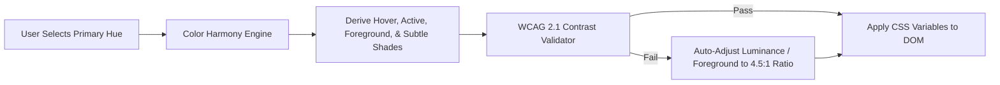

# Inventra Theming & Customization Architecture
**Document Version:** 1.0 (Phase F3.5 Architecture Baseline)
**Target:** Multi-Tenant Theme Engine & User Customization

---

## 1. Architectural Philosophy: Theming vs Branding Separation

To avoid architectural drift, Inventra strictly separates **Theming** from **Branding**:

```
┌─────────────────────────────────────────────────────────────────────────┐
│                        INVENTRA WORKSPACE SHELL                         │
├────────────────────────────────────┬────────────────────────────────────┤
│         USER THEMING               │        BUSINESS BRANDING           │
│   (Operator Ergonomics & Taste)    │     (Corporate Organization)       │
├────────────────────────────────────┼────────────────────────────────────┤
│ • Dark / Light / System Mode       │ • Business Legal Name & Trade Name │
│ • Color Presets (Clinical, Ocean)  │ • Pharmacy License & GSTIN Numbers │
│ • Primary & Accent Hue             │ • Store Logo & Print Invoice Letter│
│ • High-Contrast Mode               │ • Thermal Receipt Header & Footer  │
│ • UI Density (Comfortable/Compact) │ • Multi-Store Branch Colors (Future│
└────────────────────────────────────┴────────────────────────────────────┘
```

- **Theme**: Affects how the operator interacts with the interface on their workstation screen (contrast, eye comfort, personal preference).
- **Brand**: Represents the legal business identity on invoices, receipts, and public customer interfaces.

---

## 2. Theme Engine: Modes & Presets

### A. Theme Modes
1. **`SYSTEM` (Default)**: Automatically tracks OS/Browser media query `(prefers-color-scheme: dark)`.
2. **`LIGHT`**: Enforces the bright, clinical clean light theme.
3. **`DARK`**: Enforces the deep slate operational workstation dark theme.

### B. Curated Theme Presets

| Preset Name | Target Persona | Primary Accent | Focus / Secondary | Dark Base Surface |
| :--- | :--- | :--- | :--- | :--- |
| **1. Inventra Clinical (Default)**| Hospital / Pharmacy Operators | Deep Teal (`#0F766E`) | Cobalt Indigo (`#4F46E5`)| Deep Slate (`#0B0F17`)|
| **2. Ocean Blue** | Retail & Store Managers | Sapphire Blue (`#0284C7`) | Sky Blue (`#0EA5E9`) | Midnight Blue (`#0A1120`)|
| **3. Emerald Health** | Natural / Ayurvedic & Wellness| Botanical Green (`#16A34A`)| Mint Teal (`#0D9488`) | Forest Slate (`#06140E`)|
| **4. Midnight Clinical** | 24/7 Night Dispensary Counters| Cyan Glow (`#06B6D4`) | Steel Slate (`#64748B`) | Obsidian OLED (`#030712`)|
| **5. High Contrast (Accessible)**| Visually Impaired Operators | Pure Amber (`#D97706`)| Pure Cyan (`#0284C7`) | Monochromatic Black/White|
| **6. Custom** | Advanced Workstations | User-Selected Hue | Auto-Derived Accent | Mode-Bound Surfaces |

---

## 3. Controlled Semantic Customization Model

To prevent users from accidentally creating unreadable, broken, or inaccessible color combinations, Inventra employs a **Constrained Generative Customization Pipeline**:



### Safety Rules for Custom Color Generation
1. **Foreground Invariance**: The text on any primary button or solid badge is automatically computed via relative luminance:
   $$\text{Luminance}(C) = 0.2126R + 0.7152G + 0.0722B$$
   If $\text{Luminance}(C) > 0.4$, text is forced to Dark Slate (`#0F172A`); otherwise, text is forced to Pure White (`#FFFFFF`).
2. **Semantic Shielding**: The user can **never** change the core meaning of semantic states:
   - Danger remains Rose/Red.
   - Warning remains Amber/Gold.
   - Success remains Emerald/Green.
   - Info remains Sky/Blue.
3. **Contrast Minimums**: If a custom primary color fails the 4.5:1 contrast ratio against the background surface, the engine automatically clamps the saturation/lightness to the nearest accessible boundary.

---

## 4. Theme Persistence Architecture

### Client-Side Storage (Phase F3.5 - F8)
Theme preferences are managed reactively via a standalone Zustand store (`useThemeStore`) and persisted to `localStorage` under the key `inventra_theme_preferences`:

```typescript
export interface ThemePreferences {
  mode: "system" | "light" | "dark";
  preset: "clinical" | "ocean" | "emerald" | "midnight" | "high-contrast" | "custom";
  density: "comfortable" | "compact";
  customPrimary?: string; // Hex code when preset === 'custom'
  customAccent?: string;
}
```

### Application Lifecycle & Zero-FOUC (Flash of Unstyled Content)
1. **Early Script Execution**: A lightweight inline script in `index.html` inspects `localStorage.getItem("inventra_theme_preferences")` and immediately applies the `.dark` class and CSS variable overrides before React renders.
2. **React Query & DOM Sync**: `useThemeStore` subscribes to system changes and updates the root `document.documentElement` dataset attributes (`data-theme="clinical"`, `data-density="compact"`).

### Future Backend User-Profile Persistence (Phase F8)
When user profile management is introduced in Phase F8, client-side preferences will automatically sync with `GET /api/v1/users/me/preferences` and `PATCH /api/v1/users/me/preferences`.

---

## 5. CSS Variable Theming Implementation

```css
/* Light Theme Token Overrides */
[data-theme="ocean"] {
  --color-primary: #0284c7;
  --color-primary-hover: #0369a1;
  --color-primary-fg: #ffffff;
  --color-accent: #0ea5e9;
  --color-border-focus: #0284c7;
}

/* Dark Theme Token Overrides */
.dark[data-theme="ocean"] {
  --color-primary: #38bdf8;
  --color-primary-hover: #0284c7;
  --color-primary-fg: #082f49;
  --color-accent: #7dd3fc;
  --color-border-focus: #38bdf8;
}

/* High Contrast Accessibility Override */
[data-theme="high-contrast"] {
  --border-subtle: #000000;
  --border-strong: #000000;
  --text-secondary: #000000;
}
.dark[data-theme="high-contrast"] {
  --bg-app: #000000;
  --bg-surface: #000000;
  --border-subtle: #ffffff;
  --border-strong: #ffffff;
  --text-primary: #ffffff;
  --text-secondary: #ffffff;
}
```
